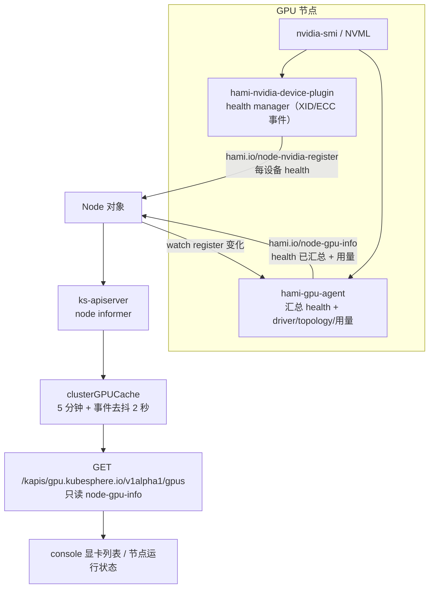

# 集群算力 · 技术方案（L1）

## 概述

算力模块把「机箱里有几张 GPU」与「现在能调度几张」这两件事分开呈现。前者来自节点注解，后者是 kubelet 的 allocatable。页面读前者，运维从两者的差额里发现「有卡被摘了」。

## 关联需求

- `AC-CORE-CLUSTER_GPU-01`

## 设计目标与非目标

**目标**：显卡列表以物理卡为粒度，健康状态取 device plugin 的结论，故障卡可见。

**非目标**：不做卡的调度、重置、绑定；不做跨集群聚合。

## 运行时拓扑

## 模块边界与仓库落点

| 层 | 仓库 | 路径 |
| --- | --- | --- |
| 接口 | `kube-server` | `pkg/kapis/gpu/v1alpha1/{handler.go,cache.go,types.go}` |
| 集群页 | `console` | `src/pages/clusters/containers/Nodes/Gpus/index.jsx` |
| 节点页显卡列表 | `console` | `src/pages/clusters/containers/Nodes/Detail/RunningStatus/GpuCardList/index.jsx` |
| 单卡详情 | `console` | `src/pages/clusters/containers/Nodes/Detail/GpuDetail/index.jsx` |
| 健康判定 | `HAMi` | `pkg/device-plugin/nvidiadevice/nvinternal/rm/health.go`（判定）与 `plugin/register.go`（写 register 注解） |
| 健康汇总 | `HAMi` | `pkg/gpu-agent/collector/register.go`（扫描 register）与 `nvidia.go`（写 `node-gpu-info`） |
| 汇总触发 | `HAMi` | `cmd/gpu-agent/main.go` 的 `watchRegisterAnnotations` |

## 数据归属

| 事实 | 唯一来源 | 谁读它 |
| --- | --- | --- |
| 有哪些卡、卡是否健康 | `hami.io/node-nvidia-register`（device plugin 写） | **只有 gpu-agent** |
| 健康状态 + driver/CUDA/拓扑/用量 | `hami.io/node-gpu-info`（gpu-agent 汇总后写） | kube-server、页面、其它消费者 |
| 能调度几张 | `node.status.allocatable["nvidia.com/gpu"]`（kubelet 按 device plugin 的 `ListAndWatch` 计） | 页面资源栏 |
| 利用率、显存、温度 | Prometheus `gpu_card_*` / `node_gpu_*` | 页面图表 |

## 关键共享契约

- **CON-CORE-CLUSTER_GPU-01** — `GET /kapis/gpu.kubesphere.io/v1alpha1/gpus` 的每个 item 含 `health`（bool）；`health` 取自 `hami.io/node-gpu-info`，由 gpu-agent 从 device plugin 的 register 注解汇总。接口不解析 register 注解，也不从 allocatable 差额推断。字段语义见 `gpu-card/health.md` 的「对外契约」。

## 不变量

- **INV-CORE-CLUSTER_GPU-01** — 同一个节点上，接口返回的设备集合等于该节点 `hami.io/node-gpu-info` 里的设备集合（按 UUID 一一对应）。

## 已知坑

- **GOT-CORE-CLUSTER_GPU-01** — `node-gpu-info` 与 `node-nvidia-register` 是两份注解、两个写者。gpu-agent 负责把前者的 health 从后者汇总过来；历史上它把 `health` 硬编码为 `true`，导致故障卡永远显示健康。**接口层不要自己再扫一遍 register 注解**，否则同一份事实有两个解析点。细节见 `gpu-card/health.md`。
- **GOT-CORE-CLUSTER_GPU-02** — allocatable 小于 capacity 时，差额说不出是哪几张卡。只能用 register annotation 的逐设备 `health` 定位。

## 测试与可观测

- gpu-agent 单测：`pkg/gpu-agent/collector/register_test.go`（注解解析与变化判定）、`cmd/gpu-agent/register_watch_test.go`（自激防护）。
- UI 用例见 `gpu-card/health.md` 与 `gpu-card/_index.md` 的「验收用例」。

## 明确不做

- 不做卡的调度与抢占。
- 不做历史健康趋势。

## 后续改进

- 把 XID 明细（错误码、发生时间）也写进注解并在详情页展示。

## 入口与子模块

- 菜单：集群 → 算力 → 显卡（`clusterNavs` 的 `gpus`）。
- 子模块：`gpu-card`。

## 验收用例

- `TC-CORE-CLUSTER_GPU-01`
