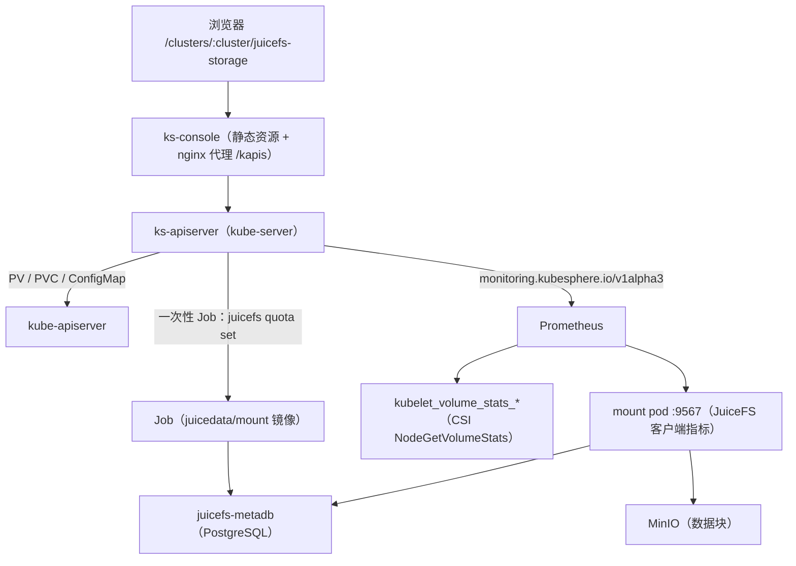

# 集群存储 · 技术方案（L1）

## 概述

共享存储由三个部件拼起来：`ks-installer` 的 juicefs chart（驱动 + StorageClass + 静态 PV）、`kube-server` 的 `juicefs.kubesphere.io/v1alpha1`（卷列表、汇总、改配额）、`console` 的页面（`Storage/JuiceFS`）。数据只有两个来源：Kubernetes 对象（PV/PVC/驱动 ConfigMap）与 Prometheus（kubelet 卷统计、mount pod 客户端指标）。

## 关联需求

- `AC-CORE-CLUSTER_STORAGE-01`

## 设计目标与非目标

**目标**：一个页面同时回答容量、配额、性能三件事；配额改动即时生效且不会被驱动改回；每个数字可追溯到唯一来源。

**非目标**：不在页面里管理 JuiceFS 文件系统本身（创建、扩容、快照），不做跨集群聚合。

## 运行时拓扑

## 模块边界与仓库落点

| 层 | 仓库 | 路径 |
| --- | --- | --- |
| 菜单与页面 | `console` | `server/config.yaml` 的 `clusterNavs`、`src/pages/clusters/containers/Storage/JuiceFS/` |
| 路由 | `console` | `src/pages/clusters/routes/index.js` |
| 状态 | `console` | `src/stores/juicefs.js` |
| 接口 | `kube-server` | `pkg/kapis/juicefs/v1alpha1/`，注册在 `pkg/apiserver/apiserver.go` |
| 指标 | `kube-server` | `pkg/models/monitoring/named_metrics.go`、`pkg/simple/client/monitoring/prometheus/promql.go` |
| 驱动与 PV | `ks-installer` | `roles/common/files/juicefs/` |

## 数据归属

| 事实 | 来源 | 备注 |
| --- | --- | --- |
| 卷的配额 | PV 的 `spec.capacity` | 驱动每次 `NodePublishVolume` 都用它覆盖目录 quota |
| 卷的用量 / inodes | `kubelet_volume_stats_*` | 来自 CSI 的 `NodeGetVolumeStats`（statfs） |
| 卷是否挂载、挂在哪 | 卷统计的 `node` 标签 | 未挂载时为空 |
| 性能 | mount pod 的 `juicefs_*` 系列 | 客户端指标，按节点一条 |
| 指标是否开启 | 驱动 ConfigMap 的 `mountPodPatch.mountOptions` | 含 `metrics=` 即视为开启 |

## 关键共享契约

- `GET /kapis/juicefs.kubesphere.io/v1alpha1/volumes`、`GET .../summary`、`PUT .../volumes/{pv}`，字段见 L3 的 `CON-*`。
- 指标名白名单：`juicefs_read_bytes`、`juicefs_written_bytes`、`juicefs_cache_hit_ratio`、`juicefs_cache_read_latency`、`juicefs_fuse_latency`、`juicefs_object_errors` 等，只在后端登记一次。

## 不变量

- **INV-L1-CLUSTER-STORAGE-01** — 页面展示的配额与 PV 的 `spec.capacity` 永远一致；statfs 不一致时只做标注，不改数字。
- **INV-L1-CLUSTER-STORAGE-02** — 同一个事实只在一个地方解释：配额来自 PV，用量来自 kubelet，性能来自客户端指标。

## 已知坑

- **GOT-L1-CLUSTER-STORAGE-01** — 控制台是深色主题。页面 SCSS 写浅色主题的十六进制色值时，卡片上的正文对比度只有 2.12:1，肉眼几乎看不见。必须用 `scss/variables` 的语义 token。
- **GOT-L1-CLUSTER-STORAGE-02** — 只叠前端 `dist` 不会带上菜单：`clusterNavs` 在 `server/config.yaml` 里，console overlay 必须同时替换它，且不要整个 `server/` 覆盖（webpack 产出的 `server.js` 会被源码替换，容器起不来）。
- **GOT-L1-CLUSTER-STORAGE-03** — 新指标只加 PromQL 模板不够，`named_metrics.go` 的白名单里没有名字时 `metrics_filter` 匹配不到，接口返回 `results: null`。

## 测试与可观测

- UI：`tests/ui/specs/cluster-storage/` 下的 core/full/L3 用例；对比度审计与未翻译 key 断言。
- 后端：`go test ./pkg/kapis/juicefs/...`。
- 可观测：接口返回的 `quotaDrift`、`metricsEnabled` 是页面提示的唯一依据。

## 明确不做

- 不管理文件系统本身（创建、扩容、快照）。
- 不做跨集群聚合。

## 后续改进

- 把「配额 Job 的失败原因」结构化返回，页面直接显示而不是贴 CLI 输出。

## 入口与子模块

- 入口：集群 → 存储 → 共享存储（`/clusters/:cluster/juicefs-storage`）。
- 子模块：`shared-storage`（概览、卷与配额、性能）。

## 验收用例

- `TC-CORE-CLUSTER_STORAGE-01`
