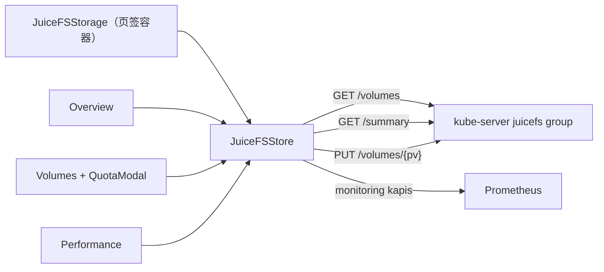

# 共享存储（JuiceFS） · 技术方案（L2）

## 概述

一个页面三个页签，共享一份卷列表。前端在 `console/src/pages/clusters/containers/Storage/JuiceFS/`，状态在 `console/src/stores/juicefs.js`（继承 `stores/monitoring/base`，因为性能页要用同一套时间范围与查询参数）。后端提供卷列表、汇总与改配额三个接口。

## 关联需求

- `AC-FULL-CLUSTER-STORAGE-SHARED_STORAGE-01`
- `AC-FULL-CLUSTER-STORAGE-SHARED_STORAGE-02`

## 设计目标与非目标

**目标**：三个页签的数据不可能对不上；写操作后三页同步刷新；空态与异常态都有明确文案。

**非目标**：不做跨集群视图，不做卷的生命周期管理。

## 关键约束

- 配额只认 PV 的 `spec.capacity`（见 L1 的不变量与 L3 的 `DEC-*`）。
- 颜色只取主题 token（宪法 C3）。
- 指标只经 monitoring kapis（宪法 C4）。

## 页面与技术结构

- 页签容器在 `constructor` 里创建 store 并注册到 rootStore（与 `Monitor/Cluster/index.jsx` 同一写法），三个子页面通过 `rootStore.juicefs` 取同一份数据。
- 性能页单独调用 `fetchPerformance()`，时间范围由 `components/Cards/Monitoring/Controller` 提供。

## 状态与数据归属

| 状态 | 位置 | 刷新时机 |
| --- | --- | --- |
| `volumes[]` | store | 进入页面、写操作后、手动刷新 |
| `summary` | store | 进入页面、写操作后 |
| `data`（时序） | store（继承 monitoring base） | 性能页进入、时间范围变化、自动刷新 |

## 关键契约与依赖

- `GET /volumes` 的每一项至少包含 `name`、`path`、`parent`、`claimName`、`claimNamespace`、`capacityBytes`、`usedBytes`、`inodes`、`inodesUsed`、`mountedNodes`、`metricsEnabled`、`quotaDrift`。
- `PUT /volumes/{pv}` 的 body 是 `{ "capacity": "6Ti" }`；失败时后端回滚 PV 容量并返回原因。

## 不变量

- **INV-L2-CLUSTER-STORAGE-SHARED_STORAGE-01** — 三个页签读同一份 `volumes`，页面上的卷集合与顺序一致。
- **INV-L2-CLUSTER-STORAGE-SHARED_STORAGE-02** — 任何写操作成功后，`volumes` 与 `summary` 都被重新拉取，不靠前端本地加减。

## 已知坑

- **GOT-L2-CLUSTER-STORAGE-SHARED_STORAGE-01** — `@kube-design/components` 的 `Table` 读 `column.render`，不是 `renderCell`；用错时每个单元格显示原始字节数、操作列不渲染。
- **GOT-L2-CLUSTER-STORAGE-SHARED_STORAGE-02** — `Form.Item` 会 clone 子元素并注入自己的 `value`/`onChange`，受控 `Input` 会被覆盖成空值，弹窗永远提交不了。表单字段直接布局，不要套 `Form.Item`。
- **GOT-L2-CLUSTER-STORAGE-SHARED_STORAGE-03** — `Input` 的 `onChange` 签名是 `(event, value)`，只取第一个参数会拿到事件对象。

## 测试与可观测

- `pytest -m full` 走 L2 用例：三个页签、写操作后三页同步。
- 页面的 `quotaDrift` 与 `metricsEnabled` 是提示条的唯一开关，便于定位「为什么有/没有提示」。

## 明确不做

- 不在前端做配额换算的二次校验之外的业务判断（下限由后端也校验一次）。
- 不在页面里直连 Prometheus。

## 后续改进

- 卷列表加排序与筛选（按使用率）。

## 功能点

- `overview.md`、`quota.md`、`performance.md`

## 验收用例

- `TC-FULL-CLUSTER-STORAGE-SHARED_STORAGE-01`
- `TC-FLOW-SHARED_STORAGE`
