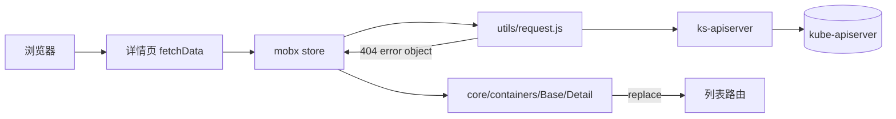

# 控制台基础 · 技术方案（L1）

## 概述

详情页的公共失败路径。请求从详情页的 `fetchData` 进入对应的 mobx store，store 经 `src/utils/request.js` 访问 ks-apiserver；404 时 store 记下「不存在」，页面骨架负责提示与回退。

## 关联需求

- `AC-CORE-CONSOLE-CORE-01`

## 设计目标与非目标

- **目标**：所有按名字寻址的详情页共用一套「不存在」处理，新增资源类型零改动；失败有终点、提示可读、回退不污染历史。
- **非目标**：不统一 403 / 500 / 超时的表现；不做独立 404 页面；不改后端错误码。

## 运行时拓扑

## 模块边界与仓库落点

| 层 | 仓库 | 路径 | 职责 | 不做什么 |
| --- | --- | --- | --- | --- |
| 错误对象 | `console` | `src/utils/request.js` | 把 HTTP 404 归一成带 `status` / `reason` / `message` 的对象 | 不做产品文案 |
| 状态 | `console` | `src/stores/base.js` | 记录 `notFound`、结束加载、去重提示 | 不决定回退到哪 |
| 骨架 | `console` | `src/core/containers/Base/Detail/index.jsx` | 读取 `notFound` 并 `replace` | 不解析具体资源字段 |
| 兜底 | `console` | `src/core/index.js` | `onunhandledrejection` 里的 404 分支 | 不替代 store 的正常路径 |
| 文案 | `console` | `locales/{en,zh}/l10n-console-resourceDetail.js` | 提示标题与正文 | 不放资源专属文案 |
| 后端 | `kube-server` | — | 不改 | — |

## 数据归属

| 对象 | 存储 | 归属 | 生命周期 |
| --- | --- | --- | --- |
| `notFound` 标记 | store 实例字段 | 单个详情页 | 页面卸载即丢弃 |
| 提示去重时间戳 | 模块级变量 | 控制台全局 | 页面会话 |

## 关键共享契约

| 契约 | 形式 | 谁在用 |
| --- | --- | --- |
| `isNotFound(error)` | 模块函数 | `stores/base.js`、`core/index.js`、详情页骨架 |
| `notifyResourceNotFound(name)` | 模块函数 | 同上 |
| `listUrlFor({ breadcrumbs, match })` | 模块函数 | 详情页骨架 |

## 不变量

- **INV-L1-CONSOLE-CORE-01**：任一详情请求返回后，页面必须离开「加载中」状态。
- **INV-L1-CONSOLE-CORE-02**：同一次 404 最多产生一条提示。

## 已知坑

| # | 反直觉事实 | 如果不知道会怎样 | 在哪处理 |
| --- | --- | --- | --- |
| **GOT-L1-CONSOLE-CORE-01** | 详情页 `render()` 里的 `isLoading && !detail.name` 会在 `isLoading` 永不为 false 时永久返回 Loading，骨架根本不挂载 | 只在骨架里加回退会完全不生效，看起来像「改了没效果」 | `src/stores/base.js` 的 404 分支 |
| **GOT-L1-CONSOLE-CORE-02** | `request.js` 在调用方没传 `reject` 时会走 `window.onunhandledrejection`，传了则不会 | 两处都提示，用户看到两条一模一样的 toast | `notifyResourceNotFound` 去重 + store 传 `reject` |
| **GOT-L1-CONSOLE-CORE-03** | `routing.push` 会把失效地址压进历史 | 用户点后退又回到 404，来回弹两次提示 | 用 `routing.replace` |

## 测试与可观测

- **自动化**：L1 冒烟 `TC-CORE-CONSOLE-CORE-01`；子模块与功能点的用例在对应文档的「验收用例」一节。
- **手动验证**：用不存在的名字打开 5 类资源的详情页，核对提示语言与地址栏。
- **日志 / 指标**：无新增后端指标；浏览器控制台不应出现未捕获的 404 rejection。

## 明确不做

- 不改 `request.js` 的错误对象结构（会牵动全部调用方）。
- 不给 403 加回退（跳登录页是既有约定）。
- 不引入新的全局状态库。

## 后续改进

- 若将来出现「资源存在但子资源缺失」的场景（如 PV 的 claim 已删），可在页签级加二级提示，而不是回退。

## 入口与子模块

- 子模块技术方案：[资源详情页](./resource-detail/_index.md)
- 入口示例：`/clusters/:cluster/projects/:namespace/pods/:podName/resource-status`

## 验收用例

- L1 核心路径：`TC-CORE-CONSOLE-CORE-01`
- 子模块与功能点用例见 [`resource-detail/`](./resource-detail/_index.md) 与 [`not-found.md`](./resource-detail/not-found.md)
