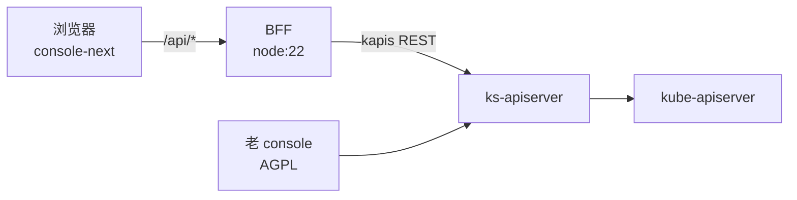

# 新前端 · 技术方案（L1）

> 本文承接 [`prd/kube-frontend/_index.md`](../../prd/kube-frontend/_index.md) 的全部 `AC-*`、`FR-*`、`SC-*`。

## 概述

在 `console/kube-frontend` 建立独立前端：dongba 的技术栈 + bisheng 的工程骨架 + ai-kit 的 UI 底座。与 AGPL 的老 console 物理隔离，通过 BFF 访问同一套 ks-apiserver。

## 关联需求

- `AC-CORE-KUBE_FRONTEND-01`
- `FR-CORE-KUBE_FRONTEND-01`
- `SC-CORE-KUBE_FRONTEND-01`

## 设计目标与非目标

**目标**：协议干净、资源页由数据描述、界面可被智能体操作、约束用测试锁住。

**非目标**：首期不做 SSR、不做创建/编辑表单、不做其他资源模块。

## 关键约束

- 不 import、不复制 `console/src` 的代码。
- 不新增后端接口：复用 kapis。
- 依赖版本只来自 `catalog:`。

## 方案决策

### DEC-CORE-KUBE_FRONTEND-01 — 重写而非改造

**为什么**：AGPL 覆盖网络服务，改造 console 会持续扩大源码开放义务。

**被否方案**：在 `console/src` 内新增页面，只在内部使用。AGPL 明确覆盖网络交互，"内部使用"不是豁免。

**何时重新考虑**：若上游改为宽松许可，可转为渐进迁移。

### DEC-CORE-KUBE_FRONTEND-02 — 技术栈取 dongba、骨架取 bisheng

**为什么**：重写没有历史包袱，适合最新一代（React 19 / Vite / TanStack）；而多包共用、版本漂移、架构约束是工程问题，bisheng 的 `catalog` + `packages/*` + `config/*.test.ts` 已经验证过。

**被否方案**：沿用 bisheng 全栈（React 18 + recoil）——recoil 已归档，是已知技术债，不应带进新项目。

### DEC-CORE-KUBE_FRONTEND-03 — BFF 而非直连

**为什么**：上游错误形态有三种（`{message}`、kube `Status`、代理 HTML），直连会让每个页面各解析一遍；token 也应只在一个进程里出现。

**被否方案**：前端直连 ks-apiserver + 每个页面各自处理错误。会在 24 个资源模块里重复 24 次。

## 系统现状

老 console 是 24 个资源模块的集合，列表页靠 `withList` HOC 压缩样板。新前端首批只迁 ConfigMaps，用它验证 schema 抽象。

## 入口与子模块

| 子模块 | 入口 | 说明 |
|---|---|---|
| 配置字典 | `/kube-frontend/:workspace/clusters/:cluster/projects/:namespace/configmaps` | 首个资源模块 |

## 运行时拓扑

两个前端共用后端，互不引用代码与构建产物。BFF 是无状态进程，可水平扩展；token 由浏览器逐请求携带，进程内不持有凭据。

## 模块边界与仓库落点

| 目录 | 内容 |
|---|---|
| `kube-frontend/apps/console-next` | 路由、页面、壳 |
| `kube-frontend/packages/ui` | 展示层，四条铁律 |
| `kube-frontend/packages/api-client` | HTTP 唯一入口 |
| `kube-frontend/packages/ai-surface` | 智能体契约 |
| `kube-frontend/packages/locales` | 文案 |
| `kube-frontend/server` | BFF |
| `kube-frontend/config` | 架构约束测试 |

## 关键共享契约

- `packages/ai-surface` 的属性常量与 `ActionResult` 形状：重命名为破坏性变更。
- `packages/api-client` 的 `ApiError`：`code` / `retryable` / `isPermission` / `isNotFound`，页面按此分支。
- `packages/ui` 的 `AiButton.aiId` 必填约定。

## 数据归属

| 数据 | 唯一来源 | 说明 |
|---|---|---|
| 资源列表与详情 | ks-apiserver | 前端不缓存到 localStorage，Query 缓存仅内存 |
| 页面状态 | 页面组件 | 由查询结果派生，不另行存储 |
| 文案 | `packages/locales` | 组件不持有文案 |
| 智能体清单 | `packages/ai-surface` | 页面注册，BFF 读取后对外提供 |

## 对外契约

- `GET /api/configmaps?cluster&namespace&page&pageSize&sortBy&order&keyword`
- `GET /api/configmaps/:name?cluster&namespace`
- `DELETE /api/configmaps?cluster&namespace&name`（可重复）
- `GET /api/ai/manifest`
- 错误体统一为 `{ code, message, status }`。

## 不变量

- **INV-CORE-KUBE_FRONTEND-01** — `packages/ui` 不出现状态库、请求、i18n、路由的 import。
- **INV-CORE-KUBE_FRONTEND-02** — 共享依赖一律写 `catalog:`。
- **INV-CORE-KUBE_FRONTEND-03** — 页面根元素恰好一个 `data-ai-state`。
- **INV-CORE-KUBE_FRONTEND-04** — 页面内不使用裸 `<button>`，一律经 `AiButton` 或 `actionProps`。

## 已知坑

- **GOT-CORE-KUBE_FRONTEND-01** — `createClient` 若在构造时捕获 `globalThis.fetch`，后续安装的 stub 不生效，测试会一直停在 `loading`。已改为每次请求解析。
- **GOT-CORE-KUBE_FRONTEND-02** — `exactOptionalPropertyTypes` 下不能把 `undefined` 传给可选属性（如 `activeKey`），需要条件展开。
- **GOT-CORE-KUBE_FRONTEND-03** — Tailwind 4 的 `@import` 解析在 CSS 注释含撇号时会报 `Unterminated string`。
- **GOT-CORE-KUBE_FRONTEND-04** — ai-kit 以 `dist` 提供，新增导出后必须重建 ai-kit，否则消费方构建失败。

## 测试与可观测

- `pnpm test:config`：架构约束（包边界、依赖归属、AI 句柄）。
- `pnpm test`：各包单测 + 页面集成测试。
- `pnpm typecheck`：全 workspace 严格类型。
- `GET /api/ai/manifest`：页面清单，供自动化发现。

## 明确不做

- 不改 `console/src`。
- 不做创建 / 编辑表单与其他资源模块。
- 不做 SSR 与 Cloudflare 部署。

## 后续改进

- 创建 / 编辑表单。
- 其余资源模块按同一 schema 铺开。
- manifest 由构建期生成并写入文件，供 BFF 直接提供。

## 验收用例

- `TC-CORE-KUBE_FRONTEND-01`
