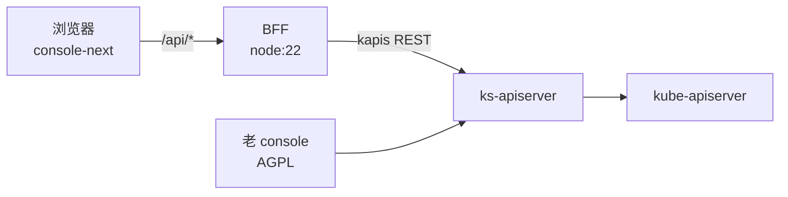

# 新前端 · 技术方案（L1）

> 本文承接 [`prd/kube-frontend/_index.md`](../../prd/kube-frontend/_index.md) 的全部 `AC-*`、`FR-*`、`SC-*`。

## 概述

在 `console/kube-frontend` 建立独立前端：dongba 的技术栈 + bisheng 的工程骨架 + ai-kit 的 UI 底座。与 AGPL 的老 console 物理隔离，通过 BFF 访问同一套 ks-apiserver。

## 关联需求

- `AC-CORE-KUBE-FRONTEND-01`
- `FR-CORE-KUBE-FRONTEND-01`
- `SC-CORE-KUBE-FRONTEND-01`

## 设计目标与非目标

**目标**：协议干净、资源页由数据描述、界面可被智能体操作、约束用测试锁住。

**非目标**：首期不做 SSR、不做创建/编辑表单、不做其他资源模块。

## 关键约束

- 不 import、不复制 `console/src` 的代码。
- 不新增业务接口：复用 kapis。BFF 增加 WebSocket `upgrade` 转发（见 `DEC-CORE-KUBE-FRONTEND-08`），端点集合不变。
- 依赖版本只来自 `catalog:`。

## 方案决策

### DEC-CORE-KUBE-FRONTEND-01 — 重写而非改造

**为什么**：AGPL 覆盖网络服务，改造 console 会持续扩大源码开放义务。

**被否方案**：在 `console/src` 内新增页面，只在内部使用。AGPL 明确覆盖网络交互，"内部使用"不是豁免。

**何时重新考虑**：若上游改为宽松许可，可转为渐进迁移。

### DEC-CORE-KUBE-FRONTEND-02 — 技术栈取 dongba、骨架取 bisheng

**为什么**：重写没有历史包袱，适合最新一代（React 19 / Vite / TanStack）；而多包共用、版本漂移、架构约束是工程问题，bisheng 的 `catalog` + `packages/*` + `config/*.test.ts` 已经验证过。

**被否方案**：沿用 bisheng 全栈（React 18 + recoil）——recoil 已归档，是已知技术债，不应带进新项目。

### DEC-CORE-KUBE-FRONTEND-03 — BFF 而非直连

**为什么**：上游错误形态有三种（`{message}`、kube `Status`、代理 HTML），直连会让每个页面各解析一遍；token 也应只在一个进程里出现。

**被否方案**：前端直连 ks-apiserver + 每个页面各自处理错误。会在 24 个资源模块里重复 24 次。

### DEC-CORE-KUBE-FRONTEND-04 — 按产品功能区拆包，不按页面预加载

**为什么**：使用者是企业内部的算力运维人员，一天在同类资源页之间来回几十次，判断标准是"切换像桌面应用"，首屏慢 1–2 秒可以接受。但产品有 24 个资源模块，若照 dongba 的做法把整站模块写进 `<head>` 预加载，首屏会随页面数线性增长，到后期不可接受。

于是取中点：**按顶部导航的产品功能区切分构建产物**——工作台（项目资源）、平台管理、应用商店、登录各自一组共享依赖，同区页面之间零额外下载，跨区切换才拉一组新的（每区有上限）。页面级 chunk 仍保留，只承载该页面的业务代码。

**实测依据**（生产构建，gzip）：首屏约 332 KB，其中 React/Radix/ai-kit 共享层 150.8 KB、图标雪碧图 113.4 KB、路由壳 31.3 KB、configmaps 自身约 23 KB；configmaps → secrets 客户端切换只新增 12 KB，无 document、无 CSS 请求。即**首屏的 84% 是共享层**，切页面的增量很小——所以优化的对象是共享层怎么切块，而不是页面。

**被否方案**：整站 `modulepreload`（dongba 现做法）。实测其两个 console 文档预加载同一组 65 个模块、首屏 JS 1836 KB；页面数翻倍时这一数字同步翻倍，而绝大多数用户一次只用一个区。

**被否方案**：完全按页面懒加载、不做区级共享块。同一区页面之间会重复下载 Radix/Select 等重复依赖，且每次切换都有可见的空白帧。

**何时重新考虑**：若首屏 P95 在弱网下超过 5 秒，再引入按区的服务端预取（见 [`DEC-...-05`](#dec-core-kube_frontend-05--共享层预取由交互意图触发)）。

### DEC-CORE-KUBE-FRONTEND-05 — 共享层预取由交互意图触发

**为什么**：区级拆包后跨区首次切换要付一次加载。在导航上 `onPointerEnter` / `onFocus` 时预取目标区的共享块，让"决定要点"的 200–400 ms 覆盖掉下载时间；`defaultPreload: 'intent'` 已有的机制可复用，只需把预取目标从路由 chunk 扩展到区级共享块。

**约束**：预取必须可被 `Save-Data` 与 `prefers-reduced-data` 关闭，且不得在首屏触发——否则等于退化成整站预加载。

**被否方案**：`<link rel="prefetch">` 预取全部区。移动网络下会与首屏请求抢带宽。

### DEC-CORE-KUBE-FRONTEND-06 — 构建期把第三方依赖按稳定性分块

**为什么**：Vite 默认把"首屏用不到的共享依赖"放进同一个大 chunk，任何依赖升级都会换掉它的哈希，整块缓存失效。按变更频率分块——`react` 系（极少变）、`radix`/`tanstack` 系（偶尔变）、`ai-kit`（随产品变）——让改业务代码只失效对应的小块。

**已知代价**：分块过细会增加请求数，每个 chunk 都带一份模块运行时代码。以 3–5 个 vendor 块为上限，不按单个库切。

**被否方案**：不配 `manualChunks`，全交给 Vite 默认策略（当前状态：一个 150.8 KB 的主 chunk 装下了全部共享依赖，改任何一处依赖都整块失效）。

### DEC-CORE-KUBE-FRONTEND-07 — 减小页面文件对 CSS 与共享 chunk 的牵连

**为什么**：开发期实测，编辑任何一个带 Tailwind 类名的页面文件，HMR 都会连带刷新 `/src/styles.css` 与承载该页面的 chunk。页面越集中在少数文件里，每次保存重建的 CSS 越大，热更新越慢；多人同时改不同页面时，重建还会互相打断。

拆法：
- **样式按区**：依据现有 `tailwind.config.cjs` 的 `content` 扫描范围，把 `styles.css` 拆成"基础 + 区级"入口，区级入口只扫描该区的页面（`@source` 限定目录）。只改某区页面时，只有该区的 CSS 失效。
- **共享组件下沉**：页面之间重复引用的组件与 hook 移到 `packages/` 或 `components/`，让页面文件只描述该页的列/字段/表单，减少单文件体积与重建扇出。

**验证方式**：改动一次页面文件后，Vite 日志里应只出现该页面自身的 update 与所属区的 CSS，不再出现全局 `styles.css`。

**被否方案**：不做拆分，靠"少改页面文件"约束开发习惯。靠人记住的约束不成立。

### DEC-CORE-KUBE-FRONTEND-08 — 建立 WebSocket 通道，实时能力是一等需求

**为什么**：老 console 的实时性（列表 watch、详情 watch、容器终端、日志 tail）全部走 `ws://`（`console/src/components/Terminal/index.jsx:35-39`）。这四项不是锦上添花：容器终端是排障的第一动作，日志 tail 是「它为什么起不来」的第一现场，列表 watch 决定了「改完之后看到的是不是真的」。把「暂时没有通道」写成「不做实时」，等于把最常用的运维动作判死。

**被否方案（原决策，2026-11-14 推翻）**：不做 WebSocket，实时能力一律不承诺，只保留查询缓存 + 手动刷新。当时的两条依据是：①BFF（`kube-frontend/server/src/proxy.ts`）只有 HTTP 转发、没有 `upgrade` 处理；②`packages/api-client` 没有 exec/logs/stream 端点。**这两条描述的是「现在没有」，不是「不该有」**——BFF 是自研 Node 服务，加一个 `upgrade` 事件转发是几十行改动；拿「永久失去终端」当作它的代价，是把成本算反了。原决策里唯一站得住的一半是「不要用轮询假装实时」，这一条保留。

**落地分三步**：
1. **BFF 支持 `upgrade`**：把 WebSocket 握手透传到 ks-apiserver，沿用现有鉴权（token 从 query 或子协议取），断开时清理。
2. **前端 watch 客户端**：列表与详情订阅对象变更，`ADDED/MODIFIED/DELETED` 触发定向失效；断线重连并显示连接状态，不静默假装实时。
3. **终端**：xterm 组件 + `kapis/terminal.kubesphere.io/v1alpha2/klusters/{c}/namespaces/{ns}/pods/{pod}/exec`（容器）、`/nodes/{name}/exec`（节点）、kubectl 会话（先取 kubectl pod 再连 exec）。

**不做**：轮询。原决策这一条保留——每 N 秒全量重取会打满 apiserver，且分页与选中态会被无提示重置。

### DEC-CORE-KUBE-FRONTEND-09 — 浮动工具箱作为壳层组件单独落地

**新决定（2026-11-17 产品复核决定重纳）**：恢复老 console 的浮动工具箱（`console/src/components/KubeTools/index.jsx`，挂在 `core/layouts/Base/index.jsx:144` 的每页壳层上）——右下角可拖拽悬浮球，展开 6 个工具入口：日志查询、事件检索、审计检索、资源消费统计、kubeconfig、kubectl；展开位置记忆在 `localStorage`。

**原判断（现被推翻）**：它从未被正式写成「不做」，但连续几批都把它记为「属工具箱，单独规划」/「另立单元」（如 `prd/kube-frontend/cluster-management/log-collections.md:69`、`pod-events.md:49`）。**被推迟到没有排期，与不做没有区别**——而那三个检索页当时正是靠「工具箱以后再说」被拆散的，结果是每个工具各有一个入口，没有一个地方能一屏触达全部。

**被否方案**：把 6 个入口做进顶栏菜单。否掉的原因：顶栏已经承载平台切换、模块导航、语言、主题、用户菜单；再加 6 项会与模块导航争夺同一块注意力，而工具箱是**低频但紧急**的入口（排障时才用），属于悬浮层而不是常驻导航。

**被否方案**：每个工具页自己提供入口，不做统一壳。否掉的原因：正是现状——日志、事件、审计各在集群作用域有一页，但「我现在想看审计日志」要先进入某个集群再找侧栏；悬浮球把「跨作用域的工具」与「作用域内的页面」区分开。

**落地约定**：
1. **只挂载一次**：在 `AppShell` 内渲染，不在各页面重复挂载；任何页面都能看到它（老 console 的 `BaseLayout` 也是每页挂载）。
2. **位置与展开态持久化**：拖拽结束写 `localStorage`，刷新后回到原位置；移动端断点下不渲染（悬浮球会遮挡内容），改为菜单入口。
3. **入口按权限与能力裁剪**：拿不到权限的入口不渲染（不是点了报 403）；工具目标页不存在时不渲染该项——这条是为了避免再出现「顶栏有入口、路由不存在」的死链。

### DEC-CORE-KUBE-FRONTEND-10 — 资源消费统计：没有计量数据源时说明原因，不渲染空表

**新决定（2026-11-17 产品复核决定重纳）**：恢复资源消费统计页（老 `/bill`，`console/src/pages/console/containers/Bill/index.jsx`），入口在浮动工具箱（`DEC-CORE-KUBE-FRONTEND-09`）。

**原判断（2026-11-14，现被推翻）**：`capability-matrix.md` §3.1 登记为「明确不做」，理由「`metering` 模块未开启」。这条理由有两个问题：①模块开关是**配置事实**，不证明接口不存在（迁移指南 §2.3 的原话：`configz` 是配置事实，不证明 API 存在、安装状态或运行健康）；②当时的 404 **没有记录探测版本与角色**，只试一个版本得到的 404 证明的是那个版本没有。

**被否方案**：继续保持不做。否掉的原因同 ①：环境事实会随部署变化，写成永久不做会让将来启用计量的部署无从下手。

**被否方案**：没有数据时渲染空表。否掉的原因：迁移指南 §8 坑 15——「读不到被渲染成没有」是比缺功能更糟的误导；用户会读成「本集群没花钱」。

**落地约定**：
1. **先探测再定形态**：「①老源码调哪个 API（`components/Modals/Bill`）→②该组该版本是否被服务→③实际读一次」，结论连同版本与角色记录。
2. **三种状态各给一句不同的文案**：`本集群未启用计量`（接口 404 且模块关闭）、`计量数据读取失败`（有权限问题或上游错误，给重试）、`所选时间区间没有消费记录`（请求成功但结果为空）。三者不互相顶替。
3. **维度与区间写死在 AC 里**：按项目 + 时间区间看 CPU / 内存 / 存储，不允许只做「总消费」一个数字。

### DEC-CORE-KUBE-FRONTEND-11 — 帮助入口：地址可配置，未配置时不渲染

**新决定（2026-11-17 产品复核决定重纳）**：顶栏恢复帮助 / 文档入口，指向可配置的文档地址（`kube-docs` 或部署配置的地址），新窗口打开。

**原判断（2026-11-14，现被推翻）**：`capability-matrix.md` CHECK-09 登记为「帮助外链**明确不做**（部署无文档站点、无身份源，链接会落到 SPA 兜底页）」。这个理由描述的是一个**实现缺陷**（死链），却用「不做」来规避；正确做法是让入口在地址未配置时**不渲染**——那样既没有死链，也没有丢掉能力。

**被否方案**：继续保持不做。否掉的原因：把「某个部署没配文档站点」当成所有部署的永久结论。

**被否方案**：硬编码一个文档 URL。否掉的原因：不同部署的文档站点不同，硬编码在另一个部署上必然 404，等于把 CHECK-09 描述的死链坐实。

**落地约定**：
1. **地址来自部署配置**，不在代码里写字面量；配置缺失时入口不出现（不是渲染成不可点的按钮，也不是死链）。
2. **新窗口 + `rel="noopener"`**；不在 SPA 内路由，避免被兜底页接住。
3. **入口位置与语言、主题并列**（都属于「对整站生效、不属于某个资源」的显示项），不放进用户菜单——用户菜单是账号属性，帮助是产品能力。

## 系统现状

老 console 是 24 个资源模块的集合，列表页靠 `withList` HOC 压缩样板。新前端首批只迁 ConfigMaps，用它验证 schema 抽象。

## 入口与子模块

| 子模块 | 入口 | 说明 |
|---|---|---|
| 登录 | `/login` | 见 [`login.md`](login.md) |
| 主题 | `<html data-theme>` | 见 [`theme.md`](theme.md) |
| 配置字典 | `/kube-frontend/:workspace/clusters/:cluster/projects/:namespace/configmaps` | 首个资源模块 |

## 运行时拓扑

两个前端共用后端，互不引用代码与构建产物。BFF 是无状态进程，可水平扩展；token 由浏览器逐请求携带，进程内不持有凭据。

## 模块边界与仓库落点

| 目录 | 内容 |
|---|---|
| `kube-frontend/apps/console-next` | 路由、页面、壳 |
| `kube-frontend/packages/ui` | 展示层，四条铁律 |
| `kube-frontend/packages/api-client` | HTTP 唯一入口 |
| `kube-frontend/packages/ai-surface` | 智能体契约 |
| `kube-frontend/packages/locales` | 文案 |
| `kube-frontend/server` | BFF |
| `kube-frontend/config` | 架构约束测试 |

## 关键共享契约

- `packages/ai-surface` 的属性常量与 `ActionResult` 形状：重命名为破坏性变更。
- `packages/api-client` 的 `ApiError`：`code` / `retryable` / `isPermission` / `isNotFound`，页面按此分支。
- `packages/ui` 的 `AiButton.aiId` 必填约定。

## 数据归属

| 数据 | 唯一来源 | 说明 |
|---|---|---|
| 资源列表与详情 | ks-apiserver | 前端不缓存到 localStorage，Query 缓存仅内存 |
| 页面状态 | 页面组件 | 由查询结果派生，不另行存储 |
| 文案 | `packages/locales` | 组件不持有文案 |
| 智能体清单 | `packages/ai-surface` | 页面注册，BFF 读取后对外提供 |

## 对外契约

- `GET /api/configmaps?cluster&namespace&page&pageSize&sortBy&order&keyword`
- `GET /api/configmaps/:name?cluster&namespace`
- `DELETE /api/configmaps?cluster&namespace&name`（可重复）
- `GET /api/ai/manifest`
- `POST /api/session/login` / `GET /api/session/me` / `POST /api/session/logout`（见 [`login.md`](login.md)）
- 错误体统一为 `{ code, message, status }`。

## 不变量

- **INV-CORE-KUBE-FRONTEND-01** — `packages/ui` 不出现状态库、请求、i18n、路由的 import。
- **INV-CORE-KUBE-FRONTEND-02** — 共享依赖一律写 `catalog:`。
- **INV-CORE-KUBE-FRONTEND-03** — 页面根元素恰好一个 `data-ai-state`。
- **INV-CORE-KUBE-FRONTEND-04** — 页面内不使用裸 `<button>`，一律经 `AiButton` 或 `actionProps`。

## 已知坑

- **GOT-CORE-KUBE-FRONTEND-01** — `createClient` 若在构造时捕获 `globalThis.fetch`，后续安装的 stub 不生效，测试会一直停在 `loading`。已改为每次请求解析。
- **GOT-CORE-KUBE-FRONTEND-02** — `exactOptionalPropertyTypes` 下不能把 `undefined` 传给可选属性（如 `activeKey`），需要条件展开。
- **GOT-CORE-KUBE-FRONTEND-03** — Tailwind 4 的 `@import` 解析在 CSS 注释含撇号时会报 `Unterminated string`。
- **GOT-CORE-KUBE-FRONTEND-04** — ai-kit 以 `dist` 提供，新增导出后必须重建 ai-kit，否则消费方构建失败。
- **GOT-CORE-KUBE-FRONTEND-05** — 开发期编辑任何带 Tailwind 类名的页面文件，都会连带触发 `/src/styles.css` 整体重建，日志里的 `hmr update /src/styles.css, /src/pages/...` 即由此而来。改样式扫描范围（`DEC-CORE-KUBE-FRONTEND-07`）之前，这是保存变慢的主因。

## 测试与可观测

- `pnpm test:config`：架构约束（包边界、依赖归属、AI 句柄）。
- `pnpm test`：各包单测 + 页面集成测试。
- `pnpm typecheck`：全 workspace 严格类型。
- `GET /api/ai/manifest`：页面清单，供自动化发现。

## 明确不做

- 不改 `console/src`。
- 不做创建 / 编辑表单与其他资源模块。
- 不做 SSR 与 Cloudflare 部署。
- **不做整站预加载**：不把所有模块写进 `<head>` 的 `modulepreload`，也不在首屏预取未访问区的共享块。理由与替代做法见 `DEC-CORE-KUBE-FRONTEND-04` / `-05`。
- **本节不含**浮动工具箱、资源消费统计与帮助入口：这三项在 2026-11-17 产品复核后已**重新纳入**范围（见 `DEC-CORE-KUBE-FRONTEND-09` / `-10` / `-11`）。旧文档把它们记为「另立单元」或「明确不做」，那些表述已失效。

## 后续改进

- 创建 / 编辑表单。
- 其余资源模块按同一 schema 铺开。
- manifest 由构建期生成并写入文件，供 BFF 直接提供。
- **2026-11-17 重纳、尚未实现**：浮动工具箱（`DEC-…-09`）、资源消费统计（`DEC-…-10`）、帮助 / 文档入口（`DEC-…-11`）。三者的 `US`/`AC`/`TC` 均待补，见 [重纳决策](../../docs/plans/reinclusion-decisions-20261117.md)。

## 验收用例

- `TC-CORE-KUBE-FRONTEND-01`
