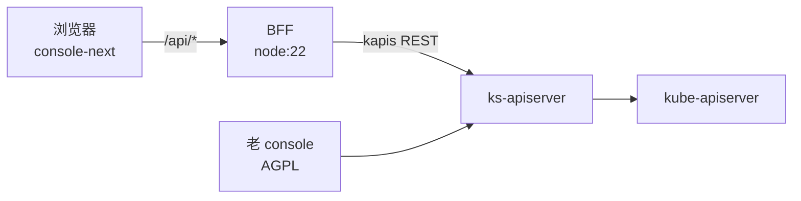

# 新前端 · 技术方案（L1）

> 本文承接 [`prd/kube-frontend/_index.md`](../../prd/kube-frontend/_index.md) 的全部 `AC-*`、`FR-*`、`SC-*`。

## 概述

在 `console/kube-frontend` 建立独立前端：dongba 的技术栈 + bisheng 的工程骨架 + ai-kit 的 UI 底座。与 AGPL 的老 console 物理隔离，通过 BFF 访问同一套 ks-apiserver。

## 关联需求

- `AC-CORE-KUBE-FRONTEND-01`
- `FR-CORE-KUBE_FRONTEND-01`
- `SC-CORE-KUBE_FRONTEND-01`

## 设计目标与非目标

**目标**：协议干净、资源页由数据描述、界面可被智能体操作、约束用测试锁住。

**非目标**：首期不做 SSR、不做创建/编辑表单、不做其他资源模块。

## 关键约束

- 不 import、不复制 `console/src` 的代码。
- 不新增后端接口：复用 kapis。
- 依赖版本只来自 `catalog:`。

## 方案决策

### DEC-CORE-KUBE-FRONTEND-01 — 重写而非改造

**为什么**：AGPL 覆盖网络服务，改造 console 会持续扩大源码开放义务。

**被否方案**：在 `console/src` 内新增页面，只在内部使用。AGPL 明确覆盖网络交互，"内部使用"不是豁免。

**何时重新考虑**：若上游改为宽松许可，可转为渐进迁移。

### DEC-CORE-KUBE-FRONTEND-02 — 技术栈取 dongba、骨架取 bisheng

**为什么**：重写没有历史包袱，适合最新一代（React 19 / Vite / TanStack）；而多包共用、版本漂移、架构约束是工程问题，bisheng 的 `catalog` + `packages/*` + `config/*.test.ts` 已经验证过。

**被否方案**：沿用 bisheng 全栈（React 18 + recoil）——recoil 已归档，是已知技术债，不应带进新项目。

### DEC-CORE-KUBE-FRONTEND-03 — BFF 而非直连

**为什么**：上游错误形态有三种（`{message}`、kube `Status`、代理 HTML），直连会让每个页面各解析一遍；token 也应只在一个进程里出现。

**被否方案**：前端直连 ks-apiserver + 每个页面各自处理错误。会在 24 个资源模块里重复 24 次。

### DEC-CORE-KUBE-FRONTEND-04 — 按产品功能区拆包，不按页面预加载

**为什么**：使用者是企业内部的算力运维人员，一天在同类资源页之间来回几十次，判断标准是"切换像桌面应用"，首屏慢 1–2 秒可以接受。但产品有 24 个资源模块，若照 dongba 的做法把整站模块写进 `<head>` 预加载，首屏会随页面数线性增长，到后期不可接受。

于是取中点：**按顶部导航的产品功能区切分构建产物**——工作台（项目资源）、平台管理、应用商店、登录各自一组共享依赖，同区页面之间零额外下载，跨区切换才拉一组新的（每区有上限）。页面级 chunk 仍保留，只承载该页面的业务代码。

**实测依据**（生产构建，gzip）：首屏约 332 KB，其中 React/Radix/ai-kit 共享层 150.8 KB、图标雪碧图 113.4 KB、路由壳 31.3 KB、configmaps 自身约 23 KB；configmaps → secrets 客户端切换只新增 12 KB，无 document、无 CSS 请求。即**首屏的 84% 是共享层**，切页面的增量很小——所以优化的对象是共享层怎么切块，而不是页面。

**被否方案**：整站 `modulepreload`（dongba 现做法）。实测其两个 console 文档预加载同一组 65 个模块、首屏 JS 1836 KB；页面数翻倍时这一数字同步翻倍，而绝大多数用户一次只用一个区。

**被否方案**：完全按页面懒加载、不做区级共享块。同一区页面之间会重复下载 Radix/Select 等重复依赖，且每次切换都有可见的空白帧。

**何时重新考虑**：若首屏 P95 在弱网下超过 5 秒，再引入按区的服务端预取（见 [`DEC-...-05`](#dec-core-kube_frontend-05--共享层预取由交互意图触发)）。

### DEC-CORE-KUBE-FRONTEND-05 — 共享层预取由交互意图触发

**为什么**：区级拆包后跨区首次切换要付一次加载。在导航上 `onPointerEnter` / `onFocus` 时预取目标区的共享块，让"决定要点"的 200–400 ms 覆盖掉下载时间；`defaultPreload: 'intent'` 已有的机制可复用，只需把预取目标从路由 chunk 扩展到区级共享块。

**约束**：预取必须可被 `Save-Data` 与 `prefers-reduced-data` 关闭，且不得在首屏触发——否则等于退化成整站预加载。

**被否方案**：`<link rel="prefetch">` 预取全部区。移动网络下会与首屏请求抢带宽。

### DEC-CORE-KUBE-FRONTEND-06 — 构建期把第三方依赖按稳定性分块

**为什么**：Vite 默认把"首屏用不到的共享依赖"放进同一个大 chunk，任何依赖升级都会换掉它的哈希，整块缓存失效。按变更频率分块——`react` 系（极少变）、`radix`/`tanstack` 系（偶尔变）、`ai-kit`（随产品变）——让改业务代码只失效对应的小块。

**已知代价**：分块过细会增加请求数，每个 chunk 都带一份模块运行时代码。以 3–5 个 vendor 块为上限，不按单个库切。

**被否方案**：不配 `manualChunks`，全交给 Vite 默认策略（当前状态：一个 150.8 KB 的主 chunk 装下了全部共享依赖，改任何一处依赖都整块失效）。

### DEC-CORE-KUBE-FRONTEND-07 — 减小页面文件对 CSS 与共享 chunk 的牵连

**为什么**：开发期实测，编辑任何一个带 Tailwind 类名的页面文件，HMR 都会连带刷新 `/src/styles.css` 与承载该页面的 chunk。页面越集中在少数文件里，每次保存重建的 CSS 越大，热更新越慢；多人同时改不同页面时，重建还会互相打断。

拆法：
- **样式按区**：依据现有 `tailwind.config.cjs` 的 `content` 扫描范围，把 `styles.css` 拆成"基础 + 区级"入口，区级入口只扫描该区的页面（`@source` 限定目录）。只改某区页面时，只有该区的 CSS 失效。
- **共享组件下沉**：页面之间重复引用的组件与 hook 移到 `packages/` 或 `components/`，让页面文件只描述该页的列/字段/表单，减少单文件体积与重建扇出。

**验证方式**：改动一次页面文件后，Vite 日志里应只出现该页面自身的 update 与所属区的 CSS，不再出现全局 `styles.css`。

**被否方案**：不做拆分，靠"少改页面文件"约束开发习惯。靠人记住的约束不成立。

## 系统现状

老 console 是 24 个资源模块的集合，列表页靠 `withList` HOC 压缩样板。新前端首批只迁 ConfigMaps，用它验证 schema 抽象。

## 入口与子模块

| 子模块 | 入口 | 说明 |
|---|---|---|
| 登录 | `/login` | 见 [`login.md`](login.md) |
| 主题 | `<html data-theme>` | 见 [`theme.md`](theme.md) |
| 配置字典 | `/kube-frontend/:workspace/clusters/:cluster/projects/:namespace/configmaps` | 首个资源模块 |

## 运行时拓扑

两个前端共用后端，互不引用代码与构建产物。BFF 是无状态进程，可水平扩展；token 由浏览器逐请求携带，进程内不持有凭据。

## 模块边界与仓库落点

| 目录 | 内容 |
|---|---|
| `kube-frontend/apps/console-next` | 路由、页面、壳 |
| `kube-frontend/packages/ui` | 展示层，四条铁律 |
| `kube-frontend/packages/api-client` | HTTP 唯一入口 |
| `kube-frontend/packages/ai-surface` | 智能体契约 |
| `kube-frontend/packages/locales` | 文案 |
| `kube-frontend/server` | BFF |
| `kube-frontend/config` | 架构约束测试 |

## 关键共享契约

- `packages/ai-surface` 的属性常量与 `ActionResult` 形状：重命名为破坏性变更。
- `packages/api-client` 的 `ApiError`：`code` / `retryable` / `isPermission` / `isNotFound`，页面按此分支。
- `packages/ui` 的 `AiButton.aiId` 必填约定。

## 数据归属

| 数据 | 唯一来源 | 说明 |
|---|---|---|
| 资源列表与详情 | ks-apiserver | 前端不缓存到 localStorage，Query 缓存仅内存 |
| 页面状态 | 页面组件 | 由查询结果派生，不另行存储 |
| 文案 | `packages/locales` | 组件不持有文案 |
| 智能体清单 | `packages/ai-surface` | 页面注册，BFF 读取后对外提供 |

## 对外契约

- `GET /api/configmaps?cluster&namespace&page&pageSize&sortBy&order&keyword`
- `GET /api/configmaps/:name?cluster&namespace`
- `DELETE /api/configmaps?cluster&namespace&name`（可重复）
- `GET /api/ai/manifest`
- `POST /api/session/login` / `GET /api/session/me` / `POST /api/session/logout`（见 [`login.md`](login.md)）
- 错误体统一为 `{ code, message, status }`。

## 不变量

- **INV-CORE-KUBE-FRONTEND-01** — `packages/ui` 不出现状态库、请求、i18n、路由的 import。
- **INV-CORE-KUBE-FRONTEND-02** — 共享依赖一律写 `catalog:`。
- **INV-CORE-KUBE-FRONTEND-03** — 页面根元素恰好一个 `data-ai-state`。
- **INV-CORE-KUBE-FRONTEND-04** — 页面内不使用裸 `<button>`，一律经 `AiButton` 或 `actionProps`。

## 已知坑

- **GOT-CORE-KUBE-FRONTEND-01** — `createClient` 若在构造时捕获 `globalThis.fetch`，后续安装的 stub 不生效，测试会一直停在 `loading`。已改为每次请求解析。
- **GOT-CORE-KUBE-FRONTEND-02** — `exactOptionalPropertyTypes` 下不能把 `undefined` 传给可选属性（如 `activeKey`），需要条件展开。
- **GOT-CORE-KUBE-FRONTEND-03** — Tailwind 4 的 `@import` 解析在 CSS 注释含撇号时会报 `Unterminated string`。
- **GOT-CORE-KUBE-FRONTEND-04** — ai-kit 以 `dist` 提供，新增导出后必须重建 ai-kit，否则消费方构建失败。
- **GOT-CORE-KUBE-FRONTEND-05** — 开发期编辑任何带 Tailwind 类名的页面文件，都会连带触发 `/src/styles.css` 整体重建，日志里的 `hmr update /src/styles.css, /src/pages/...` 即由此而来。改样式扫描范围（`DEC-CORE-KUBE-FRONTEND-07`）之前，这是保存变慢的主因。

## 测试与可观测

- `pnpm test:config`：架构约束（包边界、依赖归属、AI 句柄）。
- `pnpm test`：各包单测 + 页面集成测试。
- `pnpm typecheck`：全 workspace 严格类型。
- `GET /api/ai/manifest`：页面清单，供自动化发现。

## 明确不做

- 不改 `console/src`。
- 不做创建 / 编辑表单与其他资源模块。
- 不做 SSR 与 Cloudflare 部署。
- **不做整站预加载**：不把所有模块写进 `<head>` 的 `modulepreload`，也不在首屏预取未访问区的共享块。理由与替代做法见 `DEC-CORE-KUBE-FRONTEND-04` / `-05`。

## 后续改进

- 创建 / 编辑表单。
- 其余资源模块按同一 schema 铺开。
- manifest 由构建期生成并写入文件，供 BFF 直接提供。

## 验收用例

- `TC-CORE-KUBE-FRONTEND-01`
