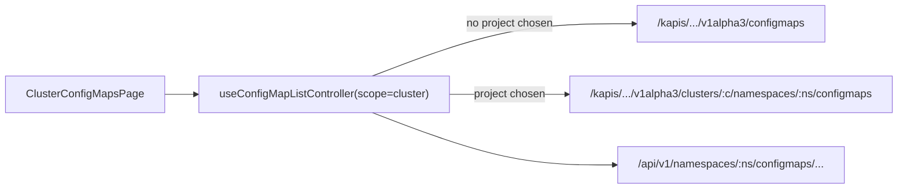

# 集群配置字典 · 技术方案（L2）

> 承接 [`prd/kube-frontend/cluster-configmaps/_index.md`](../../../prd/kube-frontend/cluster-configmaps/_index.md)。

## 概述

本文件说明集群级配置字典的实现方式与取舍，不复述需求。项目级的机制（读写分离、schema 列表、弹窗复用）见 [`../configmaps/`](../configmaps/)，这里只写差异。

## 关联需求

- `AC-FULL-KUBE-FRONTEND-CLUSTER-CONFIGMAPS-01`

## 设计目标与非目标

**目标**：与项目级共享状态机、弹窗与详情布局，差异只落在列、数据来源与创建流程三处。

**非目标**：不把两个页面合并成一个参数化页面。

## 关键约束

- 读走 kapis，写走 `/api/v1`；跨项目读取走不带作用域段的集合端点。
- 联邦对象（`kubefed.io/managed=true`）只读。
- 页面根元素恰好一个 `data-ai-state`。

## 方案决策

### DEC-L3-KUBE-FRONTEND-CLUSTER_CONFIGMAPS-01 — 独立页面而不是参数化项目页

**为什么**：两个页面的差异集中在三处——列（多「项目」）、数据来源（跨项目集合）、创建流程（必须选项目）。若合并成一个页面，每个 handler 都要 `if (scope === 'cluster')`，而这些分支只有一处会被执行，另一处永远走不到、也就永远没人测。拆成两个页面后，共享的部分下沉到 `useConfigMapListController`，差异部分各自可读。

**被否方案**：给 `ConfigMapsPage` 加 `scope` 参数。首个 `scope === 'cluster'` 分支之后，每加一个资源页都要重新判断哪些分支需要处理两种 scope。

### DEC-L3-KUBE-FRONTEND-CLUSTER_CONFIGMAPS-02 — 跨项目集合用不带作用域段的端点

**为什么**：实测该 ks-apiserver 上 `/kapis/resources.kubesphere.io/v1alpha3/configmaps` 返回 200 与数千条跨命名空间的对象，而 `/klusters/<id>/configmaps` 返回 404。老 console 的 `stores/base.js` 里 `klusters` 段在这个版本没有注册，照抄会得到一个永远为空的列表。

**被否方案**：照搬老 console 的 `klusters/<id>` 路径。实测 404，且不会表现为错误而是空表——最难排查的形态。

### DEC-L3-KUBE-FRONTEND-CLUSTER_CONFIGMAPS-03 — 详情页留在集群管理内

**为什么**：老 console 的集群列表把名称链到**项目级**详情（`/clusters/:c/projects/:ns/configmaps/:name`）。点了之后顶栏从「平台管理」跳回「工作台」，读者丢失了当前位置。新页面把名称链到 `/kube-frontend/clusters/:c/configmaps/:name?namespace=<ns>`：project 放进查询串是因为 ConfigMap 名称只在项目内唯一，URL 必须能指认是哪一个。

**被否方案**：照搬老 console 跳项目详情。改进的代价是详情页多一个组件，收益是任务不被打断。

**何时重新考虑**：若产品决定「集群管理只做浏览，编辑一律回项目」，则删掉集群详情页，名称链接改回项目详情。

### DEC-L3-KUBE-FRONTEND-CLUSTER_CONFIGMAPS-04 — 联邦对象只读

**为什么**：联邦对象由联邦控制面维护，本地修改会被下一次分发覆盖或直接被拒。老 console 用 `show: !record.isFedManaged` 隐藏四个行操作并禁用复选框，行为一致。

**实现**：`ListSchema.isRowSelectable` 返回 `false`；`rowActions[].visible` 返回 `false`。详情页把操作区换成一句说明，而不是留空——空白工具栏读起来像页面坏了。

## 系统现状

项目级页面已上线并被用例覆盖；本模块复用其 `ConfigMapCreateDialog`、`ConfigMapEditDialogs`、`ConfigMapDeleteDialog`、`ConfigMapYamlDialog`，以及 `controller.ts` 里的列表状态机。

## 入口与子模块

| 子模块 | 入口 | 说明 |
|---|---|---|
| 列表 | `/kube-frontend/clusters/:cluster/configmaps` | 跨项目，可 `?namespace=` 收窄 |
| 详情 | `/kube-frontend/clusters/:cluster/configmaps/:name?namespace=<ns>` | `namespace` 必填才能定位对象 |

## 运行时拓扑



## 模块边界与仓库落点

| 目录 | 内容 |
|---|---|
| `apps/console-next/src/pages/configmaps/controller.ts` | 两个页面共享的列表状态机 |
| `apps/console-next/src/pages/configmaps/ClusterConfigMapsPage.tsx` | 集群级列表 |
| `apps/console-next/src/routes/kube-frontend.clusters.$cluster.configmaps*.tsx` | 路由 |
| `packages/api-client/src/configmaps.ts` | `scope` 参数与路径生成 |

## 关键共享契约

- `ConfigMapScope`：`'project' | 'cluster'`；`list` 的默认值为 `'project'`。
- 写操作一律带对象自身的 `namespace`，即使列表是跨项目的。

## 页面与技术结构

```text
routes/kube-frontend.clusters.$cluster.configmaps.tsx        列表路由（?namespace= 可收窄）
routes/kube-frontend.clusters.$cluster.configmaps.$name.tsx  详情路由（?namespace= 定位对象）
pages/configmaps/ClusterConfigMapsPage.tsx                   列表页：列 + onAction
pages/configmaps/controller.ts                               两页共享：状态、查询、mutation、loadDetail
```

两个页面共享 `ResourceList`；差异只有列定义、创建入口和数据来源。

## 功能点

| 功能点 | 需求 | 技术方案 |
|---|---|---|
| 列表 | `list.md` | `list.md` |
| 搜索 | `search.md` | `search.md` |
| 详情 | `detail.md` | `detail.md` |
| 创建 | `create.md` | `create.md` |
| 编辑 | `edit.md` | `edit.md` |
| 删除 | `delete.md` | `delete.md` |
| 智能体 | `ai-surface.md` | `ai-surface.md` |
| 移动端 | `mobile.md` | `mobile.md` |

## 关键契约与依赖

- `useConfigMapListController({ scope, cluster, namespace? })`：`scope: 'cluster'` 且无项目时读跨项目集合。
- `ConfigMapScope` 由 `@kube-ai-hub/api-client` 导出，`configMapsApi.list` 的 `scope` 默认为 `'project'`。
- `ListSchema.isRowSelectable` 与 `ListAction.visible` 是 ai-kit 的公开能力，本模块是它们的第一个使用者。

## 状态与数据归属

| 状态 | 存放 | 说明 |
|---|---|---|
| 页码、搜索、排序、选择 | 页面（`useState`，经控制器） | 不写入 URL，与项目级一致 |
| 项目筛选 | `?namespace=` 查询串 + 控制器状态 | 查询串使链接可分享；控制器状态是唯一事实 |
| 对象数据 | React Query 缓存 | 键含 `scope`，两种作用域不互相覆盖 |
| 写目标 `(namespace, name)` | 控制器 `target` | 打开弹窗前由行数据设置 |

## 不变量

- **INV-L3-KUBE-FRONTEND-CLUSTER_CONFIGMAPS-01** — 写请求的路径里必须出现对象自己的 namespace。
- **INV-L3-KUBE-FRONTEND-CLUSTER_CONFIGMAPS-02** — 联邦对象不可被选中、不可被编辑或删除。

## 已知坑

- **GOT-L3-KUBE-FRONTEND-CLUSTER_CONFIGMAPS-01** — `klusters/<id>` 段在本 ks-apiserver 上 404。用不带作用域段的端点。
- **GOT-L3-KUBE-FRONTEND-CLUSTER_CONFIGMAPS-02** — 跨项目集合在数千条时首屏较慢；查询缓存键包含 `scope`，否则与项目级查询撞键并互相覆盖。

## 测试与可观测

- `packages/api-client/test/configmaps.test.ts`：两个 scope 的 URL 形状。
- `apps/console-next/test/cluster-configmaps-page.test.tsx`：跨项目列、联邦只读、创建必须选项目。
- `tests/ui/tests/kube-frontend/cluster-configmaps/`：真实集群上的端到端。
- `data-ai-id`：`cluster-configmaps:surface` / `:search` / `:create` / `:select:<ns>/<name>` / `:bulk-delete`。

## 明确不做

- 不合并进项目级页面。
- 不做「批量删除跨项目选择」：删除按命名空间定位，跨项目批量会让同名的另一条被误删。

## 后续改进

- 其余集群级资源（如集群级 Secret）按同一控制器铺开。

## 验收用例

- `TC-FULL-KUBE-FRONTEND-CLUSTER_CONFIGMAPS-01`
