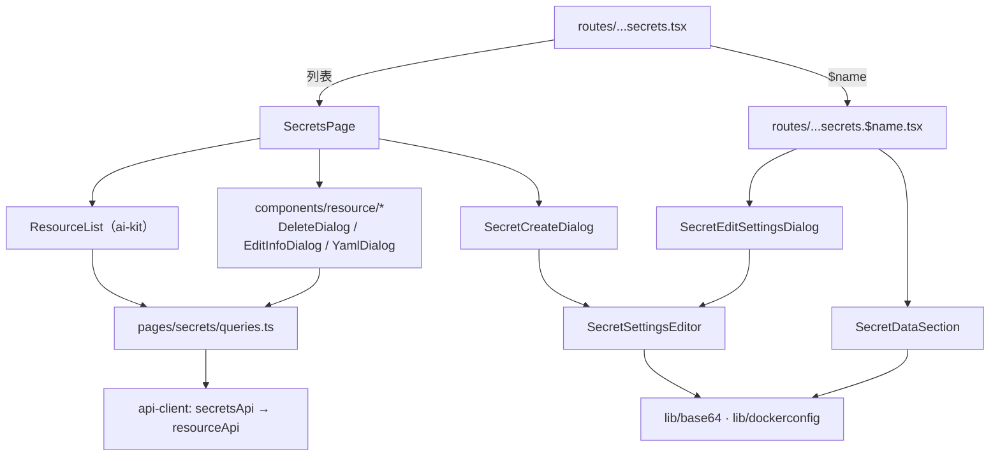

# 保密字典 · 技术方案（L2）

> 承接 [`prd/kube-frontend/secrets/_index.md`](../../../prd/kube-frontend/secrets/_index.md)。

## 概述

保密字典是 `kube-frontend` 的第二个完整资源模块。它复用了配置字典已验证的页面骨架（`ResourceList` + `AiSurface` + TanStack Query），把「资源专用」的部分收敛为：类型映射、四类数据的编辑器与渲染器、UTF-8 安全的 Base64、镜像仓库文档的解析与生成。

数据层不再复制 `configmaps.ts`——那份 300 行的读写实现是第一个模块摸索出来的，现在有了第二个使用者，抽取为 `packages/api-client/src/resources.ts` 的 `resourceApi()`（见 DEC-SECRETS-01）。

## 关联需求

- `AC-FULL-KUBE-FRONTEND-SECRETS-01`

## 设计目标与非目标

**目标**：

- 四种已知类型在列表、详情、创建、编辑四个位置的行为一致（同一份类型表驱动）；
- 值在整条链路上「输入明文、存储 Base64、展示默认遮挡」；
- 删除、编辑、YAML 三种通用能力只写一次，被三个资源共用。

**非目标**：

- 不重构已上线的配置字典页面（见 DEC-SECRETS-02）；
- 不做 Secret 的引用分析或轮换策略。

## 关键约束

- 读走 kapis、写走 `/api/v1`（kapis 的 resources 端点只注册 GET）。
- 值的编码必须是 UTF-8 安全：老控制台依赖 `js-base64`（AGPL），本项目不得引入，因此自实现 `safeBtoa` / `safeAtob`。
- 类型是 Secret 的**结构契约**：上游按类型校验 `data`，界面必须在提交前保证必填键存在。
- 遮挡只发生在展示层，不改数据。

## 页面与技术结构

| 层 | 文件 |
|---|---|
| 页面 | `apps/console-next/src/pages/secrets/SecretsPage.tsx` |
| 详情 | `apps/console-next/src/routes/kube-frontend.$workspace.clusters.$cluster.projects.$namespace.secrets.$name.tsx` |
| 弹窗 | `SecretCreateDialog.tsx`、`SecretEditDialogs.tsx`、`SecretSettingsEditor.tsx` |
| 详情数据区 | `SecretDataSection.tsx` |
| 查询 / manifest | `queries.ts` |
| 纯函数 | `lib/base64.ts`、`lib/dockerconfig.ts`、`lib/time.ts` |
| 共享弹窗 | `components/resource/DeleteDialog.tsx` 等 |
| 接口 | `packages/api-client/src/secrets.ts`、`resources.ts` |
| 文案 | `packages/locales/src/index.ts`（`secrets.*`、`resource.*`、`delete.*`、`yaml.*`） |

## 状态与数据归属

- 服务端状态归 TanStack Query：列表键 `['secrets', cluster, namespace, page, pageSize, sortBy, order, keyword]`；详情键 `['secret', cluster, namespace, name]`。
- 写操作成功后失效 `secrets`、`secret`、`registry-secrets` 三个前缀，列表与详情同时刷新。
- 本地状态归页面：分页、搜索、排序、选择由 `useResourceListState` 统一管理；弹窗由页面的 `Dialog` 联合类型管理。

## 关键契约与依赖

### CON-FULL-KUBE-FRONTEND-SECRETS-01 — 端点与注解

| 操作 | 方法与路径 |
|---|---|
| 列表 | `GET /kapis/resources.kubesphere.io/v1alpha3[/clusters/{c}]/namespaces/{ns}/secrets?page&limit&sortBy&ascending&name` |
| 详情 | `GET .../secrets/{name}` |
| 创建 | `POST /api/v1/namespaces/{ns}/secrets` |
| 替换 | `PUT /api/v1/namespaces/{ns}/secrets/{name}`（携带当前 `resourceVersion`） |
| 部分更新 | `PATCH .../{name}`，`content-type: application/merge-patch+json` |
| 删除 | `DELETE /api/v1/namespaces/{ns}/secrets/{name}` |

与老控制台（`stores/secret.js` + `stores/base.js`）完全一致，后端不需要任何改动。

### CON-FULL-KUBE-FRONTEND-SECRETS-02 — 注解

| 注解 | 含义 |
|---|---|
| `kubesphere.io/alias-name` | 别名（列表用它替换名称） |
| `kubesphere.io/description` | 描述 |
| `kubesphere.io/creator` | 创建者 |
| `secret.kubesphere.io/is-default-class` | 默认镜像仓库（`"true"` / `"false"`） |
| `secret.kubesphere.io/force-insecure` | 地址为 `http://` 时要求跳过证书校验 |

## 不变量

- **INV-FULL-KUBE-FRONTEND-SECRETS-01** — 页面初次渲染时，任何 Secret 的值都以等长 `*` 出现；明文只在用户点击「显示明文」之后出现，且该状态不持久化。
- **INV-FULL-KUBE-FRONTEND-SECRETS-02** — `data` 中的每个值在提交前都经过 `safeBtoa`，在展示时经过 `safeAtob`；两者互逆（含中文、emoji、换行）。
- **INV-FULL-KUBE-FRONTEND-SECRETS-03** — 详情与列表对同一字段只使用一份格式化实现（`lib/time.ts`、`SecretSettingsEditor` 的类型表）。

## 已知坑

- **GOT-FULL-KUBE-FRONTEND-SECRETS-01** — `btoa` 只接受 Latin-1。直接用 `btoa(value)` 保存含中文的密码会抛 `InvalidCharacterError`，表现为「点创建没反应」。
  处置：`safeBtoa` 先用 `TextEncoder` 转 UTF-8 字节再编码；`safeAtob` 用 `TextDecoder(fatal)` 解码，失败时退回 Latin-1，保证任意字节都不崩。
- **GOT-FULL-KUBE-FRONTEND-SECRETS-02** — `actionProps()` 的展开位置会覆盖业务 handler。`{...actionProps(id)}` 放在 `onChange` 之后时，`onChange` 被覆盖，表现为「下拉框选了没反应」。
  处置：所有带业务回调的控件把 `actionProps` 放在回调**之前**；契约测试扫描这一点。
- **GOT-FULL-KUBE-FRONTEND-SECRETS-03** — ai-kit 的可搜索 `Select` 是一个 combobox（关闭时是 button、打开时是 input），且不透传额外属性。挂在它上面的 `data-ai-id` 不会出现在 DOM 里，自动化会超时。
  处置：用 `AiSurface` 包一层承载句柄；`aria-label` 仍是文本定位的锚点。
- **GOT-FULL-KUBE-FRONTEND-SECRETS-04** — `kubectl create secret docker-registry` 生成的 `.dockerconfigjson` 通常只有 `auth` 字段而没有 `username`/`password`。表单只读这两个字段时会把它们显示为空，保存后就把 `auth` 覆盖成空账号。
  处置：编辑器优先使用 `username`/`password`，缺失时从 `auth` 解出；保存时总是同时写 `auth`。

## 测试与可观测

- 单元：`apps/console-next/test/secrets-lib.test.ts`（Base64、dockerconfig）、`secrets-page.test.tsx`（弹窗与校验）、`packages/api-client/test/secrets.test.ts`（端点与映射）。
- 契约：`config/ai-surface-contract.test.ts`（新页面必须发布状态、无裸 `<button>`）、`config/license-boundary.test.ts`（不得引用 AGPL 的 `console/src`）。
- 端到端：`tests/ui/specs/kube-frontend/secrets/`，真实集群或评估 harness 上跑完整 CRUD。

## 明确不做

- 不迁移老控制台的镜像仓库「验证」按钮（见 DEC-SECRETS-06）。
- 不做类型之外的表单（`ssh-auth` 等走 YAML）。
- 不做 Secret 的引用关系与轮换。

## 后续改进

- 更多类型（`dockercfg`、`ssh-auth`）的表单化，一旦有真实用户提出即可按同一份类型表扩展。
- 值的「复制」能力（当前刻意不做，见详情 PRD）。

## 功能点

- 列表 `list`、搜索 `search`、详情 `detail`
- 创建 `create`、编辑 `edit`、删除 `delete`
- 智能体可操作性 `ai-surface`、移动端 `mobile`

## 验收用例

- `TC-FULL-KUBE-FRONTEND-SECRETS-01`

## 方案决策（本层）

### DEC-FULL-KUBE-FRONTEND-SECRETS-01 — 抽取通用 `resourceApi`，配置字典不重写

**为什么**：配置字典的 `configmaps.ts` 把「读 kapis / 写 `/api/v1` / 读取资源版本 / merge patch / 批量删除」写在一处，保密字典与服务账户需要一字不差的能力。第二个（第三个）使用者出现时抽取，是配置字典技术方案中「列定义放组件内」那条决策写明的触发条件。

**被否方案**：让 Secret 复用 `configMapsApi` 并把路径参数化——类型会被迫包含 ConfigMap 的字段（`keys`、`binaryData`），调用方拿到的每个值都要再断言一次，等于把清晰度换成行数。

**被否方案**：同时把配置字典切到 `resourceApi`。它已上线并有 23 条用例通过；纯重构的收益是「看起来整齐」，风险是真实回归，且无法用新用例补偿。

**何时重新考虑**：配置字典需要新能力（例如跨项目批量）时，顺带迁移。

### DEC-FULL-KUBE-FRONTEND-SECRETS-02 — 通用弹窗放 `components/resource`，不进 `packages/ui`

**为什么**：删除确认、编辑信息、YAML 编辑都依赖 i18n、`actionProps`、`api-client` 的注解常量——这些正是 `packages/ui` 契约禁止的。放在应用层的 `components/resource` 既不违反边界，又能被三个资源共用。

**被否方案**：放进 `packages/ui`。会立刻触发 `dependency-contracts.test.ts` 失败，而且把「业务动作」塞进展示层。

### DEC-FULL-KUBE-FRONTEND-SECRETS-03 — 遮挡使用等长 `*` 而不是固定占位符

**为什么**：老控制台（`SecretDetail.convert`）用等长 `*`。长度本身是有用信息（例如确认证书是否被截断），而固定 `•••••` 会让所有值看起来一样长，反而诱导用户误以为内容一致。

**被否方案**：不渲染值、只提供「点击查看」。遮挡比隐藏更能表达「这里有东西，只是没显示」。

### DEC-FULL-KUBE-FRONTEND-SECRETS-04 — 编辑设置锁定类型

**为什么**：上游按类型校验 `data`（TLS 必须有 `tls.crt`），在本对话框内换类型通常会在提交时被拒，而数据已经被清空。老控制台的 `secret.edit` 同样传 `disableSelect`。

**被否方案**：允许换类型并自动把数据转成新类型的形状。TLS → 用户名密码没有有意义的转换，猜错的转换比拒绝更糟。

**何时重新考虑**：当「转换类型」成为常见诉求，并定义出确定的转换规则。

### DEC-FULL-KUBE-FRONTEND-SECRETS-05 — 类型表只在前端维护一份

**为什么**：类型到中文名、到必填键、到编辑器的映射集中在一个模块（`secretTypes.ts` + `SecretSettingsEditor`），列表、详情、创建、编辑都读它。四份分散的 `switch` 是「改一处漏三处」的根源。

**被否方案**：让后端返回类型的中文名。ks-apiserver 没有这个接口，且老控制台也是前端翻译。

### DEC-FULL-KUBE-FRONTEND-SECRETS-06 — 不迁移镜像仓库「验证」按钮

**为什么**：老控制台的「验证」调用 `kapis/.../registrysecrets/{name}/verify`，需要一个**已存在**的 Secret 名称。在创建弹窗里名称还是草稿，点击只会 404；在编辑弹窗里能验证，但它的作用是「确认这组账号能登录」，而这一步在拉取镜像时必然会被验证，且失败信息比这个接口更具体。更关键的是：该接口在本仓库 `kube-server` 中没有注册，属于 KubeSphere 企业版能力，迁移过来在开源部署上就是死按钮。

**被否方案**：保留按钮但隐藏在本仓库无法判断的条件后面。判据需要探测上游版本，代价大于收益。

**何时重新考虑**：确认真实部署上该端点可用、且用户明确提出需要预验证时。

### DEC-FULL-KUBE-FRONTEND-SECRETS-07 — 允许含中文的值，并给出提示

**为什么**：老控制台的 `dataValidator` 拒绝含中文的键与值（`SECRET_NO_CHINESE_CODE_DESC`）。但 kube-apiserver 对 `data` 只要求是 base64，任何 UTF-8 文本都合法；拒绝会迫使用户放弃更易读的密码。新前端在子表单里提示「将以 UTF-8 编码保存（旧控制台会拒绝含中文的值）」，不阻断提交。

**被否方案**：继续拒绝。用户被老控制台拒绝后会用 `kubectl` 绕过，结果更糟。

### DEC-FULL-KUBE-FRONTEND-SECRETS-08 — 列表禁止显示键名

**为什么**：Secret 的键名通常直接暴露用途（`password`、`aws_secret_access_key`），而列表常被截图、共享给同事。老控制台在列表只显示字段数，这一点值得照搬，甚至应写进「明确不做」以防被「顺便加上」。
