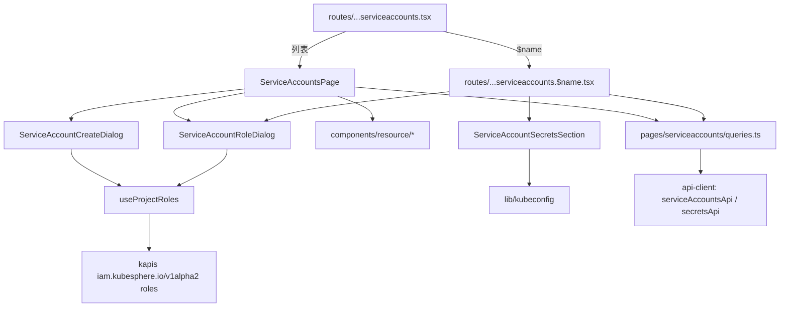

# 服务账户 · 技术方案（L2）

> 承接 [`prd/kube-frontend/serviceaccounts/_index.md`](../../../prd/kube-frontend/serviceaccounts/_index.md)。

## 概述

服务账户是 `kube-frontend` 的第三个完整资源模块，与保密字典共用 `resourceApi`、共享弹窗和列表状态 hook。它特有的部分有三块：项目角色（注解 + `iam` 角色列表）、令牌 Secret 的解析（详情页按名字逐个拉取）、kubeconfig 生成（纯函数）。

## 关联需求

- `AC-FULL-KUBE_FRONTEND-SERVICEACCOUNTS-01`

## 设计目标与非目标

**目标**：角色可见可改；任一令牌 Secret 都能一键得到可用 kubeconfig；与服务账户的 `secrets[]`（控制器维护）不产生写冲突。

**非目标**：生成新令牌、管理 RoleBinding、workspace/集群级列表。

## 关键约束

- 读走 kapis、写走 `/api/v1`；角色变更走 merge patch。
- 角色列表端点 `kapis/iam.kubesphere.io/v1alpha2/[.../]namespaces/{ns}/roles?limit=-1&sortBy=createTime`（与老控制台 `RoleStore.fetchList` 一致）。
- 令牌 Secret 需要单独读取：kapis 不内联 Secret。
- kubeconfig 是**生成物**，不写回集群。

## 页面与技术结构

| 层 | 文件 |
|---|---|
| 列表 | `apps/console-next/src/pages/serviceaccounts/ServiceAccountsPage.tsx` |
| 详情 | `routes/...serviceaccounts.$name.tsx` |
| 数据区 | `pages/serviceaccounts/ServiceAccountSecretsSection.tsx` |
| 弹窗 | `ServiceAccountCreateDialog.tsx`、`ServiceAccountRoleDialog.tsx` |
| 查询 / manifest | `pages/serviceaccounts/queries.ts` |
| 纯函数 | `lib/kubeconfig.ts`、`lib/time.ts` |
| 接口 | `packages/api-client/src/serviceaccounts.ts`、`resources.ts` |

## 状态与数据归属

- 列表键 `['serviceaccounts', cluster, namespace, page, pageSize, sortBy, order, keyword]`。
- 详情键 `['serviceaccount', cluster, namespace, name]`。
- 令牌内容键 `['serviceaccount-secrets', cluster, namespace, ...names]`，仅在 `names` 非空时请求。
- 项目角色键 `['project-roles', cluster, namespace]`，`staleTime` 5 分钟，创建/修改角色弹窗共享。

## 关键契约与依赖

### CON-FULL-KUBE_FRONTEND-SERVICEACCOUNTS-01 — 端点

| 操作 | 方法与路径 |
|---|---|
| 列表 / 详情 | `GET /kapis/resources.kubesphere.io/v1alpha3[/clusters/{c}]/namespaces/{ns}/serviceaccounts[/{name}]` |
| 创建 | `POST /api/v1/namespaces/{ns}/serviceaccounts` |
| 替换 | `PUT /api/v1/namespaces/{ns}/serviceaccounts/{name}` |
| 改角色 | `PATCH .../{name}`，`merge-patch+json`，只含 `metadata.annotations["iam.kubesphere.io/role"]` |
| 角色列表 | `GET /kapis/iam.kubesphere.io/v1alpha2[/clusters/{c}]/namespaces/{ns}/roles?limit=-1&sortBy=createTime` |
| 令牌内容 | `GET /kapis/.../secrets/{tokenSecretName}` |

### CON-FULL-KUBE_FRONTEND-SERVICEACCOUNTS-02 — 注解

| 注解 | 含义 |
|---|---|
| `iam.kubesphere.io/role` | 项目角色 |
| `kubesphere.io/alias-name` / `kubesphere.io/description` / `kubesphere.io/creator` | 与其它资源相同 |

## 不变量

- **INV-FULL-KUBE_FRONTEND-SERVICEACCOUNTS-01** — 角色变更只发出 merge patch，不发出整对象 PUT。
- **INV-FULL-KUBE_FRONTEND-SERVICEACCOUNTS-02** — kubeconfig 只由 `buildKubeconfig()` 生成，详情预览与下载使用同一份文档。
- **INV-FULL-KUBE_FRONTEND-SERVICEACCOUNTS-03** — 任何页面初始渲染都不会以明文展示令牌值。

## 已知坑

- **GOT-FULL-KUBE_FRONTEND-SERVICEACCOUNTS-01** — 1.24+ 集群默认不再自动为 ServiceAccount 生成令牌 Secret（`LegacyServiceAccountTokenNoAutoGeneration`）。新建的账户 `secrets[]` 为空，若详情页把「没有 kubeconfig」当成错误，用户会以为页面坏了。
  处置：明确的空态文案解释原因（PRD 边界情况），不报错。
- **GOT-FULL-KUBE_FRONTEND-SERVICEACCOUNTS-02** — `data.token` 是 base64；kubeconfig 的 `user.token` 需要解码后的 JWT。把 base64 直接写进去，`kubectl` 会报 `Unauthorized`。
  处置：`decodeToken()` 先尝试 base64 解码，解不出来则按原值使用（兼容 `stringData`）。
- **GOT-FULL-KUBE_FRONTEND-SERVICEACCOUNTS-03** — `certificate-authority-data` 在 kubeconfig 中要求是 base64 文本，而 Secret 的 `data['ca.crt']` 也是 base64。少一层编码，`kubectl` 会报 `unable to load root certificates`。
  处置：`buildKubeconfig()` 对 `ca.crt` 再做一次 base64。
- **GOT-FULL-KUBE_FRONTEND-SERVICEACCOUNTS-04** — 整对象 PUT 编辑信息时，若控制器在此期间更新了 `secrets[]`，旧值会被写回；下一次调谐会纠正，但中间态不一致。
  处置：角色变更一律走 patch；编辑信息只改注解，且文档明确提示。

## 测试与可观测

- 单元：`test/serviceaccounts-lib.test.ts`（kubeconfig 生成）、`test/serviceaccounts-page.test.tsx`（列表/详情渲染、角色 patch）。
- 接口：`packages/api-client/test/serviceaccounts.test.ts`（端点、注解映射、角色列表、merge patch）。
- 端到端：`tests/ui/specs/kube-frontend/serviceaccounts/`。

## 明确不做

- 不做令牌生成与轮换。
- 不做 RoleBinding 管理。

## 后续改进

角色说明文案的本地化：`roles[].description` 是 KubeSphere 的 i18n key（如 `PROJECT_VIEWER_DESC`），本仓库没有对应翻译表，因此只显示角色名；后续可引入 KubeSphere 的角色说明字典。

## 功能点

- 列表 `list`、搜索 `search`、详情 `detail`
- 创建 `create`、编辑 `edit`、修改角色 `role`、删除 `delete`
- 智能体可操作性 `ai-surface`、移动端 `mobile`

## 验收用例

- `TC-FULL-KUBE_FRONTEND-SERVICEACCOUNTS-01`

## 方案决策（本层）

### DEC-FULL-KUBE_FRONTEND-SERVICEACCOUNTS-01 — 角色变更是注解 patch，不是整对象替换

**为什么**：`secrets[]` 由 ServiceAccount 控制器维护；整对象 PUT 会把读取后到写入前的控制器更新覆盖掉。merge patch 只触碰一个注解，与控制器无竞争。

**被否方案**：复用编辑信息弹窗的 PUT 路径并把角色作为其中一个字段。实现更简单，但每次改角色都多一次写竞争窗口。

**何时重新考虑**：需要一次性修改多个注解时，已由 `EditInfoDialog` 的 PUT 承担，而角色仍在 patch 路径上。

### DEC-FULL-KUBE_FRONTEND-SERVICEACCOUNTS-02 — 令牌 Secret 由前端逐个读取

**为什么**：kapis 返回的 ServiceAccount 只带 `secrets[].name`，不内联内容。前端按名字并发读取（`Promise.all`），并用一个以 Secret 名字列表为键的查询缓存。

**被否方案**：让 BFF 增加聚合接口。违反「后端复用相同 API、除非必要不修改」的约束；且聚合接口需要决定 `secrets[]` 中哪些是令牌、哪些是镜像拉取凭证。

### DEC-FULL-KUBE_FRONTEND-SERVICEACCOUNTS-03 — kubeconfig 用 `yaml` 库序列化，模板由纯函数提供

**为什么**：生成逻辑与展示/下载解耦，`buildKubeconfig()` 可单测；序列化复用 YAML 弹窗同一个 `toYaml()`，保证缩进与引号风格一致。

**被否方案**：手写模板字符串。base64 与 JWT 中可能含特殊字符，手写拼接的引号处理容易出错。

### DEC-FULL-KUBE_FRONTEND-SERVICEACCOUNTS-04 — 行操作第一条文案是「编辑」

**为什么**：老控制台这一页的行操作是「编辑」（`t('EDIT')`），而保密字典与配置字典是「编辑信息」。用户从旧页面迁移过来时按文字找按钮；把三页统一成「编辑信息」会让老用户多花时间。

**被否方案**：统一文案。一致性的收益小于老用户肌肉记忆的价值，且这不是功能缺陷。

### DEC-FULL-KUBE_FRONTEND-SERVICEACCOUNTS-05 — 角色说明只显示角色名

**为什么**：KubeSphere 角色项的 `description` 是 i18n key（`PROJECT_VIEWER_DESC`）。本仓库的文案表没有这些键，直接显示会渲染成 `PROJECT_VIEWER_DESC` 这样的原始 key（用例里的 `untranslated_keys()` 会直接判失败）。

**被否方案**：复制 KubeSphere 的角色说明字典（AGPL 文案）。引入 AGPL 文本与引入 AGPL 代码在授权上同样不可接受。

**何时重新考虑**：由产品提供一份自有措辞的角色说明表时。
