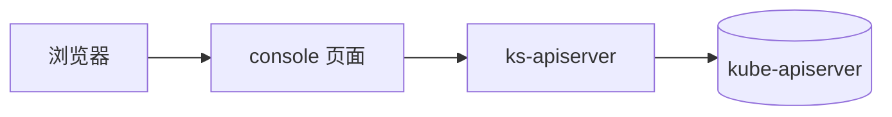

# 模块标题 — 技术方案

> 模板：本文件是 **L1 模块技术方案**。分层、ID 与章节顺序见 [`../README.md`](../README.md)。
> 与需求的分工：需求（`prd/`）回答**做什么与验收**；本文回答**这个模块在系统里长什么样**。不复述需求。

**技术方案 ID**：`DES-L1-<模块>`

## 概述

（数据从哪个入口进来、落到哪个服务或表、被谁消费。1–3 句话。不要复述需求里的套话。）

## 关联需求

（承接哪些验收场景。门禁用这里做 `AC ↔ DES` 追溯，所以必须是反引号包起来的 AC ID，一条一行。）

- `AC-CORE-MODULE-01`

## 设计目标与非目标

- **目标**：
- **非目标**：

## 运行时拓扑

（对象与进程的落点：浏览器 → console Node 服务 → ks-apiserver → kube-apiserver / 外部服务。跨模块能力必须配 Mermaid。）

## 模块边界与仓库落点

（本模块的代码在哪些目录，各自负责什么，不和谁混。两个仓库都要写。）

| 层 | 仓库 | 路径 | 职责 | 不做什么 |
| --- | --- | --- | --- | --- |
| 页面 | `console` | `src/pages/...` | （） | （） |
| 状态 | `console` | `src/stores/...` | （） | （） |
| 接口 | `kube-server` | `pkg/kapis/<group>/...` | （） | （） |

## 数据归属

（本模块拥有的对象与存储；哪些是「本模块唯一正文」，哪些是引用别人的。）

| 对象 | 存储 | 归属 | 生命周期 |
| --- | --- | --- | --- |
| （） | （） | （） | （） |

## 关键共享契约

（本模块对外提供、被其它模块依赖的契约。改它等于破坏谁。契约版本化见宪法 C5。）

| 契约 | 形式 | 谁在用 |
| --- | --- | --- |
| （） | （） | （） |

## 不变量

（改了就会静默坏掉、但代码里看不出来的约定。）

- **INV-L1-<模块>-01**：（不变量）

## 已知坑

（最防失传的内容。每条要带「如果不知道会怎样」，让后人知道严重性。）

| # | 反直觉事实 | 如果不知道会怎样 | 在哪处理 |
| --- | --- | --- | --- |
| **GOT-L1-<模块>-01** | （事实） | （后果） | （文件:函数） |

## 测试与可观测

- **自动化**：（哪些用例覆盖本模块的哪些 AC。）
- **手动验证**：（入口地址、账号、关键步骤。）
- **日志 / 指标**：（在哪看。）

## 明确不做

（被否决的方案与理由。）

## 后续改进

（已知短板 + 重写/拆分的触发条件。）

## 入口与子模块

- 导航：`/clusters/:cluster/<入口>`
- 子模块技术方案：[子模块](./sub/_index.md)

## 验收用例

- L1 核心路径：`TC-CORE-MODULE-01`
