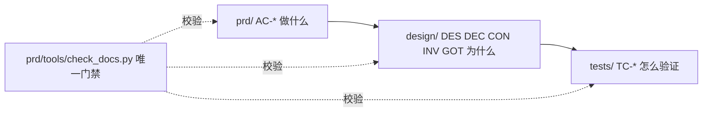

# 智算平台 · SDD（Spec-Driven Development）— 唯一入口

> **人与 AI coding 工具都从这里开始。** 本文回答「读什么、改哪里、跑什么」。
> 章节顺序、ID 语法、字段规则**不在本文重复**，都链到各自的正文，避免两处漂移。
>
> 平台由两个仓库组成：前端 [`console`](https://codeup.aliyun.com/5ff9e1c4168c689c9272ccdb/kube-ai-hub/console)（KubeSphere Console 3.4.2，React 18），后端 `kube-server`（ks-apiserver，Go）。**本目录的 prd/design/tests 是产品级的**，同时覆盖两边；design 里的「仓库落点」一节说明每个功能点改哪个仓库的哪些文件。
>
> 旧 UI 迁移还需先读[迁移指南](legacy-ui-migration-guide.md)并填写[单页交付模板](plans/page-migration-template.md)。
> 本文件的门禁只检查已登记规格，不能发现一开始未写入 AC 的旧字段和交互。
> 当前文档分工与历史资料入口见 [docs/README.md](README.md)。

---

## 0. 一句话分工

| 文档 | 回答 | 正文 |
|------|------|------|
| 需求 `prd/` | **做什么**、验收是什么（`AC-*`） | [`../prd/README.md`](../prd/README.md) |
| 技术方案 `design/` | **为什么这么实现**（`DES`/`DEC`/`CON`/`INV`/`GOT`） | [`../design/README.md`](../design/README.md) |
| 用例 `tests/` | **怎么验证**（`TC-*`） | [`../tests/README.md`](../tests/README.md) |
| 架构铁律 | 不可违反的约束 C1–C5 与「UI 与交互设计原则」 | [`constitution.md`](constitution.md) |

三份文档用同一套后缀 ID 互相钉住：



---

## 目录与文件

| 路径 | 功能 |
|------|------|
| `docs/SDD.md` | **本文件**。唯一入口 |
| `docs/constitution.md` | 架构铁律 C1–C5：接口、生成物、主题 token、指标白名单、契约版本；文末附 UI 与交互设计原则 |
| `prd/README.md` | 需求怎么写：L1–L3 章节序、ID 规则、自检 |
| `prd/catalog.yaml` | 功能树索引。**生成物，不要手改** |
| `prd/tools/tree.py` | 功能树的源。新增模块 / 子模块 / 功能点只改这里 |
| `prd/tools/build_prd.py` | 按 `tree.py` 重写 catalog，并**只补缺失**的需求稿、技术方案稿、L1/L2 用例桩 |
| `prd/tools/check_docs.py` | **唯一门禁**：三向追溯 + 章节 + 结构 + 套话扫描 |
| `prd/templates/` | L1/L2/L3 需求模板，复制后要改什么见 [`prd/templates/README.md`](../prd/templates/README.md) |
| `design/README.md` | 技术方案怎么写 |
| `design/templates/` | L1/L2/L3 技术方案模板，复制后要改什么见 [`design/templates/README.md`](../design/templates/README.md) |
| `tests/README.md` | 三级套件与追溯规则 |
| `tests/ui/README.md` | 怎么装、怎么跑、选择器约定 |
| `tests/ui/SPEC-SCHEMA.md` | 用例 YAML 的字段：`covers`、`story`、`suite` |
| `tests/ui/_templates/case.yaml` | 用例规格模板，复制到 `specs/{模块}/{子}/` 后填写；说明见 [`tests/ui/_templates/README.md`](../tests/ui/_templates/README.md) |
| `tests/ui/specs/{模块}/{子}/TC-*.yaml` | **用例事实源**。人维护 |
| `tests/ui/cases/{模块}/{子}/TC-*.md` | 由规格生成的可读用例。**不要手改** |
| `tests/ui/cases/_traceability.md` | 生成的四向矩阵（AC → 用例 → 技术方案 → 测试文件） |
| `tests/ui/generate_case_docs.py` | 读 `specs/`，写出 `cases/` 与 `_traceability.md` |
| `tests/ui/tests/{模块}/{子}/test_TC_*.py` | Playwright 自动化。**一 spec 一文件，路径镜像 `specs/`** |
| `tests/ui/pages/` | 页面对象。选择器放这里，不写进规格 |
| `tests/ui/helpers/` | 登录、对比度审计、i18n 断言、接口客户端 |
| `tests/ui/artifacts/` | 跑测试时的截图和日志。不是事实源 |
| `prd/tools/test_index.py` | spec ↔ 测试文件的路径映射，门禁与矩阵共用 |
| `bugs/` | 缺陷档案。修复后要回写 `tests/`，不是第二套需求 |

一条功能点在三棵树上的对应关系：

```text
prd/cluster-storage/shared-storage/quota.md
design/cluster-storage/shared-storage/quota.md
tests/ui/specs/cluster-storage/shared-storage/TC-L3-CLUSTER-STORAGE-SHARED_STORAGE-QUOTA-01.yaml
tests/ui/cases/cluster-storage/shared-storage/TC-L3-CLUSTER-STORAGE-SHARED_STORAGE-QUOTA-01.md   # 生成物
```

---

## 1. 选 track

| Track | 什么时候 | 做什么 |
|------|----------|--------|
| **Hotfix / trivial** | 改 bug、文案、依赖；≲1 个文件；**不动对外契约** | 直接改 → 跑相关测试 → 收敛门禁 → MR |
| **Small feature** | 单模块、无跨模块契约 | 只补对应 **L3** 的需求 + 技术方案 + 用例 |
| **Full SDD** | 新能力、跨模块、新增或变更契约、触碰宪法 | 补 L1–L3 三类文档；需求先行、技术方案承接、用例覆盖 |

判断口诀：**要改别人依赖的契约、要动 C1–C5、要动页面结构 / 交互 / 主题色或指标口径，就是 Full SDD。**

---

## 2. 能力级闭环（改一个功能点）

```
tree.py → build_prd.py → prd(AC) → design(承接 AC) → tests(covers) → 测试文件（路径镜像 spec） → check_docs → generate_case_docs
```

**迁移准入**：先独立建立旧入口/子组件/字段/动作/条件/选项清单、请求→映射→展示链路及
视觉/复用基线，再写新 AC。功能、数据、权限、状态与视觉同批实现和验收，不默认另开“美化收尾”批次。
只有上述旧能力表与新 AC 的关联核对完成，才进入实现；API/环境未核实项保持待核实，不用“不做”缩减范围。

1. **改功能树**（结构变了才做）：编辑 [`../prd/tools/tree.py`](../prd/tools/tree.py)。
2. **补缺失文件**：
   ```bash
   cd console
   python3 prd/tools/build_prd.py
   ```
   已有 Markdown 一律不动（`--force-prd` / `--force-design` 才会覆盖，会毁掉手写内容）。
3. **写需求** `prd/<模块>/<子>/<功能>.md`：按模板补 `用户故事 / 验收场景（AC-*）/ 设计目标 / 约束与边界 / UI 交互设计 / 功能需求 / 成功标准 / 明确不做 / 假设`。
4. **写技术方案** `design/<模块>/<子>/<功能>.md`：删掉「待迁移」标记行，在 `## 关联需求` 列出该功能点需求里的**全部** `AC-*`。决策要写「为什么 + 被否方案 + 何时重新考虑」，坑要写「不知道会怎样」。
5. **写用例** `tests/ui/specs/<模块>/<子>/<TC>.yaml`：`covers` 指回 `AC-*`，`story` 指回 `US<n>`。
6. **写测试** `tests/ui/tests/<模块>/<子>/test_<TC，连字符换下划线>.py`：一个文件一个测试函数，docstring 首行是 `TC-*` 字面 ID。不写测试 = 门禁失败。
7. **收敛门禁**：
   ```bash
   python3 prd/tools/check_docs.py                       # 全部；未迁移只告警
   python3 prd/tools/check_docs.py --strict              # 告警也失败
   python3 prd/tools/check_docs.py --strict prd/cluster-storage design/cluster-storage
   ```
8. **重生成用例文档与三向矩阵**：
   ```bash
   cd tests/ui && python3 generate_case_docs.py
   ```

### 减少往返：先问「这类错误能不能静态检出」

迁移期统计：125 条 feat 对 123 条 fix，几乎一条功能配一次修补。把 fix 归类后发现，多数不是逻辑
错误，而是**声明与实现不一致**这类机械问题——它们不需要跑浏览器就能发现。

写代码前先问三个问题，能省掉整轮往返：

| 问题 | 落到哪里 |
| --- | --- |
| 这个约束能否用契约测试静态检查？ | `kube-frontend/config/*.test.ts` |
| 这段机械登记能否交给脚本？ | `prd/tools/add_feature.py` |
| 这次改动该跑哪些检查？ | `prd/tools/verify.py` |

再核对两项不能仅靠静态门禁完成的证据：
旧能力全集是否独立于新 PRD，是否覆盖条件入口、全部选项与下钻；
视觉目标是否在 AC 中写明区块所在列、字段对齐、可选行留空、主题及三档截图。
概览两次复盘已经证明，源码/PRD/测试自洽和构建通过都不能代替这两项。
现有独立能力契约只有部分页面已接入，其他页面仍需人工清单，不声称已有通用自动覆盖门禁。

**视觉方向错了，门禁全绿也救不回来。** 2026-11-17 概览属性表把“标签与值可区分”实现成
“小标签 + 大值”，PRD 也照此写了具体像素，测试再按此断言——三者自洽，方向却是反的，
用户指出后要连 PRD、design、生成用例、契约注释和测试断言一起改。需求里从来没写那两个数字，
它们是实现时的自行决定被回填进了 AC。

因此：参考页先截图、写明复制哪一层；字号/间距这类视觉决策在 AC 里写成**关系**
（“标签是行里更大的那一半”），不写像素；断言也写关系，不 `toContain('text-sm')`。
细节见[迁移指南 §1](legacy-ui-migration-guide.md#1-一次完整交付的原则)与模板 §4。

**请求 5xx 不等于前端 bug。** 先按[指南 §7.5](legacy-ui-migration-guide.md#75-页面正常但写入失败先证明是谁的问题)
分清前端、apiserver、被调组件，再决定改代码还是记环境问题。同类问题的根因常在资源 limit、
证书、webhook 依赖上，报错正文里的组件名未必是故障点。

已有护栏（`config/consistency-contracts.test.ts`）：中英文键集合一致、字面 `t()` 键都存在、
每个 `*Api` 都从 barrel 导出、`Row`/`statusLabel`/`ErrorPanel` 只有一份实现、页面不手写确认框。
**第一次运行就抓出 3 个未被引用的详情页组件（700+ 行）和 4 处样式漂移。**

**跨页面行为问题先问「能不能修在共享层」。** 滚动、关闭、焦点、错误可见这类问题几乎都不是某一页的
问题：修在 `Modal`/`Select`/`FormField` 一次覆盖全部页面，逐个页面补一遍必然改漏。判断依据是
「这个问题在别的页面会不会也出现」——会，就下沉；不会，才留在页面里。

### 开页一条命令

```bash
python3 prd/tools/add_feature.py --submodule cluster-management --feature node-pools \
    --title 节点池 --scope cluster
```

生成 PRD 树节点、需求、技术方案、用例规格、测试骨架、区域注册表条目，产物直接通过 `--strict` 门禁。
脚本不写页面代码、不猜字段、不填决策——那些是迁移本身的工作。

### 测试残留会伪装成产品缺陷

用例在 `finally` 里删自己创建的对象，但进程被中断/超时/fixture 中途失败时删不掉。残留对象让列表
变长、出现分页、「第一行」不再是目标对象，**后续用例开始莫名失败**。一次清理在单个命名空间里
找出 46 个残留。跑全量前先 dry-run 一次：

```bash
python3 prd/tools/cleanup_test_objects.py          # 看有什么
python3 prd/tools/cleanup_test_objects.py --apply  # 真的删
```

`--apply` 仅在确认对象属于本次测试、获得相应清理授权后执行；
不得删除并行用例或用户对象，不把“清理到没有数据”当成恢复基线。

### 验证节奏：快反馈用并发，判定用串行

迁移一页就跑一次全量是不现实的：145 个用例串行要 14 分钟，而绝大多数时间花在「每个用例重新
打开一次单页应用」的固定开销上，不是等接口。

| 时机 | 命令 | 耗时 |
| --- | --- | --- |
| 改完一页自检 | `pytest tests/kube-frontend/<本页模块> -n 4` | 20–45 秒 |
| 一轮迁移收尾 | `pytest tests/kube-frontend -n 4` | ~4 分钟 |
| 本批提交判定 | 本批相关 + 共享组件影响用例，显式 `-n 0` | 以本次记录为准 |
| 全站发布判定 | `pytest tests/kube-frontend -n 0` | 以本次记录为准 |

**门禁的耗时取决于带不带 scope，而不是「跑哪几类」。** 2026-11-18 实测：

| 命令 | 耗时 |
| --- | --- |
| `check_docs.py --what prd prd/kube-frontend` | **1.1 秒** |
| `check_docs.py prd/kube-frontend design/kube-frontend` | 4 分 10 秒 |
| `check_docs.py --what tests`（忽略 scope） | **4 分 42 秒** |
| `check_docs.py --strict`（全量） | 15 分钟以上 |

`--what tests` 和 `--what structure` 是全局检查，**给不给 scope 都一样慢**；只有带 scope 的
`prd`/`design` 才是秒级。所以一轮改动的顺序应是：先跑秒级的 prd/design 看编号与追溯，
把全局的 tests 留到本批最后一次；不要每改一条 AC 就跑一次 4 分钟的门禁。

**改多处同类问题时，先全部改完再统一验证。** 一个共享层改动（`Modal`/`Select`/`FormField`）通常一次
影响几十个页面；每改一处就跑一次浏览器，时间几乎全花在重复启动上。做法是：单元测试跟着改动走（毫秒级），
浏览器验证攒到最后，用同一批构建跑一次脚本覆盖多个对话框并打印每处的判定值。
代价是中间态不可验收——所以改完必须跑完整清单，不能因为"已经改了几处"就跳过。

并发的前提是**用例之间不共享可变对象**，写测试时守三条：

1. 夹具创建的具名对象带每次运行唯一的前缀，不要写死字面量名；
2. 需要「已存在的对象」时，用夹具**返回的**真实名字；
3. 要操作某一行时，**自己创建再按名搜索**，不要取「第一行的名字」——并发时那一行随时会消失。

串行仍是判定基准：少数依赖集群整体状态的用例（列表总量、首页排序）在并发下会偶发失败，
可能来自共享状态，也可能是真实产品缺陷，需要实际证据区分。
并发失败须保留证据并串行确认，不能在未复现/未分析前直接宣称都是环境抖动。
通过、失败、重跑通过、skip 与未执行分别统计；模拟、B200 读取、本地全栈及新版生产部署分别结论。

**先确认失败是不是自己引入的。** 全仓基线本来就有失败（缺样式文件、双 React 的 `Invalid hook call`、
上游返回 400 而非 404）。判定方法是回到本批**之前**的代码重跑同一条命令：仍失败即为基线，
把它连命令与错误一起写进记录，不豁免、不修改并行范围掩盖。

`git stash` 只覆盖未提交的改动。本批已被提交（或一部分已提交）时，stash 后的树仍含本批代码，
量出来的不是基线——2026-11-18 就这样把「带着自己改动的失败列表」当成了基线。基线要用
`git worktree add /tmp/base <本批第一个提交>^` 检出，构建后在同一端口跑同一命令；跑完删掉 worktree。
记录里写清基线的提交号，否则无法判断它是否真的在本批之前。

### 用户故事怎么钉到用例

需求里的每条 `### US<n>` 都要能被单独验证，用例 YAML 用 `story` 指回去。一旦该需求写了 `AC-*`，门禁要求**每条 US 至少被一条用例引用**。

### 用例怎么钉到测试（一 spec 一文件）

用例 YAML 只是规格，真正的终点是**会跑的测试文件**。对应关系由路径决定，不靠命名约定：

```text
tests/ui/specs/cluster-storage/shared-storage/TC-L3-...-QUOTA-01.yaml
tests/ui/tests/cluster-storage/shared-storage/test_TC_L3_..._QUOTA_01.py
```

1. **目录镜像**：`specs/{模块}/{子}/` ↔ `tests/{模块}/{子}/`。`core/`、`flow/` 是套件目录，原样镜像。
2. **文件名镜像**：`TC-<...>.yaml` ↔ `test_<同名，连字符换下划线>.py`。
3. **一个文件只放一个测试函数**，函数名与文件名一致，docstring 首行是字面 ID：

```python
@pytest.mark.point
def test_TC_L3_CLUSTER_STORAGE_SHARED_STORAGE_QUOTA_02(storage_page, screenshot):
    """TC-L3-CLUSTER-STORAGE-SHARED_STORAGE-QUOTA-02 配额弹窗：初始值、下限校验、取消不变、提交生效。"""
```

`check_docs.py --what tests` 会核对：期望的测试文件是否存在、文件里是否恰好一个测试函数且 docstring 声明了该 ID、`tests/` 下有没有对不上任何 spec 的孤儿文件、`suite` 与 `@pytest.mark.*` 是否一致。缺一条就是 `ERROR`。

### 流程用例（`TC-FLOW-*`）

`point` 用例只压一个控件。一条用户故事的 `Independent Test` 往往要跨页面走完，这时加一条流程用例：`suite: flow`，位置 `tests/ui/specs/<模块>/flow/TC-FLOW-*.yaml`，标记 `@pytest.mark.full`。

---

## 3. ID 规则速查

| 类型 | 形态 | 例（对应用例 `TC-L3-CLUSTER-STORAGE-SHARED_STORAGE-QUOTA-01`） |
|------|------|--------------------------------------------------|
| 需求侧 | `AC`/`FR`/`SC-<用例 ID 去掉 TC->` | `AC-L3-CLUSTER-STORAGE-SHARED_STORAGE-QUOTA-01` |
| 技术方案文档 | `DES-<同上>` | `DES-L3-CLUSTER-STORAGE-SHARED_STORAGE-QUOTA` |
| 设计决策 / 对外契约 / 不变量 / 已知坑 | `DEC`/`CON`/`INV`/`GOT-<同上>-<NN>` | `DEC-L3-CLUSTER-STORAGE-SHARED_STORAGE-QUOTA-01` |

**编号由用例 ID 前缀替换推导**，不要手工造。用例 ID **含下划线**（`SHARED_STORAGE`），推导时不能 slugify。

---

## 4. 一个事实只有一个家

| 事实 | 唯一正文 |
|------|----------|
| 架构铁律 C1–C5 与「UI 与交互设计原则」 | [`constitution.md`](constitution.md) |
| 接口契约与错误码 | `kube-server/pkg/kapis/<group>` 的 `register.go` + design 的 `CON-*` |
| 主题色与间距 | 旧 console：`src/scss/variables.scss`；新 UI：`packages/ai-kit/src/styles/tokens.css` 与 `tailwind.preset.ts`（design 只引用语义 token） |
| 指标名与单位 | `kube-server/pkg/models/monitoring/named_metrics.go` + `prometheus/promql.go` |
| **能力级 durable 技术方案** | **[`../design/`](../design/)** |

写新文档前先确认：这个事实是不是已经有家了？有就**链接**，不要复制。
迁移方法正文在指南；当前能力复核任务在[能力矩阵](plans/capability-matrix.md)；
独立清单和实测证据在该页记录。历史 GAP 和批次计划不是第二套实时状态。
生成审计 `docs/plans/page-parity-audit.md` 由 `parity_report.py` 更新，
旧 `page-parity-report.md` 不再维护逐页状态；生成物也可能忠实汇出过期 PRD，仍要核对源码与证据。

---

## 5. 命令速查

| 命令 | 作用 |
|------|------|
| `python3 prd/tools/build_prd.py [--force-prd] [--force-design]` | 同步 catalog + 补缺失稿 |
| `python3 prd/tools/check_docs.py [--strict] [--what prd\|design\|tests\|structure] [范围]` | **唯一门禁** |
| `cd tests/ui && python3 generate_case_docs.py` | 生成 `cases/**` 与三向 `_traceability.md` |
| `cd tests/ui && pytest -m core\|full\|point\|ui` | UI 集成测试 |
| `yarn build:client` / `yarn lint` | 旧 console 构建与静态检查，不代替新 UI 检查 |
| `cd kube-frontend && pnpm --filter @kube-ai-hub/console-next typecheck` | 新 UI 显式类型检查 |
| `cd kube-frontend && pnpm --filter @kube-ai-hub/console-next build` | 新 UI 构建；API/ai-kit 等受影响包另按各包 scripts 检查 |
| `cd ../kube-server && go test ./pkg/kapis/... ./pkg/models/monitoring/...` | 后端单测 |
| `cd tests/ui && python3 tools/multicluster_sweep.py --env-file <env> --baseline --clusters host,<member>` | 多集群基线八段（集群读/项目读/企业空间读/数据归属/详情/Tab/交互/写入落点）；退出码 0 全绿、1 有缺陷、2 环境不可用、3 超预算中止、4 有模式被跳过（INCOMPLETE） |
| 同上 `--keyboard` / `--keyboard-local` | 键盘走查：Tab 顺序、焦点指示的**渲染层对比度**（3:1）；`--keyboard-local` 只走登录页，**不需要集群** |
| 同上 `--locale-scan --locale en` | 扫「形如 `a.b.c` 的裸标识符」，查未翻译的文案 |
| 同上 `--budget <秒>` | 整轮预算（默认 1800），上游掉线时中止而不是无限等待 |
| `cd tests/ui && tools/verify-all.sh <env-file> <app> <bff> <clusters> <workspace> <project>` | 一次跑完四种模式并按「最快失败」排序；末行给 `VERDICT: PASS\|FAIL\|INCOMPLETE`；`<bff>` 传 `-` 表示与 app 同源（BFF 退役后的形态） |

**部署形态（2026-11-18 变更）**：新 console 由 **ks-console 直接提供**，BFF 已退役——
转发、OAuth 密码授权、静态文件都回到 ks-console / ks-apiserver。登录走 `POST /kapis/oauth.kubesphere.io/v1alpha1/login`。
此前「静态站与 BFF 配对」的约束随 BFF 一起作废。

巡检工具已适配：第三个参数传 `-` 表示「应用与接口同源」（shell wrapper 与 Python 两侧都会归一化），
登录按 `LOGIN_PATHS` 先试新路由再退回旧路由，preflight 的会话探针按是否同源选 `/oauth/userinfo` 或 `/api/session/me`。
在 mlu370 实测：凭据不对时退出码 **2**、结论是「环境不可用」，不会被记成页面缺陷。
见[影响记录](plans/bff-retired-tooling-impact-20261118.md)。

并行开发时全量 `check_docs --strict` 可能超过 15 分钟（2026-11-17 实测 1003.6s）；
批次判定用本批范围 + 受影响包检查，全量门禁留到合入/发布前，不每批重复。

---

## 6. 迁移状态约定

- `check_docs.py` 对**尚未迁移**的模块只报 `待迁移` **告警**；`--strict` 下才失败。
- 判定依据：需求带 `## 用户故事` 即视为已迁移；技术方案带「待迁移」标记行即视为未迁移。
- 上述为脚本的规格状态识别，不是功能交付完成判据；“页面有路由/规格有 AC”不证明旧能力、视觉或部署已验收。
- 新增或修改的内容一律**不许留** `[NEEDS CLARIFICATION]`。

---

## 7. 给 AI coding 工具的硬要求

1. **改之前先读**：本文件 → 目标模块的 `prd/` 与 `design/` → [`constitution.md`](constitution.md)。
2. **改完必须收敛**：`python3 prd/tools/check_docs.py --strict` 必须无 `ERROR`；新增功能点必须同时有需求、技术方案、用例、测试文件（一 spec 一文件）。
3. **不许绕门禁**：不要为了过门禁去删章节、删 AC，或把 `covers` 指向不存在的 AC。
4. **UI 改动先过原则再截图**：按 [`constitution.md`](constitution.md) 的「UI 与交互设计原则」核对——一个主任务、一个入口、一套共享组件、点击即反馈、等待可见；再在真实环境截图记录改动前后，对比度、单位、空态逐项核对（见 `.cursor/rules/ui-screenshot-verify.mdc`）。
5. **改了产品代码要跑测试**：前端 `pytest -m point`（相关用例）；后端 `go test`。
6. **同批闭环，不削减验收**：对照独立旧能力表检查 AC/实现/断言，保留原数据及安全回归；
   修改视觉时同步三档、主题计算色和人工复核，不以截图存在代替可读性。
7. **验证逐项报告**：显式类型检查、构建、Storybook、相关/全站 E2E、部署不包含在
   `verify.py --no-e2e` 的通过结论里。基线错误和并行范围如实记录，不能豁免规则或冒称全仓通过。
8. **区分「未执行」与「通过」，并绑定代码状态**：skip 要打印出来；结论要带 HEAD 与未提交文件数；
   多集群另按 [`constitution.md`](constitution.md) C6 判定成员集群的读写归属。
