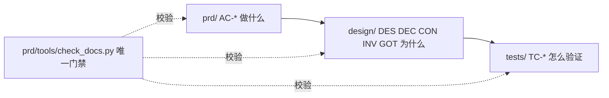

# 智算平台 · SDD（Spec-Driven Development）— 唯一入口

> **人与 AI coding 工具都从这里开始。** 本文回答「读什么、改哪里、跑什么」。
> 章节顺序、ID 语法、字段规则**不在本文重复**，都链到各自的正文，避免两处漂移。
>
> 平台由两个仓库组成：前端 [`console`](https://codeup.aliyun.com/5ff9e1c4168c689c9272ccdb/kube-ai-hub/console)（KubeSphere Console 3.4.2，React 18），后端 `kube-server`（ks-apiserver，Go）。**本目录的 prd/design/tests 是产品级的**，同时覆盖两边；design 里的「仓库落点」一节说明每个功能点改哪个仓库的哪些文件。

---

## 0. 一句话分工

| 文档 | 回答 | 正文 |
|------|------|------|
| 需求 `prd/` | **做什么**、验收是什么（`AC-*`） | [`../prd/README.md`](../prd/README.md) |
| 技术方案 `design/` | **为什么这么实现**（`DES`/`DEC`/`CON`/`INV`/`GOT`） | [`../design/README.md`](../design/README.md) |
| 用例 `tests/` | **怎么验证**（`TC-*`） | [`../tests/README.md`](../tests/README.md) |
| 架构铁律 | 不可违反的约束 C1–C5 与「UI 与交互设计原则」 | [`constitution.md`](constitution.md) |

三份文档用同一套后缀 ID 互相钉住：



---

## 目录与文件

| 路径 | 功能 |
|------|------|
| `docs/SDD.md` | **本文件**。唯一入口 |
| `docs/constitution.md` | 架构铁律 C1–C5：接口、生成物、主题 token、指标白名单、契约版本；文末附 UI 与交互设计原则 |
| `prd/README.md` | 需求怎么写：L1–L3 章节序、ID 规则、自检 |
| `prd/catalog.yaml` | 功能树索引。**生成物，不要手改** |
| `prd/tools/tree.py` | 功能树的源。新增模块 / 子模块 / 功能点只改这里 |
| `prd/tools/build_prd.py` | 按 `tree.py` 重写 catalog，并**只补缺失**的需求稿、技术方案稿、L1/L2 用例桩 |
| `prd/tools/check_docs.py` | **唯一门禁**：三向追溯 + 章节 + 结构 + 套话扫描 |
| `prd/templates/` | L1/L2/L3 需求模板，复制后要改什么见 [`prd/templates/README.md`](../prd/templates/README.md) |
| `design/README.md` | 技术方案怎么写 |
| `design/templates/` | L1/L2/L3 技术方案模板，复制后要改什么见 [`design/templates/README.md`](../design/templates/README.md) |
| `tests/README.md` | 三级套件与追溯规则 |
| `tests/ui/README.md` | 怎么装、怎么跑、选择器约定 |
| `tests/ui/SPEC-SCHEMA.md` | 用例 YAML 的字段：`covers`、`story`、`suite` |
| `tests/ui/_templates/case.yaml` | 用例规格模板，复制到 `specs/{模块}/{子}/` 后填写；说明见 [`tests/ui/_templates/README.md`](../tests/ui/_templates/README.md) |
| `tests/ui/specs/{模块}/{子}/TC-*.yaml` | **用例事实源**。人维护 |
| `tests/ui/cases/{模块}/{子}/TC-*.md` | 由规格生成的可读用例。**不要手改** |
| `tests/ui/cases/_traceability.md` | 生成的四向矩阵（AC → 用例 → 技术方案 → 测试文件） |
| `tests/ui/generate_case_docs.py` | 读 `specs/`，写出 `cases/` 与 `_traceability.md` |
| `tests/ui/tests/{模块}/{子}/test_TC_*.py` | Playwright 自动化。**一 spec 一文件，路径镜像 `specs/`** |
| `tests/ui/pages/` | 页面对象。选择器放这里，不写进规格 |
| `tests/ui/helpers/` | 登录、对比度审计、i18n 断言、接口客户端 |
| `tests/ui/artifacts/` | 跑测试时的截图和日志。不是事实源 |
| `prd/tools/test_index.py` | spec ↔ 测试文件的路径映射，门禁与矩阵共用 |
| `bugs/` | 缺陷档案。修复后要回写 `tests/`，不是第二套需求 |

一条功能点在三棵树上的对应关系：

```text
prd/cluster-storage/shared-storage/quota.md
design/cluster-storage/shared-storage/quota.md
tests/ui/specs/cluster-storage/shared-storage/TC-L3-CLUSTER-STORAGE-SHARED_STORAGE-QUOTA-01.yaml
tests/ui/cases/cluster-storage/shared-storage/TC-L3-CLUSTER-STORAGE-SHARED_STORAGE-QUOTA-01.md   # 生成物
```

---

## 1. 选 track

| Track | 什么时候 | 做什么 |
|------|----------|--------|
| **Hotfix / trivial** | 改 bug、文案、依赖；≲1 个文件；**不动对外契约** | 直接改 → 跑相关测试 → 收敛门禁 → MR |
| **Small feature** | 单模块、无跨模块契约 | 只补对应 **L3** 的需求 + 技术方案 + 用例 |
| **Full SDD** | 新能力、跨模块、新增或变更契约、触碰宪法 | 补 L1–L3 三类文档；需求先行、技术方案承接、用例覆盖 |

判断口诀：**要改别人依赖的契约、要动 C1–C5、要动页面结构 / 交互 / 主题色或指标口径，就是 Full SDD。**

---

## 2. 能力级闭环（改一个功能点）

```
tree.py → build_prd.py → prd(AC) → design(承接 AC) → tests(covers) → 测试文件（路径镜像 spec） → check_docs → generate_case_docs
```

1. **改功能树**（结构变了才做）：编辑 [`../prd/tools/tree.py`](../prd/tools/tree.py)。
2. **补缺失文件**：
   ```bash
   cd console
   python3 prd/tools/build_prd.py
   ```
   已有 Markdown 一律不动（`--force-prd` / `--force-design` 才会覆盖，会毁掉手写内容）。
3. **写需求** `prd/<模块>/<子>/<功能>.md`：按模板补 `用户故事 / 验收场景（AC-*）/ 设计目标 / 约束与边界 / UI 交互设计 / 功能需求 / 成功标准 / 明确不做 / 假设`。
4. **写技术方案** `design/<模块>/<子>/<功能>.md`：删掉「待迁移」标记行，在 `## 关联需求` 列出该功能点需求里的**全部** `AC-*`。决策要写「为什么 + 被否方案 + 何时重新考虑」，坑要写「不知道会怎样」。
5. **写用例** `tests/ui/specs/<模块>/<子>/<TC>.yaml`：`covers` 指回 `AC-*`，`story` 指回 `US<n>`。
6. **写测试** `tests/ui/tests/<模块>/<子>/test_<TC，连字符换下划线>.py`：一个文件一个测试函数，docstring 首行是 `TC-*` 字面 ID。不写测试 = 门禁失败。
7. **收敛门禁**：
   ```bash
   python3 prd/tools/check_docs.py                       # 全部；未迁移只告警
   python3 prd/tools/check_docs.py --strict              # 告警也失败
   python3 prd/tools/check_docs.py --strict prd/cluster-storage design/cluster-storage
   ```
8. **重生成用例文档与三向矩阵**：
   ```bash
   cd tests/ui && python3 generate_case_docs.py
   ```

### 用户故事怎么钉到用例

需求里的每条 `### US<n>` 都要能被单独验证，用例 YAML 用 `story` 指回去。一旦该需求写了 `AC-*`，门禁要求**每条 US 至少被一条用例引用**。

### 用例怎么钉到测试（一 spec 一文件）

用例 YAML 只是规格，真正的终点是**会跑的测试文件**。对应关系由路径决定，不靠命名约定：

```text
tests/ui/specs/cluster-storage/shared-storage/TC-L3-...-QUOTA-01.yaml
tests/ui/tests/cluster-storage/shared-storage/test_TC_L3_..._QUOTA_01.py
```

1. **目录镜像**：`specs/{模块}/{子}/` ↔ `tests/{模块}/{子}/`。`core/`、`flow/` 是套件目录，原样镜像。
2. **文件名镜像**：`TC-<...>.yaml` ↔ `test_<同名，连字符换下划线>.py`。
3. **一个文件只放一个测试函数**，函数名与文件名一致，docstring 首行是字面 ID：

```python
@pytest.mark.point
def test_TC_L3_CLUSTER_STORAGE_SHARED_STORAGE_QUOTA_02(storage_page, screenshot):
    """TC-L3-CLUSTER-STORAGE-SHARED_STORAGE-QUOTA-02 配额弹窗：初始值、下限校验、取消不变、提交生效。"""
```

`check_docs.py --what tests` 会核对：期望的测试文件是否存在、文件里是否恰好一个测试函数且 docstring 声明了该 ID、`tests/` 下有没有对不上任何 spec 的孤儿文件、`suite` 与 `@pytest.mark.*` 是否一致。缺一条就是 `ERROR`。

### 流程用例（`TC-FLOW-*`）

`point` 用例只压一个控件。一条用户故事的 `Independent Test` 往往要跨页面走完，这时加一条流程用例：`suite: flow`，位置 `tests/ui/specs/<模块>/flow/TC-FLOW-*.yaml`，标记 `@pytest.mark.full`。

---

## 3. ID 规则速查

| 类型 | 形态 | 例（对应用例 `TC-L3-CLUSTER-STORAGE-SHARED_STORAGE-QUOTA-01`） |
|------|------|--------------------------------------------------|
| 需求侧 | `AC`/`FR`/`SC-<用例 ID 去掉 TC->` | `AC-L3-CLUSTER-STORAGE-SHARED_STORAGE-QUOTA-01` |
| 技术方案文档 | `DES-<同上>` | `DES-L3-CLUSTER-STORAGE-SHARED_STORAGE-QUOTA` |
| 设计决策 / 对外契约 / 不变量 / 已知坑 | `DEC`/`CON`/`INV`/`GOT-<同上>-<NN>` | `DEC-L3-CLUSTER-STORAGE-SHARED_STORAGE-QUOTA-01` |

**编号由用例 ID 前缀替换推导**，不要手工造。用例 ID **含下划线**（`SHARED_STORAGE`），推导时不能 slugify。

---

## 4. 一个事实只有一个家

| 事实 | 唯一正文 |
|------|----------|
| 架构铁律 C1–C5 与「UI 与交互设计原则」 | [`constitution.md`](constitution.md) |
| 接口契约与错误码 | `kube-server/pkg/kapis/<group>` 的 `register.go` + design 的 `CON-*` |
| 主题色与间距 | `console/src/scss/variables.scss`（design 只引用 token 名） |
| 指标名与单位 | `kube-server/pkg/models/monitoring/named_metrics.go` + `prometheus/promql.go` |
| **能力级 durable 技术方案** | **[`../design/`](../design/)** |

写新文档前先确认：这个事实是不是已经有家了？有就**链接**，不要复制。

---

## 5. 命令速查

| 命令 | 作用 |
|------|------|
| `python3 prd/tools/build_prd.py [--force-prd] [--force-design]` | 同步 catalog + 补缺失稿 |
| `python3 prd/tools/check_docs.py [--strict] [--what prd\|design\|tests\|structure] [范围]` | **唯一门禁** |
| `cd tests/ui && python3 generate_case_docs.py` | 生成 `cases/**` 与三向 `_traceability.md` |
| `cd tests/ui && pytest -m core\|full\|point\|ui` | UI 集成测试 |
| `yarn build:client` / `yarn lint` | 前端构建与静态检查 |
| `cd ../kube-server && go test ./pkg/kapis/... ./pkg/models/monitoring/...` | 后端单测 |

---

## 6. 迁移状态约定

- `check_docs.py` 对**尚未迁移**的模块只报 `待迁移` **告警**；`--strict` 下才失败。
- 判定依据：需求带 `## 用户故事` 即视为已迁移；技术方案带「待迁移」标记行即视为未迁移。
- 新增或修改的内容一律**不许留** `[NEEDS CLARIFICATION]`。

---

## 7. 给 AI coding 工具的硬要求

1. **改之前先读**：本文件 → 目标模块的 `prd/` 与 `design/` → [`constitution.md`](constitution.md)。
2. **改完必须收敛**：`python3 prd/tools/check_docs.py --strict` 必须无 `ERROR`；新增功能点必须同时有需求、技术方案、用例、测试文件（一 spec 一文件）。
3. **不许绕门禁**：不要为了过门禁去删章节、删 AC，或把 `covers` 指向不存在的 AC。
4. **UI 改动先过原则再截图**：按 [`constitution.md`](constitution.md) 的「UI 与交互设计原则」核对——一个主任务、一个入口、一套共享组件、点击即反馈、等待可见；再在真实环境截图记录改动前后，对比度、单位、空态逐项核对（见 `.cursor/rules/ui-screenshot-verify.mdc`）。
5. **改了产品代码要跑测试**：前端 `pytest -m point`（相关用例）；后端 `go test`。
