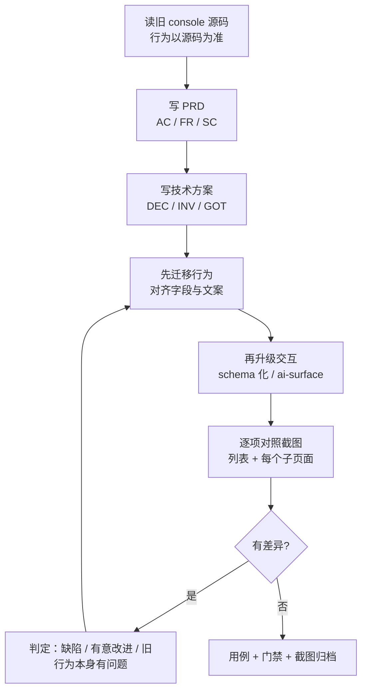

# 老 console UI 迁移指导

> 依据：配置字典（ConfigMaps）完整迁移过程与后续三轮修复。
> 目标：迁移后 **功能不缺失、体验不降级**，且新 UI 确实更好用——不是把旧交互原样搬过来。

## 0. 这份文档为什么存在

配置字典是第一个迁移完整 CRUD 的资源模块。过程中暴露的问题有明显规律：**大多数缺陷不是"写错了"，而是"照搬了旧做法"或"凭想象实现"**。下面按阶段给出可执行的流程，以及每一步真实踩过的坑。

## 1. 总流程



**关键顺序**：先把行为对齐，再升级交互。反过来做，一旦体验出问题就分不清是"迁移漏了"还是"升级改坏了"。

## 2. 阶段一：以源码为准，不以截图为准

### 2.1 读源码，不靠肉眼观察页面

配置字典的差异清单全部来自 `console/src/pages/{clusters,projects}/containers/ConfigMaps/index.jsx` 与 `components/Forms/ConfigMap/`，而不是看页面截图推断。

实测过的反面教训：

- **直接 `goto` 资源页会被 SPA 弹回别的页面**，看起来像"路由坏了"，实际是应用只认自己的导航方式。必须从 shell 内点进去，或复用登录后的 `localStorage`。
- **截图和 DOM 对不上**：旧 console 有懒加载与双渲染，`querySelector` 可能取到旧节点。判定数据以一次成功加载后的快照为准，不以后续空表为准。
- **项目选择器的默认值靠截图猜不出来**：`全部项目` + 长列表来自集群级页面，项目级页面里根本没有这一列。看源码才知道两个页面的 `getColumns()` 是两份。

### 2.2 把"字段"逐条列成表

需要逐项确认的最小集合：

| 维度 | 要确认的内容 |
|---|---|
| 列 | 有哪些列、顺序、哪些可排序、窄屏隐藏哪些 |
| 值格式 | 字段拼接符、时间格式、空值占位符 |
| 名称渲染 | 别名**替换**名称还是**追加**（配置字典是替换） |
| 行操作 | 有几项、顺序（用户肌肉记忆依赖顺序） |
| 分页 | 参数名、每页档位、总数来源 |
| 创建 | 步骤数、每步字段、校验规则与文案 |
| 编辑 | 信息 / 设置 / YAML 各是独立弹窗还是合并 |
| 删除 | 单条与批量的确认方式是否不同 |
| 详情 | 属性区四项、数据分区渲染方式 |

**配置字典实际查出的差异**（迁移后才发现，全部是真实缺陷）：

1. 字段分隔：旧 `join(',')`，新 `join(', ')` —— 多一个空格
2. 创建时间：用了 `Intl.DateTimeFormat` 的 `dateStyle`，中文渲染成 `2026/11/10 04:16`，旧版是 `YYYY-MM-DD HH:mm:ss`
3. 名称列：旧版别名**替换**名称（`getDisplayName`），新版拼成 `name (alias)`
4. 行操作顺序：旧 `编辑信息 → 编辑 YAML → 编辑设置 → 删除`

第 2 条还有个隐蔽后果：列表和详情各自实现了一份时间格式化，细节不同。**同一份展示逻辑只写一次**，抽到 `format.ts`。

## 3. 阶段二：判断"该不该照搬"

迁移不等于复制。每遇到一处旧行为，先分类：

| 类别 | 判定标准 | 处理 |
|---|---|---|
| **必须照搬** | 用户肌肉记忆、后端契约、文案含义 | 逐字对齐 |
| **应当改进** | 旧实现有明显缺陷，改进有明确收益 | 改，并写进 DEC |
| **不该迁移** | 旧实现是无意义的历史包袱 | 去掉，并说明理由 |

配置字典里的实例：

**应当改进 —— 密码加密**
旧 console 提交前对密码做 `mix(salt, base64(pw))`，服务端再解回来。salt 是公开常量、变换完全可逆，不提供任何保密性；而它会让含 `@` 的密码产生非法密文——这是线上真实故障。实测集群 `/oauth/token` 接受明文。**结论：不迁移，写进 DEC。**

**应当改进 —— 键列换行**
早先实现用 `wrap: true` 多行展示，认为"截断会回答错误的问题"。实测发现自动生成的 ConfigMap 有几十个键时，那一行高度是其他行的数倍，整张表滚动时行高来回跳，**比少看几个键更难用**。改为 50 字符截断 + `title` 悬停 + 详情页看全量。**结论：改进，并推翻自己之前的判断**（DEC-LIST-05）。

> 推翻旧决策时，不要删掉旧理由——补一句"被否方案"和"为什么当时判断错了"，否则下一个人会再推翻一次。

**不该迁移 —— 每页档位**
旧 console 有 `10/20/50/100`，新 UI 固定 10。原因：多一档就多一组没被验证的组合。这是**有意识的取舍**，不是遗漏——必须写进 PRD 的"明确不做"，否则复核时会被当成缺陷。

## 4. 阶段三：交互升级

行为对齐后再做升级，配置字典验证过的做法：

### 4.1 列表用 schema 描述，不写页面骨架

列是数据（`columns: [...]`），不是 JSX 结构。新增一种资源 = 一份列定义 + 一个查询。抽公共抽象要等到**第二个使用者出现**（DEC-LIST-02 明确被否了提前抽象）。

### 4.2 每个交互有稳定句柄

`data-ai-id`（动作，如 `configmaps:create`）、`data-ai-row`（行）、`data-ai-state`（区域状态四态）。不是 `data-testid`——它同时服务于自动化用例和智能体。

只覆盖到的坑：**`actionProps` 的展开顺序必须在 `onClick` 之后**，否则会覆盖业务 handler。

### 4.3 状态四态，失败有出口

`loading / ready / empty / error`。错误页必须给重试；权限错误（403）**不给**重试——重试一个 403 永远失败。

### 4.4 移动端是断点决策，不是"能滚动"

`100vh` 在移动端地址栏收起时会跳变，用 `100dvh`；横滑容器要 `overscroll-x-contain`，否则滑到边缘触发浏览器返回手势把页面划走。

## 5. 阶段四：逐项对照，包括每个子页面

**只截列表页是不够的**。配置字典的四个差异里有两个只在列表页可见，但如果跳过子页面，创建/编辑/删除的差异会一直留到用户那里。

每个子页面至少核对：

- **创建**：步骤条、字段顺序、校验触发时机、必填标识、YAML 模式入口位置
- **编辑信息**：名称是否只读、可改字段、保存后的刷新
- **编辑设置**：键值增删改、子表单打开时主提交是否禁用
- **编辑 YAML**：初始文档、名称锁定、上传下载按钮
- **删除**：单条与批量确认文案是否不同
- **详情**：属性区、数据分区、行内操作是否与列表一致

截图必须**用标准桌面视口**（如 1600×900）。曾因浏览器残留 610×605 的设备模拟尺寸，截图看起来被压扁，浪费了一轮排查。

## 6. 阶段五：用测试锁住

三层，缺一不可：

| 层 | 作用 | 例子 |
|---|---|---|
| 单测 | 纯逻辑、映射、状态机 | 键列截断到 53 字符、时间格式 |
| 契约测试 | 架构约束，防止回退 | 不允许裸 `<button>`、Modal 必须居中 |
| 端到端 | 真实集群上的完整链路 | 创建到所选项目、退出后 token 失效 |

**最有价值的是"契约测试"**：它读源码断言约定，能抓住"改回去也没人发现"的问题。例如 `modal-centering.test.ts` 断言关键帧里不能出现 `translate`——这类 bug 编译通过、类型正确、肉眼也难发现。

端到端用例**必须能在失败时自清理**，否则残留对象会让下一次跑挂掉（曾因此误判）。

## 7. 怎么调试和测试 UI 交互

> 这一节讲「怎么把页面跑起来、怎么点、怎么断言」，与第 6 节的分层对应：第 6 节说该测什么，这里说具体怎么测。

### 7.1 三层环境，各自能证明什么

| 环境 | 怎么起 | 能证明 | **不能**证明 |
|---|---|---|---|
| Storybook | `cd console/packages/ai-kit && pnpm storybook`（默认 6106） | 组件在深浅色、两种色调下的样子；键盘与焦点态 | 真实数据、真实路由、真实权限 |
| 本地全栈 | `scripts/dev-stack.sh start`（5174） | 登录 → 列表 → 子页面的完整链路，请求真的到了 apiserver | 部署环境的行为（ingress、TLS、集群策略） |
| 部署环境 | A100 `https://agentplatform.phanthy.com`、B200 `http://sgb000.tail94228b.ts.net` | 用户真正看到的东西 | —— |

规则：**组件问题在 Storybook 定位，交互问题在本地全栈定位，最终结论必须在部署环境复核**。只跑通本地就说「完成」最常见的后果，是 ingress 的路径前缀或 TLS 行为不一样。

### 7.2 起本地全栈

```bash
cd console/kube-frontend
KS_API_URL=https://agentplatform.phanthy.com KS_API_MODE=kapis ./scripts/dev-stack.sh start
./scripts/dev-stack.sh status    # 三个端口各自在不在，BFF 的 list 探针返回什么
./scripts/dev-stack.sh stop
```

- 三个进程：`kubectl proxy`（仅 `kube` 模式）→ BFF（8091）→ 静态站点（5174，把 `/api`、`/kapis`、`/apis` 转给 BFF）。
- `KS_API_MODE=kube` 是**无鉴权的临时 harness**，用本机 `kubectl` 凭据，分页与排序由 BFF 模拟。它只用来在没有 JWT 时看页面，任何「接口对不对」的结论都不能从这里得出。
- `kapis` 模式需要可用的 `ks-apiserver` 地址；`KS_API_INSECURE=1` 用于自签证书。
- `dev-stack.sh start` 会先构建 ai-kit 与 console-next 再起服务；改了 `packages/` 里的东西重新 `start`。只想改页面、要 HMR 时用 `pnpm dev`，但要另外 `pnpm bff`——Vite 把 `/api` 代理到 `BFF_URL`（默认 `http://127.0.0.1:8091`），BFF 默认端口却是 8080；两者对不上时所有请求都会 504，看起来像"页面加载不出来"。

### 7.3 用户登录：怎么登、怎么绕过、登不上怎么查

登录是调试其它一切的前提，也是唯一一条浏览器不接触 `client_secret` 的链路：

```text
浏览器 /login  ──POST /api/session/login {username, password}──▶  BFF
BFF 注入 client_id / client_secret ──POST /oauth/token──▶ ks-apiserver
BFF 返回 {token, user} ──▶ 浏览器写入 localStorage['kubesphere-token']
```

**手工登录**：打开 `/login`，输账号密码。密码**按原样发送**，不做旧的 `mix(salt, base64(pw))` 变换——旧变换不仅不保密，还让含 `@` 的密码解不回来。

**验证会话的三个接口**：

```bash
# 登录（成功 200 返回 {token, user}；密码错 400 invalid_credentials）
curl -s -X POST -H 'Content-Type: application/json' \
  -d '{"username":"admin","password":"……"}' http://127.0.0.1:8091/api/session/login

# 当前用户：会向上游再查一次用户，token 被吊销时返回 401，不是 200
curl -s -o /dev/null -w '%{http_code}\n' -H "Authorization: Bearer $TOKEN" \
  http://127.0.0.1:8091/api/session/me

# 退出：总是 204，上游失败也不报错
curl -s -o /dev/null -w '%{http_code}\n' -X POST -H "Authorization: Bearer $TOKEN" \
  http://127.0.0.1:8091/api/session/logout
```

**跳过登录页手工塞 token**（只用于调试，不进用例）：

```js
// 浏览器控制台，必须先在一个有 origin 的页面上执行
localStorage.setItem('kubesphere-token', localStorage.getItem('kah_token'))
```

旧 console 的 `kah_token` 可以直接复用；新 console 只认 `kubesphere-token`。**别的键名都不生效**——这是「明明登录了，刷新又回登录页」的头号原因。

**登录失败的排查顺序**（错误码由 BFF 归一，可以直接对照）：

| 页面文案 | BFF 返回 | 真正的原因 |
|---|---|---|
| 用户名或密码不正确 | `400 invalid_credentials` | 账号密码错，或该账号还没初始化 |
| 控制台的登录凭据未配置正确 | `400/invalid_client` | `KS_OAUTH_CLIENT_ID` / `KS_OAUTH_CLIENT_SECRET` 与该集群注册的客户端不一致 |
| 无法连接集群 | `502 upstream_unreachable` | `KS_API_URL` 不通，或 TLS 证书校验失败（试 `KS_API_INSECURE=1`） |
| 失败次数过多 | `400 too_many_attempts` | 触发上游限流，换账号或等窗口过去 |

排查时**先直接打 `/oauth/token`**，这样能立刻分清是集群不认这组凭据，还是 BFF 没把请求发出去：

```bash
curl -s -X POST \
  -d 'grant_type=password&username=admin&password=……&client_id=kubesphere&client_secret=kubesphere' \
  https://<ks-apiserver>/oauth/token
```

默认客户端的值来自旧 console 的 `server/config.yaml`；本集群实际注册的是 `kube-ai-hub` / `kube-ai-hub`，所以一处能登、另一处报 `invalid_client` 时先怀疑这里，不要怀疑密码。

**几个实测过的陷阱**：

- 未登录访问深链接会跳到 `/login?redirect=<原地址>`，登录后回到原页面。`redirect` 只接受同源绝对路径（`//host`、`/\host` 一律拒绝），调试时别拿它当任意跳转用。
- 账号 `initialized === false` 时 token 是有效的，但之后每个请求都 403。这个分支故意停在登录页并提示，而不是"登进去看一片 403"。
- 有一个**过期但结构完整**的 token 时，页面看起来已登录、`/api/session/me` 却返回 401。此时 AuthProvider 会清掉 token 回登录页，不会让页面停在"每个请求都失败"的状态。

### 7.4 在浏览器里调试交互

**先看状态，再看界面**。每个页面区域都带 `data-ai-state`（`loading` / `ready` / `empty` / `error`），交互有没有真的发生，看它比看截图快：

```js
document.querySelector('[data-ai-id="configmaps:surface"]').dataset.aiState
```

- `data-ai-id` 同时服务自动化和智能体，是稳定的；`css-*` 哈希类名每次构建都变，不要拿来选择。
- 请求链路直接看 Network 里 `/kapis/...` 与 `/api/v1/...` 的往返；BFF 不做字段映射，看到什么就是 apiserver 返回什么。
- 深浅色与色调在 `document.documentElement` 上是 `data-theme` / `data-accent`，配合 `localStorage` 的 `ai-kit-theme` / `ai-kit-accent` 复现某个主题状态。
- 改了用户可见的东西，按 `.cursor/rules/ui-screenshot-verify.mdc` 在**真实环境**留改前/改后截图，用 `getBoundingClientRect()` 量对齐，不要靠肉眼判断"差不多"。

### 7.5 单测与契约测试

```bash
cd console/kube-frontend
pnpm typecheck        # 全量；ai-kit 用自己的 tsc，别用全局旧版
pnpm test             # config/ 架构约束 + 各包单测
```

- 架构约束在 `config/`：包边界、`data-ai-id` 契约、依赖方向。它们读源码断言约定，是防"改回去也没人发现"的那一层。
- 组件行为在 `apps/console-next/test/`：登录错误文案、主题切换不闪、焦点环只有一圈等。
- 断言要落在**可观察的结果**上（文案、`data-ai-state`、`localStorage`），不要断言某个组件内部 state 或某个 `css-*` 类名。

### 7.6 端到端：Playwright 用例

```bash
cd console/tests/ui
cp env.example .env        # 填 KA_BASE_URL / KA_PASSWORD
pytest -m core -q          # L1 冒烟，先保证能登进去
pytest -m point tests/kube-frontend/login tests/kube-frontend/configmaps -q
```

用例结构（详见该目录 `README.md`）：`specs/` 是事实源，`cases/` 是生成物，`tests/` 是按 spec 一比一镜像的编排，选择器只写在 `pages/`。

**登录相关的既有夹具**，不要自己重写一遍：

- `logged_in_context`（session 级）：真登一次拿 token，再通过 `add_init_script` 注入 `kubesphere-token`、`kah_token`、`token` 三个键，之后每个 `page` 都是已登录的。
- `anonymous_page`：**没有** token，登录/退出用例专用。用已登录的 `page` 测登录，测的是"已登录的人看登录页"，那是另一件事。
- `login_page`：页面对象，`sign_in()` / `sign_out()` / `field_errors` 都已封装。
- `seeded_configmaps`：造出用例需要的对象，**失败也清理**。没有这个夹具的用例只在"集群碰巧有这些对象"时通过。

**断言登录成功的正确写法**（来自 `test_TC_L2_KUBE_FRONTEND_LOGIN_01`）：等 URL 落到目标页 → 等 `data-ai-state` 离开 `loading` → 再断言 `localStorage` 里有 token。只等 URL 会拿到还在加载的页面，只等 localStorage 会拿到 `beforeLoad` 跳转前的瞬间。

**失败时先看三样**：用例里主动调用 `screenshot(page, "…")` 留在 `artifacts/<test>/` 的图（失败时不会自动截图，要留证据就在断言前后各拍一张）、Playwright trace，以及 BFF 的 `.dev-stack-bff.log`。用例失败不一定是页面的问题——集群里残留对象、token 过期、上游 5xx 都会表现成同一个"断言没过"。

## 8. 高频坑清单

按踩过的频率排序，迁新资源时逐条对照：

| # | 坑 | 现象 | 处置 |
|---|---|---|---|
| 1 | 颜色 token 是**通道值** | 颜色"没生效"，编译测试全过 | 必须 `rgb(var(--x))`，裸 `var()` 静默回退 |
| 2 | 模态框位移写两处 | 弹窗从左上角飞入 | 位移交给 `translate`，关键帧只动 `transform` 的 scale |
| 3 | kapis 的 resources 端点只注册 GET | 写操作 405 | 读走 `/kapis`，写走 `/api/v1` |
| 4 | 主操作回调的 `row` 是 `undefined` | 创建按钮点了没反应 | 先判 `action === 'create'`，再判 `row` |
| 5 | 父路由无条件渲染列表 | 详情页显示成列表，无报错 | 父路由按 pathname 分流到 `<Outlet />` |
| 6 | 删除后只改本地缓存 | 总数与分页错位 | `invalidateQueries` 重新拉取 |
| 7 | 搜索防抖与页码重置不同步 | 一次操作发两次请求 | 防抖后的值同时驱动请求与页码 |
| 8 | 开发 harness 与真实 kapis 行为不同 | 分页"失效" | 判定以真实 apiserver 为准，harness 只用于无 token 时看页面 |
| 9 | 列表和详情各写一份格式化 | 同一字段两处显示不同 | 抽共享模块 |
| 10 | `tsconfig` 的 `lib` 不同 | BFF 不能 import 浏览器包 | 服务端与浏览器共用逻辑要选无 DOM 依赖的落点 |

## 9. 文档与门禁

三类文档同后缀互相钉住，改功能时同步：

- `prd/`：`AC-*` 验收场景
- `design/`：`DEC-*` 决策、`INV-*` 不变量、`GOT-*` 已知坑
- `tests/ui/specs/`：`TC-*`，`covers` 指向 AC

**每条 AC 都要有用例覆盖、有方案承接**，由 `check_docs.py --strict` 把关。

> 门禁**不检查编号重复**。过程中同一文件里出现过 4 组重复的 `DEC` 编号（新决策插在文件顶部撞了号），门禁全绿。迁移时新增决策请追加到文件末尾并按现有最大号续编。

## 10. 交付前自检

- [ ] 列表列、值格式、行操作顺序与旧版逐项对照过
- [ ] 每个子页面都单独截图核对过（创建/编辑信息/编辑设置/编辑 YAML/删除/详情）
- [ ] 与旧版的每处差异都能说出属于"照搬/改进/不迁移"哪一类，且写进文档
- [ ] 推翻过自己先前的判断的，补了"被否方案"和原因
- [ ] 截图使用标准桌面视口
- [ ] 端到端用例失败时也会清理测试数据
- [ ] 登录链路自己走通过一次：手工登录、深链接回到原页、退出后 token 失效（第 7.3/7.6 节）
- [ ] `typecheck` / 单测 / 契约测试 / `check_docs --strict` 全绿
- [ ] 测试数据已清理，环境回到基线
