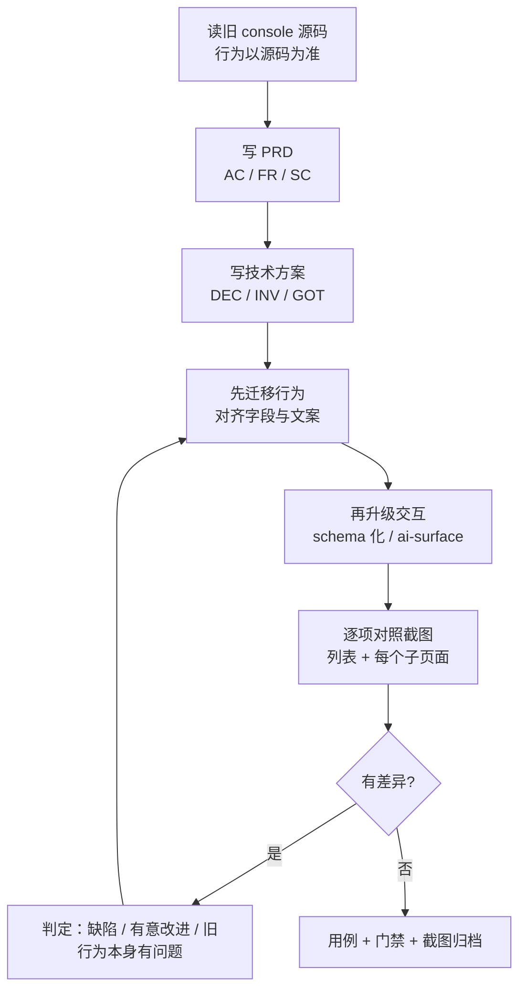

# 老 console UI 迁移指导

> 依据：配置字典（ConfigMaps）完整迁移过程与后续三轮修复。
> 目标：迁移后 **功能不缺失、体验不降级**，且新 UI 确实更好用——不是把旧交互原样搬过来。

## 0. 这份文档为什么存在

配置字典是第一个迁移完整 CRUD 的资源模块。过程中暴露的问题有明显规律：**大多数缺陷不是"写错了"，而是"照搬了旧做法"或"凭想象实现"**。下面按阶段给出可执行的流程，以及每一步真实踩过的坑。

## 1. 总流程

**关键顺序**：先把行为对齐，再升级交互。反过来做，一旦体验出问题就分不清是"迁移漏了"还是"升级改坏了"。

## 2. 阶段一：以源码为准，不以截图为准

### 2.1 读源码，不靠肉眼观察页面

配置字典的差异清单全部来自 `console/src/pages/{clusters,projects}/containers/ConfigMaps/index.jsx` 与 `components/Forms/ConfigMap/`，而不是看页面截图推断。

实测过的反面教训：

- **直接 `goto` 资源页会被 SPA 弹回别的页面**，看起来像"路由坏了"，实际是应用只认自己的导航方式。必须从 shell 内点进去，或复用登录后的 `localStorage`。
- **截图和 DOM 对不上**：旧 console 有懒加载与双渲染，`querySelector` 可能取到旧节点。判定数据以一次成功加载后的快照为准，不以后续空表为准。
- **项目选择器的默认值靠截图猜不出来**：`全部项目` + 长列表来自集群级页面，项目级页面里根本没有这一列。看源码才知道两个页面的 `getColumns()` 是两份。

### 2.2 把"字段"逐条列成表

需要逐项确认的最小集合：

| 维度 | 要确认的内容 |
|---|---|
| 列 | 有哪些列、顺序、哪些可排序、窄屏隐藏哪些 |
| 值格式 | 字段拼接符、时间格式、空值占位符 |
| 名称渲染 | 别名**替换**名称还是**追加**（配置字典是替换） |
| 行操作 | 有几项、顺序（用户肌肉记忆依赖顺序） |
| 分页 | 参数名、每页档位、总数来源 |
| 创建 | 步骤数、每步字段、校验规则与文案 |
| 编辑 | 信息 / 设置 / YAML 各是独立弹窗还是合并 |
| 删除 | 单条与批量的确认方式是否不同 |
| 详情 | 属性区四项、数据分区渲染方式 |

**配置字典实际查出的差异**（迁移后才发现，全部是真实缺陷）：

1. 字段分隔：旧 `join(',')`，新 `join(', ')` —— 多一个空格
2. 创建时间：用了 `Intl.DateTimeFormat` 的 `dateStyle`，中文渲染成 `2026/11/10 04:16`，旧版是 `YYYY-MM-DD HH:mm:ss`
3. 名称列：旧版别名**替换**名称（`getDisplayName`），新版拼成 `name (alias)`
4. 行操作顺序：旧 `编辑信息 → 编辑 YAML → 编辑设置 → 删除`

第 2 条还有个隐蔽后果：列表和详情各自实现了一份时间格式化，细节不同。**同一份展示逻辑只写一次**，抽到 `format.ts`。

## 3. 阶段二：判断"该不该照搬"

迁移不等于复制。每遇到一处旧行为，先分类：

| 类别 | 判定标准 | 处理 |
|---|---|---|
| **必须照搬** | 用户肌肉记忆、后端契约、文案含义 | 逐字对齐 |
| **应当改进** | 旧实现有明显缺陷，改进有明确收益 | 改，并写进 DEC |
| **不该迁移** | 旧实现是无意义的历史包袱 | 去掉，并说明理由 |

配置字典里的实例：

**应当改进 —— 密码加密**
旧 console 提交前对密码做 `mix(salt, base64(pw))`，服务端再解回来。salt 是公开常量、变换完全可逆，不提供任何保密性；而它会让含 `@` 的密码产生非法密文——这是线上真实故障。实测集群 `/oauth/token` 接受明文。**结论：不迁移，写进 DEC。**

**应当改进 —— 键列换行**
早先实现用 `wrap: true` 多行展示，认为"截断会回答错误的问题"。实测发现自动生成的 ConfigMap 有几十个键时，那一行高度是其他行的数倍，整张表滚动时行高来回跳，**比少看几个键更难用**。改为 50 字符截断 + `title` 悬停 + 详情页看全量。**结论：改进，并推翻自己之前的判断**（DEC-LIST-05）。

> 推翻旧决策时，不要删掉旧理由——补一句"被否方案"和"为什么当时判断错了"，否则下一个人会再推翻一次。

**不该迁移 —— 每页档位**
旧 console 有 `10/20/50/100`，新 UI 固定 10。原因：多一档就多一组没被验证的组合。这是**有意识的取舍**，不是遗漏——必须写进 PRD 的"明确不做"，否则复核时会被当成缺陷。

## 4. 阶段三：交互升级

行为对齐后再做升级，配置字典验证过的做法：

### 4.1 列表用 schema 描述，不写页面骨架

列是数据（`columns: [...]`），不是 JSX 结构。新增一种资源 = 一份列定义 + 一个查询。抽公共抽象要等到**第二个使用者出现**（DEC-LIST-02 明确被否了提前抽象）。

### 4.2 每个交互有稳定句柄

`data-ai-id`（动作，如 `configmaps:create`）、`data-ai-row`（行）、`data-ai-state`（区域状态四态）。不是 `data-testid`——它同时服务于自动化用例和智能体。

只覆盖到的坑：**`actionProps` 的展开顺序必须在 `onClick` 之后**，否则会覆盖业务 handler。

### 4.3 状态四态，失败有出口

`loading / ready / empty / error`。错误页必须给重试；权限错误（403）**不给**重试——重试一个 403 永远失败。

### 4.4 移动端是断点决策，不是"能滚动"

`100vh` 在移动端地址栏收起时会跳变，用 `100dvh`；横滑容器要 `overscroll-x-contain`，否则滑到边缘触发浏览器返回手势把页面划走。

## 5. 阶段四：逐项对照，包括每个子页面

**只截列表页是不够的**。配置字典的四个差异里有两个只在列表页可见，但如果跳过子页面，创建/编辑/删除的差异会一直留到用户那里。

每个子页面至少核对：

- **创建**：步骤条、字段顺序、校验触发时机、必填标识、YAML 模式入口位置
- **编辑信息**：名称是否只读、可改字段、保存后的刷新
- **编辑设置**：键值增删改、子表单打开时主提交是否禁用
- **编辑 YAML**：初始文档、名称锁定、上传下载按钮
- **删除**：单条与批量确认文案是否不同
- **详情**：属性区、数据分区、行内操作是否与列表一致

截图必须**用标准桌面视口**（如 1600×900）。曾因浏览器残留 610×605 的设备模拟尺寸，截图看起来被压扁，浪费了一轮排查。

## 6. 阶段五：用测试锁住

三层，缺一不可：

| 层 | 作用 | 例子 |
|---|---|---|
| 单测 | 纯逻辑、映射、状态机 | 键列截断到 53 字符、时间格式 |
| 契约测试 | 架构约束，防止回退 | 不允许裸 `<button>`、Modal 必须居中 |
| 端到端 | 真实集群上的完整链路 | 创建到所选项目、退出后 token 失效 |

**最有价值的是"契约测试"**：它读源码断言约定，能抓住"改回去也没人发现"的问题。例如 `modal-centering.test.ts` 断言关键帧里不能出现 `translate`——这类 bug 编译通过、类型正确、肉眼也难发现。

端到端用例**必须能在失败时自清理**，否则残留对象会让下一次跑挂掉（曾因此误判）。

## 7. 高频坑清单

按踩过的频率排序，迁新资源时逐条对照：

| # | 坑 | 现象 | 处置 |
|---|---|---|---|
| 1 | 颜色 token 是**通道值** | 颜色"没生效"，编译测试全过 | 必须 `rgb(var(--x))`，裸 `var()` 静默回退 |
| 2 | 模态框位移写两处 | 弹窗从左上角飞入 | 位移交给 `translate`，关键帧只动 `transform` 的 scale |
| 3 | kapis 的 resources 端点只注册 GET | 写操作 405 | 读走 `/kapis`，写走 `/api/v1` |
| 4 | 主操作回调的 `row` 是 `undefined` | 创建按钮点了没反应 | 先判 `action === 'create'`，再判 `row` |
| 5 | 父路由无条件渲染列表 | 详情页显示成列表，无报错 | 父路由按 pathname 分流到 `<Outlet />` |
| 6 | 删除后只改本地缓存 | 总数与分页错位 | `invalidateQueries` 重新拉取 |
| 7 | 搜索防抖与页码重置不同步 | 一次操作发两次请求 | 防抖后的值同时驱动请求与页码 |
| 8 | 开发 harness 与真实 kapis 行为不同 | 分页"失效" | 判定以真实 apiserver 为准，harness 只用于无 token 时看页面 |
| 9 | 列表和详情各写一份格式化 | 同一字段两处显示不同 | 抽共享模块 |
| 10 | `tsconfig` 的 `lib` 不同 | BFF 不能 import 浏览器包 | 服务端与浏览器共用逻辑要选无 DOM 依赖的落点 |

## 8. 文档与门禁

三类文档同后缀互相钉住，改功能时同步：

- `prd/`：`AC-*` 验收场景
- `design/`：`DEC-*` 决策、`INV-*` 不变量、`GOT-*` 已知坑
- `tests/ui/specs/`：`TC-*`，`covers` 指向 AC

**每条 AC 都要有用例覆盖、有方案承接**，由 `check_docs.py --strict` 把关。

> 门禁**不检查编号重复**。过程中同一文件里出现过 4 组重复的 `DEC` 编号（新决策插在文件顶部撞了号），门禁全绿。迁移时新增决策请追加到文件末尾并按现有最大号续编。

## 9. 交付前自检

- [ ] 列表列、值格式、行操作顺序与旧版逐项对照过
- [ ] 每个子页面都单独截图核对过（创建/编辑信息/编辑设置/编辑 YAML/删除/详情）
- [ ] 与旧版的每处差异都能说出属于"照搬/改进/不迁移"哪一类，且写进文档
- [ ] 推翻过自己先前的判断的，补了"被否方案"和原因
- [ ] 截图使用标准桌面视口
- [ ] 端到端用例失败时也会清理测试数据
- [ ] `typecheck` / 单测 / 契约测试 / `check_docs --strict` 全绿
- [ ] 测试数据已清理，环境回到基线
