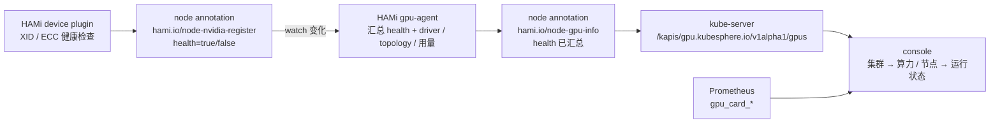

# 集群算力（L1）

## 概述

运维在「集群 → 算力」下核对集群的 GPU 资产。本模块回答一个具体问题：**每张卡现在能不能用**。集群里的 GPU 由 HAMi 调度，一张卡可能因为硬件可纠正错误被 device plugin 摘出可分配池——此时节点的 `nvidia.com/gpu` allocatable 会变小，但卡本身还在、还在上报指标。如果页面只按「卡在不在」来渲染，这类故障就完全看不见：运维会看到 8 行全绿的卡，却只能调度 5 张。

## 用户故事

### US1 - 作为集群运维，从集群菜单进入算力，看到显卡总览与健康比例

**Independent Test**：打开 `/clusters/default/gpus`，页面出现显卡总数、健康显卡比例与按厂商-型号分组的计数；健康数与 `kubectl get node -o json` 里各节点 register annotation 中 `health:true` 的条数之和一致。

## 验收场景

- **AC-CORE-CLUSTER-GPU-01** — Given 已登录且对 `nodes` 有 view 权限，When 打开 `/clusters/default/gpus`，Then 页面标题为「显卡」、显卡列表可见、顶部显示健康显卡比例，且不出现任何未翻译的 key。

## 设计目标

- **健康状态必须来自调度器的判断，而不是页面的猜测。** HAMi 的 device plugin 是唯一决定「这张卡能不能被分配」的角色；gpu-agent 汇总它的结论，页面与接口读汇总结果，不自己用 NVML 或 `nvidia-smi` 再算一遍。两处各算一次，迟早会对不上。
- **故障卡不能从列表里消失。** 被摘出可分配池的卡仍是一张物理卡、仍占着机箱位置、仍需要运维处理。列表必须显示它并标为亚健康，否则「少了几张卡」这件事只能靠人肉数数发现。
- 同一个事实只有一个家：健康状态的**判定**在 device plugin 写的 `hami.io/node-nvidia-register`，**汇总**在 gpu-agent 写的 `hami.io/node-gpu-info`，页面只读后者。

## 约束与边界

- 本模块只读。不在页面里改卡的状态、不重置 GPU、不重启 device plugin。
- 健康状态的**判定**属于 HAMi（XID 事件、ECC、NVML 事件注册）；**汇总**属于 gpu-agent。本模块只**呈现**结论，不复制判定逻辑，也不解析厂商专属注解名。
- 与节点模块的边界：节点页的「运行状态」里的显卡列表（`GpuCardList`）读同一个接口，因此健康语义必须一致；节点页不另算一套。
- 与监控模块的边界：利用率、显存、温度来自 Prometheus；健康状态不来自监控——一张卡可以利用率 0% 且不健康，也可以 100% 且健康。

## UI 交互设计

| 页面 | 路径 | 主区 |
| --- | --- | --- |
| 显卡列表 | `/clusters/:cluster/gpus` | 概览条（总数、健康比例、按型号分组）+ 表格（节点、序号、UUID、状态、型号、NUMA、厂商、模式、vGPU、核心、显存） |
| 节点运行状态 | `/clusters/:cluster/nodes/:node/status` | 显卡列表卡片（序号、UUID、状态、型号、NUMA、厂商、模式、vGPU、核心、显存） |
| 单卡详情 | `/clusters/:cluster/nodes/:node/gpus/:uuid/status` | 侧栏属性里的「状态」 |

三处都按同一份数据渲染状态：`health: true` → 「健康」，`health: false` → 「亚健康」。
## 入口与子模块

- 菜单：集群 → 算力 → 显卡（`clusterNavs` 下的 `gpus`，`authKey: nodes`）。
- 子模块：`gpu-card`（显卡列表），下辖健康状态功能点。

## 状态

- 空态：节点没有 GPU 时列表显示「暂无 GPU」。
- 节点未上报 `node-gpu-info`：该节点不出现在列表里（没有可展示的卡），而不是显示一排「亚健康」。
- 全部健康：概览条健康比例为 100%。
- 有故障卡：故障卡仍列出并标为亚健康，概览比例相应下降。

## 功能需求

- **FR-CORE-CLUSTER-GPU-01** — 系统 MUST 在集群算力入口展示显卡列表与健康比例，且只有具备 `nodes` 查看权限的用户可见。

## 成功标准

- **SC-CORE-CLUSTER-GPU-01** — 从集群总览到显卡列表不超过两次点击；首屏在 3 秒内出现表格。

## 明确不做

- 不在页面里重置 GPU、重启 device plugin、修改 XID 忽略名单。
- 不做卡的分配、绑定、抢占。
- 不做历史健康趋势（只有当前状态）。

## 假设

- 集群使用 HAMi 提供 `nvidia.com/gpu`，device plugin 会写 `hami.io/node-nvidia-register`。
- `gpu-agent` 会监听 register 注解变化，把 driver / 拓扑 / 用量与**汇总后的健康状态**一起写进 `hami.io/node-gpu-info`。

## 验收用例

- `TC-CORE-CLUSTER-GPU-01`
