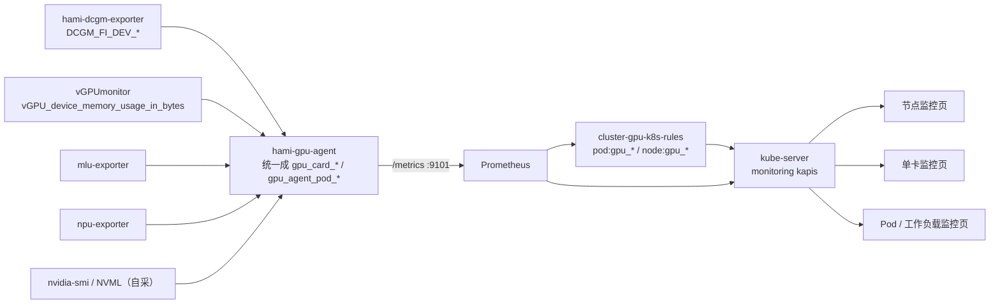

# GPU 监控（L2）

[上级模块](../_index.md)

## 概述

GPU 监控分三个维度：**节点**（这台机器上 GPU 整体用得多满）、**卡**（这一张卡用得多满）、**容器/POD**（这个任务用了多少 GPU）。三个维度的数据来自 gpu-agent 统一输出的 Prometheus 指标，页面只读监控 kapis。

不同厂商、不同虚拟化方式下，指标的**取数来源**不同（DCGM / vGPUmonitor / mlu-exporter / npu-exporter / 自采），有的方式拿不到容器级指标、只能用分配到的卡指标近似。这一层差异由 gpu-agent 消化，页面看到的是同一套指标名。

## 用户故事

### US1 - 作为集群运维，在节点监控页看到这台机器 GPU 的整体利用率与显存

**Independent Test**：打开 `/clusters/default/nodes/sagesuite-demo/monitors`，GPU 相关图表有曲线，节点 GPU 总量等于该节点卡数。

### US2 - 作为集群运维，在单卡详情页看到这一张卡的利用率、显存、功耗、温度

**Independent Test**：从节点显卡列表点进某张卡，Monitoring 页签出现五条曲线（利用率、显存、分配率、功耗、温度），且只反映这一张卡。

### US3 - 作为集群运维，在 Pod 监控页看到这个任务用了多少 GPU

**Independent Test**：打开一个 GPU Pod 的监控页，GPU 显存/分配量非零，且与该 Pod 的 `vgpu-devices-allocated` 注解条数一致。

### US4 - 作为集群运维，理解为什么某种虚拟化方式下容器级指标是近似的

**Independent Test**：在 `mig` 模式下打开 Pod 监控，页面上指标有值；对照节点显卡列表的分配情况，数值是按显存比例分摊的近似值。

## 验收场景

- **AC-FULL-CLUSTER-GPU-GPU_MONITOR-01** — Given 已登录且节点有 GPU，When 依次打开节点监控、单卡监控、Pod 监控三个页面，Then 三处都有 GPU 指标曲线且单位正确（利用率为 %、显存为字节换算后的 GiB、功耗为 W、温度为 °C），不出现未翻译的 key。

## 设计目标

- **一套指标名覆盖所有厂商与虚拟化方式。** `gpu_card_*` 与 `gpu_agent_pod_*` 是唯一出口，页面不按厂商分支。厂商差异只体现在「值准不准」，不体现在「字段叫什么」。
- **三个维度必须能互相印证。** 节点 GPU 总量 = 卡数；卡的分配率 × 卡数 ≈ 节点分配量；Pod 的分配量之和 ≈ 节点分配量。任何一个维度口径错了，另外两个会对不上。
- **取不到容器级指标时显式近似，而不是留空。** 空曲线会让运维以为「这个任务没用 GPU」；近似值配合「按分配比例分摊」的说明，能表达「我知道它用了多少，但不知道它具体用了多少」。

## 约束与边界

- 页面只经 `monitoring.kubesphere.io/v1alpha3`（或其 cluster 前缀）查询，不直连 Prometheus。
- 指标名与标签由 HAMi 的 gpu-agent 定义，**本仓库不定义**。改名字要同时改 HAMi 侧 exporter 与 `cluster-gpu-k8s-rules` 的 recording rules，见 `../../design/cluster-gpu/gpu-monitor/_index.md` 的 `CON-*`。
- 单位：利用率 0–100（%）、显存字节（页面换算 GiB）、功耗 W、温度 °C、分配量「卡当量」（1 = 一张整卡）。
- 与算力列表的边界：列表里的「vGPU 已分配/总量」来自 `node-gpu-info`（gpu-agent 写的分配计数），监控里的分配率来自 `gpu_agent_card_allocation_rate`（同一个数，但一条是快照、一条是时间序列）。两者不一致说明 gpu-agent 的采集周期与 Prometheus 抓取不同步，不是页面 bug。
- 与模式切换的边界：切换模式会换指标来源（如 `hami-core` 下 POD 级改走 vGPUmonitor），切换期间曲线会断一小段，这是预期的。



## UI 交互设计

| 页面 | 路径 | 图表 |
| --- | --- | --- |
| 节点监控 | `/clusters/:cluster/nodes/:node/monitors` | GPU 利用率、GPU 显存用量、GPU 分配量（节点维度） |
| 单卡监控 | `/clusters/:cluster/nodes/:node/gpus/:uuid/status`（Monitoring 页签） | 利用率、显存用量、分配率、功耗、温度 |
| Pod 监控 | `/clusters/:cluster/projects/:ns/pods/:pod/monitors` | GPU 显存用量、GPU 使用量、GPU 分配量 |
| 工作负载监控 | `/clusters/:cluster/projects/:ns/deployments/:name/monitors` 等 | 同上，按 workload 聚合 |
| 集群 GPU 资源 | `/clusters/:cluster/monitors/cluster-resource`（GPU 页签） | 按型号的 GPU 使用、显存使用、分配量、Top 排行 |

单卡监控页的图表必须按 `gpu_uuid` 过滤，否则会把同节点其它卡的值混进来。

## 页面结构

```text
节点监控 /clusters/:cluster/nodes/:node/monitors
  Card: GPU 利用率（%）
  Card: GPU 显存用量（GiB）
  Card: GPU 分配量（卡当量）

单卡监控 /clusters/:cluster/nodes/:node/gpus/:uuid/status → Monitoring
  Card: GPU 使用率（%）
  Card: GPU 显存用量（GiB）
  Card: GPU 分配率（%）
  Card: GPU 功耗（W）
  Card: GPU 温度（°C）

Pod 监控 /clusters/:cluster/projects/:ns/pods/:pod/monitors
  Card: GPU 显存用量（GiB）
  Card: GPU 使用量（%）
  Card: GPU 分配量（卡当量）
```

## 异常态

| 状态 | 表现 |
| --- | --- |
| 节点无 GPU | 不出现 GPU 图表（不是空曲线） |
| exporter 未就绪 | 图表显示空态文案，不显示 0 值曲线 |
| gpu-agent 重启 | 曲线出现短暂断点（`max without(instance,...)` 只合并不同实例，不补洞） |
| 指标名变更未同步 rules | Pod/工作负载监控静默变空——这是最危险的一种，见 `GOT-*` |
| 时间范围过长 | 后端按 500 点上限自动放稀 step（`adaptGPUQueryStep`） |

## 功能需求

- **FR-FULL-CLUSTER-GPU-GPU_MONITOR-01** — 系统 MUST 在节点、卡、Pod 三个维度提供 GPU 指标图表，单位与语义一致。
- **FR-FULL-CLUSTER-GPU-GPU_MONITOR-02** — 单卡监控 MUST 按 `gpu_uuid` 过滤，不混入同节点其它卡的数据。

## 成功标准

- **SC-FULL-CLUSTER-GPU-GPU_MONITOR-01** — 三个维度的图表在同一时间点上的数值能互相印证（误差 ≤ 一个采集周期）。
- **SC-FULL-CLUSTER-GPU-GPU_MONITOR-02** — 首屏图表在 5 秒内出现，切换时间范围不超过 3 秒。

## 明确不做

- 不做历史数据导出。
- 不做告警规则（告警在 `alerting` 模块）。
- 不做跨集群聚合。
- 不展示厂商原始指标名（如 `DCGM_FI_DEV_GPU_UTIL`）。

## 假设

- 集群已部署 Prometheus（kubesphere-monitoring-system）与 `cluster-gpu-k8s-rules`。
- gpu-agent 的 ServiceMonitor 已抓取（`hami-gpu-agent:9101`）。
- 节点上至少有一个 GPU exporter（dcgm / vGPUmonitor / mlu / npu）在跑。

## 功能点

- `node-metrics.md` — 节点维度指标
- `card-metrics.md` — 卡维度指标
- `pod-metrics.md` — 容器/POD 维度指标
- `vendor-dispatch.md` — 厂商与虚拟化方式分派

## 验收用例

- `TC-FULL-CLUSTER-GPU-GPU_MONITOR-01`
