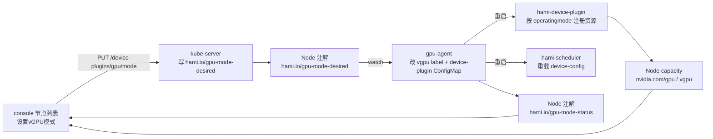

# vGPU 模式（L2）

[上级模块](../_index.md)

## 概述

NVIDIA GPU 节点有三种虚拟化方式：`default`（整卡，走上游 nvidia-device-plugin）、`hami-core`（软件虚拟化，一张卡切给多个任务）、`mig`（物理虚拟化，按 MIG 实例切分）。模式是**节点属性**，同一集群里不同节点可以不同。

运维在节点列表的「设置vGPU模式」里选模式与切分数，等资源就绪后在节点运行状态页与显卡列表里核对：资源名对不对（`nvidia.com/gpu` / `nvidia.com/vgpu`）、总量对不对（卡数 / 卡数×切分数 / MIG 实例数）、每张卡的 vGPU 已分配与总量。

## 用户故事

### US1 - 作为集群运维，把一台 GPU 节点切成 hami-core 并确认资源就绪

**Independent Test**：在节点列表对 `sagesuite-demo` 选 `hami-core`、切分数 10，等待后在节点运行状态页看到 `nvidia.com/vgpu` 总量 = 70（7 卡 × 10），显卡列表每行 vGPU 为 `0/10`。

### US2 - 作为集群运维，切模式前知道会中断什么

**Independent Test**：模式切换对话框里能看到「切换会重启 device plugin 与调度器」的提示；切到 `mig` 时另有「会销毁现有 MIG 实例」的警告。

### US3 - 作为集群运维，切错了能切回 default

**Independent Test**：把节点切回 `default`，确认 `nvidia.com/gpu` 回到卡数、`nvidia.com/vgpu` 归零、`vgpu` 标签变回 `off`。

## 验收场景

- **AC-FULL-CLUSTER-GPU-VGPU_MODE-01** — Given 已登录且对 `nodes` 有 edit 权限，When 打开节点列表并对一台 GPU 节点选择「设置vGPU模式」，Then 对话框显示当前模式、可选模式与当前模式的参数，提交后节点列表的模式列显示「切换中」，完成后显示新模式。

## 设计目标

- **模式是节点的属性，不是页面的状态。** 页面只写一个期望值（`hami.io/gpu-mode-desired` 注解），由 gpu-agent 落地成 label + device plugin ConfigMap，再由 device plugin 与调度器重启生效。页面不直接改 ConfigMap、不重启 Pod——那样会把「谁负责什么」搅乱。
- **切换是异步的，页面必须能表达中间态。** 从提交到资源就绪要几分钟（重启 Pod + 重新注册设备 + 调度器重载配置）。页面显示「切换中」而不是假装已经生效，否则运维会在资源还没就绪时去创建负载然后困惑于调度失败。
- **三种模式的容量关系必须可核对。** `default`：`nvidia.com/gpu = 卡数`；`hami-core`：`nvidia.com/vgpu = 卡数 × deviceSplitCount`；`mig`：`nvidia.com/gpu = MIG 实例数`。页面上这三个数必须能被运维一眼验证，否则「切完了但没生效」和「切完了生效了」看起来一样。

## 约束与边界

- 模式切换的**唯一写入点**是 `PUT /kapis/gpu.kubesphere.io/v1alpha1/device-plugins/gpu/mode?nodeName=<node>`，请求体 `{mode, params}`；页面不直接 patch Node。
- 模式与参数落在两处，各有唯一写者：Node label `vgpu=on|off`（gpu-agent 写，决定用哪个 device plugin）、`hami-device-plugin` ConfigMap 的 `nodeconfig` 里该节点的 `operatingmode` 与 `devicesplitcount`（gpu-agent 写，决定 HAMi 插件的行为）。
- 只有 `nvidia` 厂商有这三种模式；寒武纪是 `default`/`dynamic-smlu`/`env-share`，昇腾是硬切分 / `hami-vnpu-core`。本子模块只覆盖 NVIDIA；其它厂商的模式配置在「设置vGPU模式」对话框里按厂商配置表展示，语义见 `../gpu-card/_index.md` 的边界说明。
- 与监控的边界：模式切换本身不产生指标；但三种模式下卡级/POD 级指标来源不同，见 `../gpu-monitor/_index.md`。
- 与 HAMi 的边界：模式的**语义**（哪种资源名、切分数怎么用）由 HAMi 定义，页面只呈现。契约见 `HAMi` 仓库 `docs/SDD.md` 与 `design/gpu-agent/collector/`。



## UI 交互设计

| 位置 | 元素 | 行为 |
| --- | --- | --- |
| 节点列表 → 行操作 | 「设置vGPU模式」 | 仅当节点有 GPU（`hasGpuNode`）时出现；打开对话框 |
| 对话框 | 模式下拉 | `default` / `hami-core` / `mig`，带该模式的说明文字 |
| 对话框 | 参数 | `hami-core`：切分数（默认 10）、显存倍率、算力倍率；`mig`：切分数；`default`：无参数 |
| 对话框 | 确定 | 提交 `{mode, params}`，成功提示后关闭并刷新列表 |
| 节点列表 → 模式列 | 模式文本 | `default` 显示「默认」，其余显示模式名；`in_progress` 显示「切换中：<mode>」；`failed` 显示「切换失败：<message>」 |
| 节点运行状态 | 资源总量 | 按当前模式展示对应的资源名与总量 |
| 节点运行状态 | 显卡列表 | vGPU 列显示 `已分配/总量`，核心列显示 `已分配/总量` |

## 页面结构

```text
集群 /clusters/:cluster/nodes
  Table: 节点 | 状态 | ... | GPU虚拟化模式 | 同步时间
  RowAction: 设置vGPU模式 → Modal
    Select: 模式
    Input: 切分数 / 显存倍率 / 算力倍率（按模式）
    Alert: 切换影响说明

集群 /clusters/:cluster/nodes/:node/status
  Overview: 资源总量（含 nvidia.com/gpu 或 nvidia.com/vgpu、gpumem、gpucores）
  Panel: 显卡列表（vGPU 列 = 已分配/总量）
  Panel: GPU 拓扑
```

## 异常态

| 状态 | 表现 |
| --- | --- |
| 厂商不支持模式切换 | 对话框只显示警告「该厂商不支持设置 vGPU 模式」，隐藏确定按钮 |
| 提交失败（无权限 / 节点不存在） | 错误提示，对话框不关闭，保留已填内容 |
| 切换中 | 模式列显示「切换中：<mode>」，直到 `gpu-mode-status` 变成 completed/failed |
| 切换失败 | 模式列显示失败原因；资源总量保持切换前的值 |
| 切换后资源未就绪 | 节点运行状态页仍显示旧容量；模式列已是新模式——这是正常的过渡期，页面不掩盖 |
| MIG 模式但卡不支持 | `migProfileAllowlist` 不匹配时该卡不注册 MIG profile，容量小于预期；页面不特判，由运维从容量差看出 |

## 功能需求

- **FR-FULL-CLUSTER-GPU-VGPU_MODE-01** — 系统 MUST 在节点列表提供「设置vGPU模式」，把选择提交到 `device-plugins/gpu/mode` 接口，并在模式列显示切换中/完成/失败三种状态。
- **FR-FULL-CLUSTER-GPU-VGPU_MODE-02** — 系统 MUST 在节点运行状态页按当前模式展示对应资源名的总量，且与 Node 的 `status.capacity` 一致。

## 成功标准

- **SC-FULL-CLUSTER-GPU-VGPU_MODE-01** — 从节点列表提交一次模式切换不超过两次点击；提交后 3 秒内列表出现「切换中」。
- **SC-FULL-CLUSTER-GPU-VGPU_MODE-02** — 切换完成后，节点运行状态页的资源总量与 `kubectl get node <node> -o jsonpath='{.status.capacity}'` 的对应键一致。

## 明确不做

- 不在页面里直接改 device plugin ConfigMap 或重启 Pod。
- 不做模式切换的历史记录与回滚。
- 不做跨节点的批量切换。
- 不支持在模式切换进行中再次提交（页面不提供，接口层也拒绝并发）。

## 假设

- 集群已安装 HAMi（含 gpu-agent、device plugin、scheduler），且 gpu-agent 有权限改 Node label 与 kube-system 的 ConfigMap。
- 节点的 GPU 型号在 `devices.nvidia.migProfileAllowlist` 里（MIG 模式的前提）。
- 运维知道切换会中断该节点上正在跑的 GPU 负载。

## 功能点

- `switch.md` — 设置 vGPU 模式
- `capacity.md` — vGPU 资源就绪

## 验收用例

- `TC-FULL-CLUSTER_GPU-VGPU_MODE-01`
