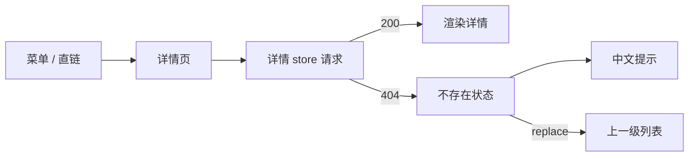

# 控制台基础（L1）

## 概述

控制台所有「按名字打开一个对象」的页面共用的一套行为：**请求失败时用户看到什么、停在哪一页**。它不是一个菜单，而是详情页的公共骨架。运维从集群 / 项目 / 工作负载菜单点进任意一条记录（Pod、部署、服务、节点、持久卷、存储类……），地址栏里带着资源名；当这条记录已经不存在（被删、被改名、所在命名空间已删、链接过期）时，本模块决定提示文案与去向。

今天的行为是：详情页请求返回 404 后，右上角弹出一条英文原文 `NotFound` / `pods "xxx" not found`，页面主体一直转圈，用户既不知道发生了什么，也没有回到列表的入口。本模块把这个结果收敛成一句话 + 一次自动回退。

## 用户故事

### US1 - 作为集群运维，从菜单点进一条已被删除的记录时，看到中文提示并被送回列表

作为 **集群运维**，我希望 **打开一个已删除资源的详情链接时看到一句能看懂的中文提示，并自动回到它所属的列表页**，以便 **不用手动删地址栏、也不用刷新猜自己是不是点错了**。

**Independent Test**：打开 `/clusters/default/projects/agent-platform/pods/agent-platform-web-not-exist/resource-status`，页面在 3 秒内跳到 `/clusters/default/projects/agent-platform/pods`，右上角提示为中文，列表可见。

## 验收场景

- **AC-CORE-CONSOLE-CORE-01** — Given 已登录且已选中某个集群，When 打开任意资源详情页的入口路由，Then 页面主区渲染出侧栏与页签，不出现未翻译的 i18n key，也不出现「加载中」常驻。

## 设计目标

- **失败要有终点。** 任何一次详情请求都必须让页面进入三种确定状态之一：加载完成、不存在、无权限。不允许停在「一直转圈」。
- **提示要能读。** 用户看到的是产品文案，不是 k8s 的 `reason` / `message` 原文；英文环境同样成立。
- **回退目标由页面自己决定。** 「上一级」不是一个全局常量，而是每个详情页自己的列表入口（`breadcrumbs[0].url`），因此列表过滤条件（工作空间、集群、命名空间）不会丢。
- **回退不污染历史。** 用 `replace` 而不是 `push`，用户点浏览器后退不会又回到那个 404 地址。
- **不误报。** 资源存在时行为完全不变：不弹提示、不跳转。

## 约束与边界

- 只处理「按名字打开的对象不存在」（HTTP 404）。403、500、网络中断不在此范围，仍走各自的既有处理。
- 回退只在详情页内部发生，不改动路由表、不改菜单、不改列表页。
- 提示与回退都发生在前端；后端不改错误码、不改响应体。
- 与错误提示的边界：全局错误处理（`window.onunhandledrejection`）负责兜底，详情页负责正常路径；两者不得各弹一次。

## UI 交互设计

- 提示：右上角轻提示（warning 级），标题与正文均为产品文案，正文带资源名。
- 回退：地址栏变为该详情页的列表入口；页签、面包屑随之消失；列表页按原有默认排序展示。
- 同一时刻最多一条「资源不存在」提示；连续打开多个失效链接不叠出多条。

## 入口与子模块

- 子模块：[资源详情页](./resource-detail/_index.md)
- 入口示例：`/clusters/:cluster/projects/:namespace/pods/:podName/resource-status`、`/clusters/:cluster/nodes/:node/status`、`/clusters/:cluster/pv/:name`

## 状态

详情页的公共状态只有三种：

| 状态 | 触发 | 页面表现 |
| --- | --- | --- |
| 加载中 | 请求未返回 | 页面级 Loading |
| 已加载 | 200 且返回对象 | 侧栏 + 页签 + 主区 |
| 不存在 | 404 | 中文提示 + 回退到列表 |

无权限（403）不在本模块状态机内：它由全局错误处理跳登录页，行为不变。

## 功能需求

- **FR-CORE-CONSOLE-CORE-01**：系统 MUST 在任意资源详情页返回 404 时，结束加载状态并让页面进入「不存在」状态，而不是停留在加载中。

## 成功标准

- **SC-CORE-CONSOLE-CORE-01**：随机抽取 5 个不同资源的详情入口（Pod / 部署 / 节点 / 持久卷 / 存储类），用不存在的名字打开，5 个页面都在 3 秒内进入「不存在」状态，且提示文案为当前语言、无未翻译 key。

## 明确不做

- 不做 403 / 500 / 超时的统一提示改造。
- 不做「资源不存在」的独立 404 页面（保留既有 `/404` 路由，但详情页不再跳它）。
- 不改列表页的过滤、排序与分页。

## 假设

- 详情页请求经 `src/utils/request.js`，404 时 `status` 为 `404`。
- 每个详情页都通过 `breadcrumbs[0].url` 声明自己的列表入口。

## 验收用例

- L1：`TC-CORE-CONSOLE-CORE-01`
