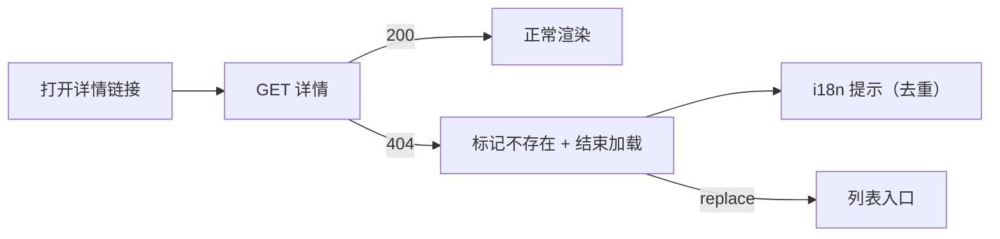

# 资源不存在（L3）

[子模块需求](./_index.md)

## 概述

详情页请求返回 404 时的完整对外行为：**一条中文提示** + **一次自动回退到该页自己的列表入口**。

触发者是任何一个详情页（Pod、部署、有状态副本集、守护进程集、任务、定时任务、服务、应用路由、保密字典、配置字典、服务账户、持久卷、存储类、节点、容器……），输入是「用户打开了一个按名字寻址、但对象已不存在的链接」，可观察结果有两处：右上角的提示文案，以及地址栏变成了列表路由。

## 用户故事

### US1 - 作为集群运维，失效链接给出的提示是我能看懂的中文 (Priority: P1)

作为 **集群运维**，我希望 **打开已删除资源的详情链接时看到一句说明「资源不存在」的中文提示，并带上是哪个资源**，以便 **判断是自己点错了还是对象真的被删了**，而不是对着 `pods "xxx" not found` 猜。

**Independent Test**：打开 `/clusters/default/projects/agent-platform/pods/agent-platform-web-not-exist/resource-status`，右上角提示标题与正文均为中文，正文包含资源名 `agent-platform-web-not-exist`；切换界面语言到 English 后同一操作显示英文，两种语言都不出现未翻译的 key。

### US2 - 作为集群运维，失效链接把我送回它所属的列表 (Priority: P1)

作为 **集群运维**，我希望 **提示出现后页面自动回到这个资源类型的列表页，并保留我原来的集群 / 命名空间**，以便 **直接重新找目标，不用改地址栏**。

**Independent Test**：同一链接打开后，地址栏在 3 秒内变为 `/clusters/default/projects/agent-platform/pods`，列表有数据行；点浏览器后退不会回到那个失效地址。

### US3 - 作为集群运维，正常打开一条存在的记录时不受影响 (Priority: P1)

作为 **集群运维**，我希望 **资源存在时行为与以前完全一致**，以便 **这次改动不会在正常路径上多出提示或跳转**。

**Independent Test**：打开一个真实 Pod 的 `/resource-status`，页面正常渲染且 5 秒内不出现「资源不存在」提示，地址栏保持在该 Pod 的详情路由。

## 验收场景

- **AC-L3-CONSOLE-CORE-RESOURCE_DETAIL-NOT_FOUND-01** — Given 已登录且目标 Pod 已被删除，When 打开它的 `/resource-status`，Then 右上角出现一条中文的「资源不存在」提示（正文含资源名），且地址栏在 3 秒内变为该项目下的 Pod 列表，页面不出现未翻译 key。
- **AC-L3-CONSOLE-CORE-RESOURCE_DETAIL-NOT_FOUND-02** — Given 已登录且目标 Pod 存在，When 打开它的 `/resource-status`，Then 5 秒内不出现「资源不存在」提示，地址栏保持在该 Pod 的详情路由，主区正常渲染。

## 设计目标

- **提示与回退成对出现。** 只有提示没有回退，用户仍然停在死页面；只有回退没有提示，用户会以为自己点错了。两者必须同一次发生。
- **提示文案来自 i18n，不来自后端。** 后端 `reason` / `message` 是给开发者看的（`NotFound`、`pods "x" not found`），产品文案由前端按语言给出。
- **一次只提示一条。** 详情页与全局错误处理都可能看到同一个 404，去重后只弹一条。
- **回退用 `replace`。** 历史记录里不留下失效地址，后退键不会把用户送回 404。
- **对存在的资源零影响。** 不新增请求、不改渲染分支、不改既有成功路径。

## 约束与边界

- 只处理 404。403 仍跳登录页；500 / 超时仍只提示、不回退。
- 回退目标只取「详情页自己声明的列表入口」；当该入口丢掉了当前路由的项目作用域时，改按路由推导（去掉尾部参数段），推导结果必须能在路由表里命中。
- 提示的触发点有两处（详情 store、全局错误处理），两者共用同一份去重逻辑与同一套文案。
- 不改后端错误码与响应体；不改 `src/utils/request.js` 的错误对象结构。

## UI 交互设计

- 提示位置：右上角，warning 级，标题「资源不存在」，正文「资源 {name} 不存在，已返回列表」。
- 提示时长：6 秒后自动消失；用户可手动关闭。
- 回退时机：与提示同一次渲染周期内触发，不做倒计时（不同于 `/404` 页的 10 秒倒计时）。
- 回退后：列表页按默认排序展示，不额外高亮、不额外 toast。
- 加载态：进入「不存在」状态时立即结束 Loading，不允许 Loading 与提示同时出现超过一帧。

## 文案与校验

- 形态：页面上没有输入控件，是一项能力；触发条件是「详情请求返回 404」，观察点是提示文案与地址栏。

| key | 中文 | 英文 | 用途 |
| --- | --- | --- | --- |
| `RESOURCE_NOT_FOUND_TITLE` | 资源不存在 | Resource not found | 提示标题 |
| `RESOURCE_NOT_FOUND_DESC` | 资源 {name} 不存在，已返回列表。 | Resource {name} was not found. Returning to the list. | 提示正文 |

校验：`{name}` 为空时退化为「资源不存在，已返回列表。」，不留空占位或 `{}`。

## 边界情况

- 资源名带引号或特殊字符：提示正文按纯文本渲染，不解析 HTML。
- 连续打开两个失效链接：第二条提示替换第一条，不叠加。
- 列表入口本身不可访问（例如命名空间也已删除）：仍执行一次 `replace`，由列表页自己的空态承接，不再二次回退。
- 详情页没有 `breadcrumbs`：按路由去掉尾部参数段推导列表地址；推导失败则只提示、不跳转。
- 详情页的 `breadcrumbs` 丢掉了项目作用域（Pod / 部署在无 workspace 参数时的集群级地址）：回退到带项目的列表，而不是集群级列表。
- 网络错误（无 `status`）：不当作 404，不回退。
- 用户已手动导航到别处：`replace` 前校验当前路径仍是该详情路由，避免把用户从新页面拉走。

## 功能需求

- **FR-L3-CONSOLE-CORE-RESOURCE_DETAIL-NOT_FOUND-01**：系统 MUST 在详情请求返回 404 时，用当前语言的 `RESOURCE_NOT_FOUND_TITLE` / `RESOURCE_NOT_FOUND_DESC` 提示，正文包含资源名，且不展示后端 `reason` / `message` 原文。
- **FR-L3-CONSOLE-CORE-RESOURCE_DETAIL-NOT_FOUND-02**：系统 MUST 在同一次「不存在」处理中把地址栏 `replace` 为该详情页的列表入口，且历史记录里不保留失效地址。
- **FR-L3-CONSOLE-CORE-RESOURCE_DETAIL-NOT_FOUND-03**：系统 MUST 在资源存在时不产生任何「资源不存在」提示，也不发生跳转。

## 成功标准

- **SC-L3-CONSOLE-CORE-RESOURCE_DETAIL-NOT_FOUND-01**：从打开失效链接到地址栏变为列表路由 ≤ 3 秒，提示文案为当前语言且不含 `NotFound` / `not found` 原文。
- **SC-L3-CONSOLE-CORE-RESOURCE_DETAIL-NOT_FOUND-02**：抽查 5 个资源类型（Pod / 部署 / 节点 / 持久卷 / 存储类）的失效链接，5 个都回退到各自列表，0 次误跳到 `/404`。
- **SC-L3-CONSOLE-CORE-RESOURCE_DETAIL-NOT_FOUND-03**：存在资源的详情页在改动前后，提示条数与跳转次数均为 0。

## 明确不做

- 不做「可能是权限问题」的猜测式提示（403 有独立处理）。
- 不做倒计时自动跳转（区别于 `/404` 页）。
- 不为每种资源单独写文案（统一一句，靠 `{name}` 区分）。
- 不改后端 404 的 `reason` / `message`。
- 不在列表页高亮「刚刚找不到的那条」。

## 假设

- 详情请求经 `src/utils/request.js`，404 时错误对象带 `status: 404` 或 `reason` 为 `NotFound` / `Not Found`。
- 详情页通过 `DetailPage` 渲染并传入 `breadcrumbs`。
- 列表入口在路由表中存在且当前用户有访问权限。

## 验收用例

- L3：`TC-L3-CONSOLE-CORE-RESOURCE_DETAIL-NOT_FOUND-01`
- L3：`TC-L3-CONSOLE-CORE-RESOURCE_DETAIL-NOT_FOUND-02`
