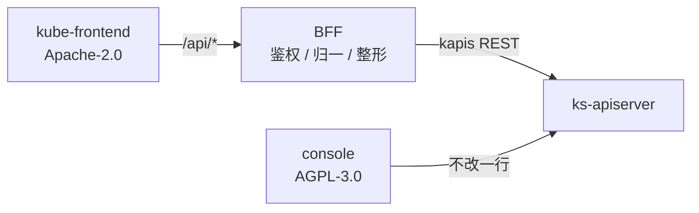

# 新前端 kube-frontend（L1）

## 概述

`console` 的上游是 AGPL-3.0。AGPL 的触发条件是「通过网络提供服务」，控制台是 SaaS，因此每一行改动都在扩大源码开放义务。`kube-frontend` 是在独立目录、独立授权（Apache-2.0）下重建的控制台前端，与老 console 并存，通过 BFF 访问同一套 ks-apiserver。

它同时承担一个工程验证：把 K8s 资源的「列表 / 详情 / 表单」收敛成 schema 驱动的渲染，使新增一个资源页只需要描述数据，而不是再写一遍 HOC 与页面骨架。

## 用户故事

### US1 - 作为平台工程师，看到迁移后的配置字典页面与老控制台行为一致

**Independent Test**：打开 `/kube-frontend/:workspace/clusters/:cluster/projects/:namespace/configmaps`，能列出真实 ConfigMap、按名称搜索、按名称与创建时间排序、翻页，结果与老控制台同一 namespace 下一致。

### US2 - 作为智能体，在不知道页面文案的情况下完成一次删除

**Independent Test**：只使用 `data-ai-id` 与 `data-ai-state` 两个属性，选中一行、触发批量删除、确认，观察页面回到 `ready` 且该行消失。

### US3 - 作为在手机上检查异常的用户，能看清列表并完成一次搜索

**Independent Test**：在 375px 宽视口打开列表，页面无横向滚动，导航收进抽屉，搜索框与操作按钮高度不小于 44px。

## 验收场景

- **AC-CORE-KUBE-FRONTEND-01** — Given 新前端与老 console 同时运行，When 访问新前端的配置字典页，Then 列出的对象与老 console 同一 namespace 的列表一致。

## 设计目标

1. **协议隔离**：新前端不 import、不复制、不派生 `console/src` 的任何代码。BFF 是唯一的通信边界。
2. **一个资源页由数据描述**：新增一种资源 = 一份列定义 + 一个查询，不新增页面骨架。
3. **界面可被智能体操作**：每个交互元素有稳定句柄，每个区域有机器可读状态，失败有可恢复的出口。
4. **移动端可用**：窄屏不是「能滚动」，而是主要任务仍可完成。
5. **约束用测试锁住**：包边界、依赖归属、AI 句柄覆盖率均由测试检查，不依赖评审记忆。

## 约束与边界

- 只读老 console 的**产品行为**，不读其源码作为实现依据；行为以本目录需求为准。
- 后端不新增接口，复用 ks-apiserver 已有的 kapis；BFF 只做鉴权透传、错误归一与字段整形。
- 数据写入（创建 / 编辑）在首期只做列表与删除；详情只读。

## UI 交互设计

- 页面状态收敛为四态：`loading` / `ready` / `empty` / `error`，每态都有明确的视觉与一句可读文案。
- 权限不足属于 `error`，但**不提供重试**：重试一个 403 永远失败。
- 主操作每屏一个：列表页主操作是「创建」，删除属于行内次要操作与批量操作。
- 智能体语义：
  - 区域根元素带 `data-ai-state`，取值固定为四态之一。
  - 交互元素带 `data-ai-id`，格式 `区域:动作`，如 `configmaps:bulk-delete`。
  - 行元素带 `data-ai-row`，值为资源名。
  - 依赖前置的动作带 `data-ai-needs`，列出必须先完成的动作 id。
- 移动端：`sm` 以下侧栏改为抽屉，表格折叠次要列，触控目标不小于 44×44px。

## 入口与子模块

| 层级 | 目录 | 职责 |
|---|---|---|
| 应用 | `apps/console-next` | 路由、页面装配、业务状态 |
| 共享 | `packages/ui` | 纯展示层，不引状态 / 请求 / i18n / 路由 |
| 共享 | `packages/api-client` | 唯一知道 HTTP 的地方 |
| 共享 | `packages/ai-surface` | 智能体契约：属性、状态、manifest |
| 共享 | `packages/locales` | 文案单一来源 |
| 后端 | `server` | BFF |

依赖版本统一由 `pnpm-workspace.yaml` 的 `catalog:` 管理；任何包写死版本号即为漂移。

## 状态

| 能力 | 状态 |
|---|---|
| 配置字典列表 / 搜索 / 排序 / 分页 | 已实现 |
| 配置字典删除（单条 / 批量） | 已实现 |
| 配置字典详情（只读） | 已实现 |
| 创建 / 编辑（表单） | 未覆盖，见「明确不做」 |
| 登录 / 登出 | 已实现，见 [`login.md`](login.md) |
| 深浅色主题切换 | 已实现，见 [`theme.md`](theme.md) |
| 第三方登录 / 注册 / 找回密码 | 未覆盖 |
| 其他资源模块 | 未覆盖 |

## 功能需求

- **FR-CORE-KUBE_FRONTEND-01** — 新前端必须与老 console 物理隔离：不同目录、不同授权、无源码引用。

## 成功标准

- **SC-CORE-KUBE_FRONTEND-01** — 架构约束测试覆盖包边界、依赖归属、AI 句柄，全部通过；新增违规会使测试失败。

## 明确不做

- 不改 `console/src` 任何文件。
- 不复用 `withList`、`ListPage`、`Table` 等 AGPL 代码。
- 不在首期实现创建 / 编辑表单与其他资源模块。
- 不实现 SSR：部署目标是 node 容器，无 SEO 需求。

## 假设

- ks-apiserver 的 `namespaces/:ns/configmaps` 在 kapis 下可用，且支持 `sortBy` / `ascending` / `page` / `limit`。
- 登录由本前端自己完成（见 [`login.md`](login.md)），token 存放在 `localStorage` 的 `kubesphere-token`，与老 console 使用同一个键，会话可互通。

## 验收用例

- `TC-CORE-KUBE-FRONTEND-01`（US1）
- `TC-L3-KUBE-FRONTEND-CONFIGMAPS-AI_SURFACE-01`（US2）
- `TC-L3-KUBE-FRONTEND-CONFIGMAPS-MOBILE-01`（US3）
- `TC-L2-KUBE-FRONTEND-LOGIN-01`（登录 US1）
- `TC-L2-KUBE-FRONTEND-LOGIN-02`（登录 US2）
- `TC-L2-KUBE-FRONTEND-LOGIN-03`（登录 US3）
- `TC-L2-KUBE-FRONTEND-THEME-01`（主题 US1）
- `TC-L2-KUBE-FRONTEND-THEME-02`（主题 US2）
