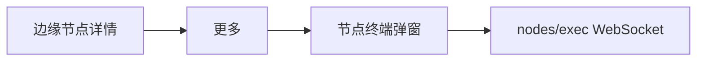

# 边缘节点终端（L3）

[子模块需求](./_index.md)

## 概述

集群管理员在边缘节点详情的「更多」里打开节点终端，排障方式与集群节点详情相同。入口是 `/clusters/<cluster>/edgenodes/<node>/status`。

## 用户故事

### US1 - 在边缘节点上直接排障 (Priority: P1)

作为 **有节点终端权限的管理员**，我希望 **在边缘节点详情的「更多」里打开节点 shell**，以便 **在边缘主机上执行命令，而不必回到列表页**。

**Independent Test**：打开一个 Ready 边缘节点的运行状态页，点「更多」，确认菜单里有「打开终端」；点开后出现与集群节点详情相同的近全屏终端弹窗，连接的是该节点。

## 验收场景

- **AC-L3-KUBE-FRONTEND-CLUSTER_MANAGEMENT-EDGE_NODES-01** — 已知集群有一个 Ready 的边缘节点，当打开该节点的运行状态页并点「更多」，则菜单中有「打开终端」；点击后立即出现近全屏终端弹窗，连接目标是该节点的 `nodes/exec`，而不是某个容器的 `pods/exec`。无 `edit` 权限时不出现这一项。

## 设计目标

边缘节点详情与集群节点详情使用同一套节点终端，差异只在入口放在「更多」里。

## 约束与边界

- 终端由后端校验 `create nodes/exec`，并负责特权访问 Pod 的生命周期。
- 前端不改用普通 `pods/exec`。
- 停止调度仍是侧栏上的主按钮；「打开终端」与编辑标签、编辑污点一起放在「更多」里。

## UI 交互设计

侧栏第一个按钮仍是「停止调度」或「启动调度」。操作超过两个时，其余项进入「更多」。菜单顺序与集群节点详情一致：打开终端、编辑标签、编辑污点。点击「打开终端」后弹出全屏终端，标题为节点名。Esc 留给终端，不关闭弹窗。

## 文案与校验

- 形态：下拉菜单项，点击后是全屏弹窗。
- 文案沿用已有键，不新增文案。

| key | 中文 | 英文 | 用途 |
| --- | --- | --- | --- |
| `OPEN_TERMINAL` | 打开终端 | Open Terminal | 「更多」菜单项 |
| `MORE` | 更多 | More | 侧栏折叠按钮 |

## 边界情况

- 节点没有 Ready 条件时，菜单项的显示规则与集群节点详情相同。
- 连接失败时，弹窗内显示节点终端的错误，而不是容器终端的错误。
- 节点名取详情对象的名称，不从地址栏另造一个名字。

## 功能需求

- **FR-L3-KUBE-FRONTEND-CLUSTER_MANAGEMENT-EDGE_NODES-01**：系统必须在边缘节点详情的「更多」中提供「打开终端」，并复用集群节点详情的节点终端弹窗。

## 成功标准

- **SC-L3-KUBE-FRONTEND-CLUSTER_MANAGEMENT-EDGE_NODES-01**：Ready 边缘节点的运行状态页上，点「更多」能看到「打开终端」，点开后的弹窗请求路径包含 `/nodes/<节点名>/exec`。

## 明确不做

- 不把「打开终端」做成侧栏主按钮。
- 不新增边缘节点专用的终端组件，也不改集群节点详情已有的终端行为。
- 不在新版 `/kube-frontend` 集群节点页上重复做这一项；新版还没有边缘节点页。

## 假设

- 边缘节点已经加入集群，并且当前账号对节点有 `edit` 权限。
- 云端 CloudStream 与边缘节点的 edgeStream 已打开，否则终端会停在连接错误。

## 验收用例

- `TC-L3-KUBE-FRONTEND-CLUSTER_MANAGEMENT-EDGE_NODES-01`
