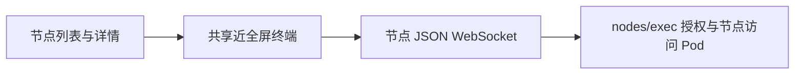

# 节点列表（L3）

[子模块需求](./_index.md)

## 概述

集群节点列表与详情：查看状态、用量、节点资源，编辑标签与污点，并在近全屏弹窗连接节点终端。

## 用户故事

### US1 - 确认节点是否就绪、还剩多少资源 (Priority: P1)

作为 **集群管理员**，我希望 **一眼看到每个节点的就绪状态与可分配资源**，以便 **判断能否继续调度**。

**Independent Test**：打开节点页，核对状态徽章与 `kubectl get nodes` 的 STATUS 列一致。

### US2 - 弄清某个节点为什么不健康 (Priority: P1)

作为 **集群管理员**，我希望 **点开一个节点看到它的状态条件、可分配量与污点**，以便 **判断它为什么不可用、还能不能再调度上去**。

**Independent Test**：从列表点进节点详情，核对条件数、可分配量与节点对象一致。

### US3 - 让节点停止接收新容器组 (Priority: P1)

作为 **集群管理员**，我希望 **一键停止/恢复节点的调度**，以便 **在维护节点前不让新容器组落上去，而不必动 kubectl**。

**Independent Test**：对节点停止调度 → 回读 `spec.unschedulable` 为 true；启动调度 → 该字段不再为 true。

### US4 - 在目标节点直接排障 (Priority: P1)

作为 **有节点终端权限的管理员**，我希望 **从列表或详情打开节点 shell**，以便 **使用原生交互命令定位主机问题**。

**Independent Test**：连接后执行 hostname 与唯一 printf 标记，验证输出来自目标节点，调整视口后核对 stty size，关闭会话。

### US5 - 查看节点关联资源并维护元数据 (Priority: P1)

作为 **集群管理员**，我希望 **查看节点的容器组、事件与趋势并编辑标签和污点**，以便 **判断调度问题而不编辑整份节点 YAML**。

**Independent Test**：增加临时标签并回读；无效污点不能提交，取消不改原污点；切换关联资源和监控页签后得到该节点数据。

### US6 - 查找节点并比较设备负载 (Priority: P1)

作为 **集群管理员**，我希望 **按状态、角色、厂商及型号查找节点并比较 GPU 与容器组负载**，以便 **在集群总览不变的情况下选择目标节点**。

**Independent Test**：搜索无匹配名称，统计仍与全局接口一致；组合筛选、分页与列显隐可恢复，指标与同次采样一致。

### US7 - 配置 vGPU 模式并确认处理结果 (Priority: P1)

作为 **集群管理员**，我希望 **查看和配置节点 vGPU 模式及参数**，以便 **经过风险确认后提交配置，并区分信号提交和实际完成**。

**Independent Test**：真实环境打开并取消；拦截写入验证参数、成功、失败、竞争请求、旧结果和超时，不切换生产节点模式。

### US8 - 不离开控制台获取新节点的加入方式 (Priority: P2)

作为 **集群管理员**，我希望 **在节点列表直接生成一条带有效期的加入命令**，以便 **新主机能加入集群，而不用自己拼 token 和 CA hash**。

**Independent Test**：有后端接口时打开弹窗看到 `kubeadm join` 命令与到期时间；后端 404 时看到明确的版本不支持说明；无权限时看到 403 原因。

### US9 - 一次给多个节点加同样的污点 (Priority: P2)

作为 **集群管理员**，我希望 **勾选多个节点后一次编辑它们的污点**，以便 **在维护一批机器时不必逐台打开详情页重复操作**。

**Independent Test**：勾选两个节点打开「编辑污点」，在公共污点里加一条并提交，两个节点的 `spec.taints` 都出现该污点；只改其中一个节点的独有污点，另一个节点不被写入。

## 验收场景

- **AC-L3-KUBE-FRONTEND-CLUSTER_MANAGEMENT-NODES-02** — 已知集群可访问节点监控接口，当打开节点列表，则显示「CPU 使用率」与「内存使用率」，取监控比率乘 100 并四舍五入；指标不可用时显示 `-`，真实零值显示 0%。

- **AC-L3-KUBE-FRONTEND-CLUSTER_MANAGEMENT-NODES-01** — 已知集群至少有一个节点，当打开节点页，则显示名称、状态、角色、CPU、内存五列，且状态为 Ready 或 NotReady。
- **AC-L3-KUBE-FRONTEND-CLUSTER_MANAGEMENT-NODES-03** — 已知节点列表中有节点，当点击节点名称，则进入节点详情：显示状态、角色、kubelet 版本、内网 IP、操作系统镜像、内核、容器运行时与创建时间；「可分配 / 总量」按人类可读单位显示（CPU 为核、内存与存储为 GiB/TiB）；并列出全部状态条件、标签与污点；这些值与该节点对象一致。
- **AC-L3-KUBE-FRONTEND-CLUSTER_MANAGEMENT-NODES-04** — 已知节点列表中有可调度节点，当对它执行「停止调度」，则该节点 `spec.unschedulable` 变为 `true`，状态列出现「已停止调度」，行操作变为「启动调度」；再执行「启动调度」，`spec.unschedulable` 不再为 `true`，徽标消失。详情提供相同操作，失败可见，写入针对当前集群。
- **AC-L3-KUBE-FRONTEND-CLUSTER_MANAGEMENT-NODES-05** — Ready 节点在列表行操作和详情提供「打开终端」，点击立即显示近全屏弹窗；真正收到远端输出后才启用输入。支持原始 ANSI、光标、Tab、历史和控制键，Esc 不关闭弹窗；1024/1280/1600 视口同步远端 PTY 行列，关闭或离开页面释放连接；无权限、启动失败、等待超时明确报错且可重连。
- **AC-L3-KUBE-FRONTEND-CLUSTER_MANAGEMENT-NODES-06** — 节点详情补充系统架构、操作系统类型、kube-proxy 与已上报的 GPU 信息，并展示全部扩展容量（GPU/RDMA 为数量，不换算为字节）。标签与污点编辑使用局部带版本写入；无效污点保留输入，取消不写入，NoExecute 风险明确。容器组按 spec.nodeName 过滤，事件按 Node 名称与类型过滤，监控展示该节点 CPU/内存/容器组趋势。列表支持刷新与每页条数。
- **AC-L3-KUBE-FRONTEND-CLUSTER_MANAGEMENT-NODES-07** — 顶部显示非 edge 节点总数、控制面数量、健康率及厂商数量，统计始终为整个集群，不随列表条件变化；健康口径取 stats.healthy，不冒充 Ready 数量。失败有重试，未知不显示零。
- **AC-L3-KUBE-FRONTEND-CLUSTER_MANAGEMENT-NODES-08** — 名称/IP 搜索、状态、角色、厂商多选 OR、型号包含筛选由服务端执行。条件变化回第一页，可单独清除和清除全部；工作节点包括无 worker 标签节点。复用 ai-kit ResourceList 与 Pagination，每页 10/20/50/100、翻页和跳页对齐其他列表。
- **AC-L3-KUBE-FRONTEND-CLUSTER_MANAGEMENT-NODES-09** — 列表批量读取 GPU/显存、CPU/内存和容器组的比率及绝对量，GPU/CPU/内存分配量独立显示；显存 bytes 换算 GiB。显示厂商、型号、当前模式及相对整个基础范围时间中位数的 NTP 偏移；30 秒警告、120 秒危险。缺失或零分母显示 `-`，指标失败不阻断操作。名称和行操作不可隐藏，其余列可隐藏并恢复；1024/1280/1600 下横向滚动限于表格。
- **AC-L3-KUBE-FRONTEND-CLUSTER_MANAGEMENT-NODES-12** — 已知节点列表，当点击「添加节点」，则调用 `POST /kapis/resources.kubesphere.io/v1alpha3/nodes/join-command`（默认 24h，可选 ttlHours）并在弹窗展示 `kubeadm join <server> --token <token> --discovery-token-ca-cert-hash sha256:<hash>`、到期时间与复制按钮；后端 404/405 显示「当前 ks-apiserver 版本不支持节点加入，需升级后端」，403 显示无权限，其他错误保留可重试；权限检查明确拒绝 create nodes 时隐藏「添加节点」入口（检查失败 fail-open）；命令不在 URL/日志中出现，弹窗关闭即丢弃。
- **AC-L3-KUBE-FRONTEND-CLUSTER_MANAGEMENT-NODES-10** — host GPU 节点提供设置 vGPU 模式及参数，NVIDIA 支持独占/MIG/HAMi-core、寒武纪支持独占/dynamic-smlu/env-share。数量为正整数，比例为有限正数，仅提交当前模式参数；未变化不重复提交。风险确认后提交，提交时禁用关闭；success=true 仅表示信号提交。三秒轮询最多五分钟，以新 desired/status 时间戳和参数判断结果，区分等待、处理中、完成、失败、外部请求和超时。403 或业务失败保留输入；member 禁用并由 API 拒绝写入。B200 仅只读与取消，所有模式写测试拦截模拟。
- **AC-L3-KUBE-FRONTEND-CLUSTER_MANAGEMENT-NODES-11** — 节点详情为紧凑身份侧栏与资源主栏；首屏展示节点 GPU/显存、CPU、内存、容器组与磁盘当前负载及可切换趋势，监控页展示全部趋势。Ready True 和压力类 False 为正常，Unknown 不误判健康；NTP 使用全局时间中位数。容量表展示全部资源的 Capacity、Allocatable、Requests、Limits，优先 status.allocated/allocatedLimits，仅 CPU/内存缺失时回退对应注解，分配率以 Allocatable 为分母并保留超过 100% 的事实。硬件页精确过滤当前节点的显卡与 RDMA 端口，展示传输类型、链路速率、后端健康和资源可用性；速率 bytes/s 转 Gb/s。拓扑分离 GPU/NIC 连接与 CPU/NUMA 亲和信息，用唯一 X 对角项识别设备，保留未知连接代码，点击高亮行列，无拓扑明确空态。详情复用已有 vGPU 配置弹窗，取消不写入；终端、调度、YAML、元数据及关联资源保留。1024/1280/1600 视口表格内部滚动，不撑宽页面。

- **AC-L3-KUBE-FRONTEND-CLUSTER_MANAGEMENT-NODES-13** — 已知节点列表有可写权限，当勾选一个或多个节点并点击「编辑污点」，或从行操作菜单选择「编辑污点」，则打开批量污点弹窗：多选时上方为「公共污点」（所有选中节点共有的污点，修改写入全部节点）、下方为按节点折叠的「各节点独有污点」；单选时只有一份列表。每行由「键 / 值 / 效果（阻止调度 / 尽可能阻止调度 / 阻止调度并驱逐现有容器组）」组成，可增删行。提交前校验键非空、键与效果不重复；未变化的节点不写入；每个节点带自己的 `resourceVersion` 独立写入，冲突（409）或无权限（403）逐节点报告且不回滚已成功的节点；成功后提示更新数量并刷新列表。成员集群的节点写入被明确拒绝并说明原因（ks-apiserver core 组无成员集群形态），不静默写到主集群。

## 设计目标

Ready 状态、可调度状态与监控负载分开呈现，筛选不改变集群总览。

## 约束与边界

- 读集群级 `nodes` 集合，无 namespace 段。
- 角色取 `node-role.kubernetes.io/*` 标签，缺省为 `worker`。
- 节点终端由后端校验 `create nodes/exec`，后端负责特权访问 Pod 生命周期；前端不能借普通 pods/exec 绕过权限。
- 标签与污点编辑带 resourceVersion；409 不覆盖其他管理员修改，保留输入并显示错误。

## UI 交互设计

状态徽章：Ready 成功色，其余危险色；CPU/内存用量保留既有百分比。详情按运行状态、硬件、容器组、监控、事件、元数据分区；身份信息保持侧栏，资源、趋势和健康为主栏重点。
节点终端只在用户点击时连接；终端模拟器与容器终端共用，不提供多余命令表单。

## 文案与校验

- 列：名称、状态、角色、CPU、内存。
- 状态：Ready / NotReady / Unknown。

## 边界情况

- 没有 Ready 条件的节点显示 Unknown。
- 没有内部 IP 时副行显示 `-`。

## 明确不做

- 节点排空、删除；不在生产环境验证 GPU 模式切换。RDMA 端口和已上报拓扑此前缺少确认契约，本批确认 B200 只读接口后迁移；不探测未上报设备或推断连接。（批量污点已于 2026-11-19 重纳，见 `AC-…-NODES-13`。）

## 重纳能力（2026-11-17 产品复核）

原登记「节点导入不做」（见上条与[节点技术方案](../../../design/kube-frontend/cluster-management/nodes.md)的非目标）。**2026-11-17 产品复核决定重纳**（N-10，见[重纳决策记录](../../../docs/plans/reinclusion-decisions-20261117.md)）。

**路径修正（2026-11-17 后端探测）**：老 console 的入口编辑 KubeKey Cluster CR（`apis/kubekey.kubesphere.io/v1alpha1`），但当前 ks-apiserver（kube-server）没有 KubeKey 集成，B200 与 mlu370 上该 CRD/组均 404。因此改为**原生 kubeadm join 路径**：ks-apiserver 新增 `POST /kapis/resources.kubesphere.io/v1alpha3/nodes/join-command`，签发 24h（可配 ttlHours 1-168）bootstrap token 并返回带 CA hash 的 `kubeadm join` 命令；控制台展示命令与说明，管理员在目标主机执行后节点自动加入。该路径不依赖 KubeKey，适用于所有 kubeadm 集群，也不需要控制台持有主机清单。

约束：

1. 节点列表顶部提供「添加节点」；后端未提供该接口（404）时，弹窗明确说明「当前 ks-apiserver 版本不支持节点加入，需升级后端」，不显示成权限错误。
2. 命令只读展示 + 复制；token 到期/权限失败/后端错误分别映射原因，保留可重试。
3. 不把 token 写入日志或页面 URL；成功后提示节点会在 kubelet 启动后出现，列表刷新由用户触发或返回列表时加载。

**交付登记**：`US8` / `AC-…-NODES-12` 随本节补齐；后端实现与测试见 [节点加入后端记录](../../../docs/plans/node-add-backend-20261117.md)。

## 假设

- 节点状态由 kubelet 上报。

## 验收用例

- `TC-L3-KUBE-FRONTEND-CLUSTER_MANAGEMENT-NODES-01`
- `TC-L3-KUBE-FRONTEND-CLUSTER_MANAGEMENT-NODES-03`
- `TC-L3-KUBE-FRONTEND-CLUSTER_MANAGEMENT-NODES-04`
- `TC-L3-KUBE-FRONTEND-CLUSTER_MANAGEMENT-NODES-05`
- `TC-L3-KUBE-FRONTEND-CLUSTER_MANAGEMENT-NODES-06`
- `TC-L3-KUBE-FRONTEND-CLUSTER_MANAGEMENT-NODES-07`
- `TC-L3-KUBE-FRONTEND-CLUSTER_MANAGEMENT-NODES-08`
- `TC-L3-KUBE-FRONTEND-CLUSTER_MANAGEMENT-NODES-09`
- `TC-L3-KUBE-FRONTEND-CLUSTER_MANAGEMENT-NODES-10`
- `TC-L3-KUBE-FRONTEND-CLUSTER_MANAGEMENT-NODES-11`
- `TC-L3-KUBE-FRONTEND-CLUSTER_MANAGEMENT-NODES-12`
- `TC-L3-KUBE-FRONTEND-CLUSTER_MANAGEMENT-NODES-13`

## 功能需求

- **FR-L3-KUBE-FRONTEND-CLUSTER_MANAGEMENT-NODES-01** — 列表展示五列，状态取自 Ready 条件。

## 成功标准

- **SC-L3-KUBE-FRONTEND-CLUSTER_MANAGEMENT-NODES-01** — 名称集合与 `kubectl get nodes` 一致。
