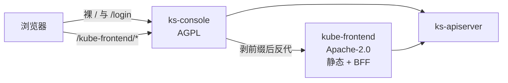

# 与老控制台同源集成（L2）

## 概述

新前端（kube-frontend）与老控制台（console）在**同一个地址**上并存：老控制台继续占用裸 `/` 与 `/login`，新前端只占 `/kube-frontend` 前缀。读者从老控制台顶部导航的「新版控制台」进入，不需要再登录一次；退出登录在两边同时生效。

这是迁移期的过渡形态：老控制台仍提供未迁移的页面，新前端提供已迁移的部分，两者共享一个 ks-apiserver 与一份登录态。

## 用户故事

### US1 - 作为平台用户，从老控制台一键进入新前端，不用重新登录

**Independent Test**：在老控制台登录后，点顶部「新版控制台」，落在 `/kube-frontend/` 的工作台且直接是已登录状态；不出现登录页。

### US2 - 作为平台用户，刷新或直接粘贴新前端的链接都能打开

**Independent Test**：在地址栏输入 `{地址}/kube-frontend/system-workspace/clusters/host/projects/default/configmaps` 并回车，页面正常渲染列表，而不是老控制台的页面或 404。

### US3 - 作为运维，能够关闭新前端入口而不影响老控制台

**Independent Test**：把 `ks-console-config` 的 `newConsole.enabled` 置为 `false` 并重启 ks-console，顶部入口消失、`/kube-frontend/*` 返回 404，而老控制台所有页面照常工作。

## 验收场景

- **AC-FULL-KUBE-FRONTEND-INTEGRATION-01** — Given 新前端已挂载在老控制台同一地址的 `/kube-frontend` 前缀下，When 依次访问 `/`、`/login`、`/kube-frontend/`、`/kube-frontend/login`，Then 前两个由老控制台响应、后两个由新前端响应，四者都返回 HTML。

三个功能点的验收场景见各自的需求稿：[`mount.md`](./mount.md)、[`entry.md`](./entry.md)、[`session.md`](./session.md)。

## 设计目标

1. **一个地址**：读者不需要记两个端口或两个域名，老控制台与新前端的入口都在同一页面上。
2. **登录态唯一**：两边读写同一个 `kah_token`，不存在「两个控制台各登录一次」。
3. **可关**：新前端是可选挂载，配置一关就完全消失，老控制台不受影响——这是回滚路径。
4. **前缀不泄漏**：新前端内部所有路径（含 `/api/session/*`、`/kapis`、终端 WebSocket）都在前缀下；老控制台的裸路径不被抢占。

## 约束与边界

- 老控制台是 AGPL，新前端是 Apache-2.0；两者通过 HTTP 边界通信，不共享源码。
- 新前端是独立 Deployment（`kubesphere-system/kube-frontend`），一个容器同时提供静态产物与 BFF。
- 老控制台按 `newConsole` 配置项把 `/kube-frontend/*` 反代到该 Service，并剥掉前缀；WebSocket 升级同样转发。
- 新前端不占用裸 `/` 与 `/login`：它的登录页是 `/kube-frontend/login`。

## UI 交互设计

- 顶部导航的入口排在「工作台」之后、「智能体工坊」之前，与其他产品入口同款按钮（`flat` + 图标 + 文案）。
- 点击是整页跳转（`window.location.assign`），不是 SPA 路由：新前端是另一个应用。
- 入口只在挂载存在时显示。指向一个没挂载的部署就是一个 404 链接，所以可见性与代理开关绑在同一个配置项上。

## 页面结构

| 路径 | 归属 |
|---|---|
| `/`、`/login` 及其余老控制台路由 | 老控制台 |
| `/kube-frontend/`、`/kube-frontend/login`、`/kube-frontend/<其余路由>` | 新前端 |
| `/kube-frontend/api/session/*`、`/kube-frontend/api/ai/manifest` | 新前端的 BFF |
| `/kube-frontend/kapis/*`、`/kube-frontend/apis/*`、`/kube-frontend/api/v1/*` | 新前端 BFF → ks-apiserver |

## 异常态

- 未挂载（`newConsole.enabled: false` 或 `target` 为空）：`/kube-frontend/*` 返回 404 JSON，顶部不出现入口。
- 新前端 Deployment 不可用：老控制台反代返回 503/502，老控制台自身页面不受影响。
- token 过期或被吊销：新前端跳到 `/kube-frontend/login` 并带 `redirect`。

## 功能需求

- **FR-FULL-KUBE-FRONTEND-INTEGRATION-01** — 两个 UI 必须能通过同一个主机名与端口访问，新前端固定在 `/kube-frontend` 前缀下。
- **FR-L3-KUBE-FRONTEND-INTEGRATION-MOUNT-01** — 反代必须剥掉前缀再转发，且静态资源与客户端路由分别得到正确的响应。
- **FR-L3-KUBE-FRONTEND-INTEGRATION-ENTRY-01** — 老控制台顶部导航必须提供入口，且只在挂载存在时显示。
- **FR-L3-KUBE-FRONTEND-INTEGRATION-SESSION-01** — 两边必须读写同一个 token 键 `kah_token`，并同步 `kah_token` cookie（模型平台的同源代理依赖它）。

## 成功标准

- **SC-FULL-KUBE-FRONTEND-INTEGRATION-01** — 从老控制台点击入口到新前端工作台渲染完成，不需要任何登录动作。
- **SC-L3-KUBE-FRONTEND-INTEGRATION-MOUNT-01** — 缺失的静态资源返回 404 而不是 HTML（否则脚本标签会报语法错误）。
- **SC-L3-KUBE-FRONTEND-INTEGRATION-ENTRY-01** — 入口按钮与相邻按钮的 y、height 完全一致，水平间距一致。
- **SC-L3-KUBE-FRONTEND-INTEGRATION-SESSION-01** — `localStorage` 里不残留第二个 token 键。

## 明确不做

- 不做统一外壳（在新前端里嵌老控制台页面，或反过来）。
- 不把新前端并入 ks-console 镜像（构建与重启会互相绑死，评估后否决）。
- 不为新前端单独分配端口或域名。
- 不做两个 UI 之间的单点登录协议（同一个 `kah_token` 已经足够）。

## 假设

- 老控制台与新前端部署在同一集群、同一 namespace 可见范围内，反代走集群内 Service DNS。
- ks-apiserver 的 `/oauth/token` 接受明文密码（已在 mlu370 实测）。

## 功能点

| 功能点 | 需求 | 技术方案 | 用例 |
|---|---|---|---|
| 前缀挂载与反代 | [`mount.md`](./mount.md) | [`design/kube-frontend/integration/mount.md`](../../../design/kube-frontend/integration/mount.md) | `TC-L3-KUBE-FRONTEND-INTEGRATION-MOUNT-01` |
| 老控制台顶部入口 | [`entry.md`](./entry.md) | [`design/kube-frontend/integration/entry.md`](../../../design/kube-frontend/integration/entry.md) | `TC-L3-KUBE-FRONTEND-INTEGRATION-ENTRY-01` |
| 登录态互通 | [`session.md`](./session.md) | [`design/kube-frontend/integration/session.md`](../../../design/kube-frontend/integration/session.md) | `TC-L3-KUBE-FRONTEND-INTEGRATION-SESSION-01` |

## 验收用例

- `TC-FULL-KUBE-FRONTEND-INTEGRATION-01`
