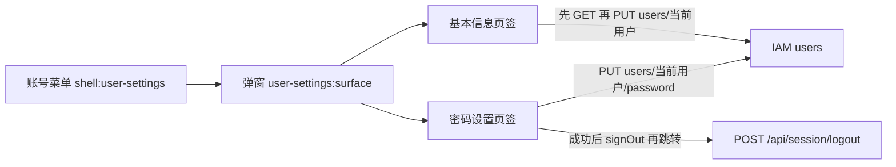

# 用户设置（L2）

[上级模块](../_index.md)

登录用户对自己的账号做两件事：改邮箱、改密码。入口是顶栏右侧的账号菜单，打开的是弹窗，不换路由，也不属于任何项目或集群。

## 概述

- **入口**：顶栏右侧账号菜单里的「用户设置」（`shell:user-settings`），点击打开弹窗；没有独立路由。
- **谁用**：任意已登录用户，包括只有 platform-regular 的普通用户。
- **做哪几步**：打开弹窗 → 默认落在「基本信息」→ 看用户名与平台角色（只读）、改邮箱并保存；或切到「密码设置」→ 填当前密码、新密码、确认密码并提交。
- **看到什么**：保存邮箱后原地出现「已保存。」；改密成功后出现「密码已修改，请用新密码重新登录。」，约 1.2 秒后退出登录并回到登录页，此后只能用新密码登录。

## 用户故事

### US1 - 打开自己的设置并在两个页签之间切换 (Priority: P1)

作为 **登录用户**，我希望 **从右上角用户菜单打开自己的设置，在两个页签之间切换，关闭后回到原处**，以便 **改邮箱或密码时不必离开正在看的页面，也不必请管理员代劳**。

**Independent Test**：登录后停在任意页面（例如 `/kube-frontend/settings/info`），打开账号菜单 → 用户设置，核对默认页签是「基本信息」；切到「密码设置」再切回；关闭弹窗，核对仍在原页面且没有发出任何写请求。

## 验收场景

- **AC-FULL-KUBE-FRONTEND-USER_SETTINGS-01** — 已知已登录用户停在任意页面，当从顶栏账号菜单打开「用户设置」，则弹窗默认显示「基本信息」页签，两个页签可互相切换，关闭后回到原页面，且期间没有提交任何改动。

## 设计目标

1. **不离开当前页面**：改邮箱与改密码都不依赖用户正在看什么，跳页面会丢掉上下文（例如正在填的表单）。弹窗是这里唯一合理的容器。
2. **两个页签的写互不牵连**：改邮箱只写 `spec.email`，改密码只调密码接口；一次操作不会顺带写入另一页的字段。
3. **会话状态必须诚实**：改密之后当前会话不再代表「用户知道的那个密码」，必须真的退出，而不是只跳一个登录页。

## 约束与边界

对象是当前登录账号自己的 User（`iam.kubesphere.io/v1alpha2`），只有这一份；不列其他用户，也不创建、删除账号。

- **读**：`GET /kapis/iam.kubesphere.io/v1alpha2/users/<当前用户名>`，取 `metadata.name`、`spec.email`、`annotations[iam.kubesphere.io/platform-role]`。读的是对象本身，不是登录时拿到的会话快照——快照里的邮箱是登录那一刻的值。
- **写邮箱**：整对象 `PUT` 同一个地址。该端点对 `PATCH` 返回 405（实测），所以只能整对象替换，先读 `resourceVersion` 再写。
- **写密码**：`PUT /kapis/iam.kubesphere.io/v1alpha2/users/<当前用户名>/password`，正文 `{currentPassword, password}`。
- **权限**：platform-regular 用户对自己的对象做上述两个写都成功（实测），不需要平台管理员权限。改别人的账号属于「访问控制 → 用户」，不在本模块。
- **与访问控制的边界**：创建/删除用户、分配平台角色、看登录历史都在 `access-control`；本模块只读平台角色，不提供修改入口。
- **与语言切换的边界**：语言由顶栏语言开关写 `localStorage['kube-frontend-locale']`，本模块不写 `spec.lang`（见「明确不做」）。

## UI 交互设计

- 账号菜单新增一项「用户设置」，点击打开弹窗，菜单随之收起。
- 弹窗标题「用户设置」，一句说明「管理你自己的账号：邮箱与密码。」；标题下方是两个横向页签：基本信息、密码设置，默认选中基本信息。页脚只有「关闭」。
- 基本信息页签：用户名与平台角色是只读文本，邮箱是可编辑输入框；页内底部是「保存」按钮与「已保存。」提示。邮箱与读取值不一致时，页签上出现一个提示点（`userSettings.tab.dirty`「内容已修改但未保存」），提醒用户切走前还没保存。
- 密码设置页签：三个密码框、一行常驻的规则说明、页内底部「修改密码」按钮；失败提示与成功提示都在按钮上方。
- 页签切换不提交、不重置另一页的输入；关闭弹窗（右上角关闭、Esc、点遮罩、页脚关闭）即丢弃未保存的输入，不再二次确认——两页加起来最多四个字段，重填成本低于一次确认弹窗。
- 弹窗根节点带 `data-ai-state`：基本信息页签读取中为 `loading`、可交互为 `ready`、读取失败为 `error`；密码设置页签没有读取请求，恒为 `ready`。
- 交互元素带固定 `data-ai-id`，实现与用例共用：`shell:user-settings`、`user-settings:surface`、`user-settings:tab-profile`、`user-settings:tab-password`、`user-settings:username`、`user-settings:platform-role`、`user-settings:email`、`user-settings:profile-save`、`user-settings:profile-error`、`user-settings:current-password`、`user-settings:new-password`、`user-settings:confirm-password`、`user-settings:password-save`、`user-settings:password-error`。另有四个辅助句柄：`user-settings:close`（页脚关闭）、`user-settings:retry`（读取失败重试）、`user-settings:profile-saved`、`user-settings:password-saved`。
- 错误与说明文字用 `text-ai-danger` / `text-ai-fg-muted` 语义 token（宪法 C3），不写字面色值。

## 页面结构

| 位置 | 内容 |
|---|---|
| 顶栏账号菜单 | 「用户设置」项（其余项：当前邮箱、退出登录） |
| 弹窗标题区 | 标题、说明、两个页签 |
| 基本信息页签 | 用户名（只读文本）、平台角色（只读文本）、邮箱（输入框）、保存按钮、已保存提示、错误行 |
| 密码设置页签 | 当前密码、新密码、确认密码、规则说明、修改密码按钮、错误行、成功提示 |
| 弹窗页脚 | 关闭 |

弹窗不改变地址栏：打开前后路由相同，关闭后页面状态（滚动位置、已填的表单）不变。

## 异常态

| 情形 | 用户看到 | 停在哪 |
|---|---|---|
| 正在读取账号 | 弹窗内骨架，`data-ai-state=loading` | 弹窗内，保存按钮不出现 |
| 读取失败 | 「无法读取账号信息。」+ 具体原因 + 重试按钮，`data-ai-state=error` | 弹窗内，基本信息页签没有保存按钮 |
| 邮箱为空或格式非法 | 邮箱下方「请输入合法的邮箱地址。」 | 弹窗内，不发出写请求 |
| 当前密码错误 | 「当前密码不正确」，输入保留 | 密码页签，可改正后重试 |
| 新密码不合规 | 「密码需 8–64 位，且同时包含大写字母、小写字母与数字。」或「密码不能超过 64 字节。」 | 密码页签，不发出写请求 |
| 两次输入不一致 | 「两次输入的密码必须一致。」 | 密码页签，不发出写请求 |
| 写邮箱遇到 409（对象被并发改过） | 显示保存失败，弹窗保持打开 | 弹窗内，重新打开弹窗可读到最新对象 |
| 会话已过期（401） | 读取失败提示；刷新页面后回到登录页 | 弹窗内 |

## 功能需求

- **FR-FULL-KUBE-FRONTEND-USER_SETTINGS-01** — 系统必须从顶栏账号菜单打开用户设置弹窗，且默认选中「基本信息」页签。
- **FR-FULL-KUBE-FRONTEND-USER_SETTINGS-02** — 系统必须支持两个页签互相切换，切换不得提交，也不得丢弃另一页已输入的未保存内容。
- **FR-FULL-KUBE-FRONTEND-USER_SETTINGS-03** — 系统必须在关闭弹窗时不发出任何写请求，并保持打开前的路由与页面状态不变。
- **FR-FULL-KUBE-FRONTEND-USER_SETTINGS-04** — 系统必须只读写当前登录账号自己的 User 对象，不提供选择其他用户的能力。

## 成功标准

- **SC-FULL-KUBE-FRONTEND-USER_SETTINGS-01** — 从打开弹窗到关闭，写请求数为 0；正常集群下弹窗打开后 1 秒内 `data-ai-state` 从 `loading` 变为 `ready`。

## 明确不做

- **语言选择**：老 console 的基本信息页有语言下拉，写 `spec.lang` 后 `location.reload()`；新 UI 的语言开关在顶栏，写 `localStorage['kube-frontend-locale']`，切换不刷新页面。两个入口各写一处、互不生效，先只保留顶栏一个入口。
- **头像上传**：需要对象存储与图片处理，User 对象里没有承载头像的字段，平台也没有该接口。
- **两步验证**：平台认证只有用户名密码与 OIDC，没有 TOTP 的注册与校验接口。
- **登录历史**：已在「访问控制 → 用户详情」里呈现（读 `users/<name>/loginrecords`），再放一份就有两个事实源。
- **把用户设置做成独立页面**：这是两个低频小改动，独立页面要占一条路由与一个菜单项，还要求用户先离开当前页面；弹窗没有这些代价。

## 假设

- 用户已登录，且 `/api/session/me` 能给出当前用户名。
- 当前用户对自己的 User 对象有读写权限（platform-regular 已实测可行）。
- 平台在服务端 admission 里强制密码规则与邮箱格式；客户端校验只是提前告知，不是唯一防线。

## 功能点

- [基本信息](./profile.md)
- [密码设置](./password.md)

## 验收用例

- `TC-FULL-KUBE-FRONTEND-USER_SETTINGS-01`
