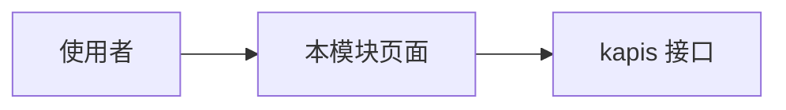

# 模块标题

> 模板：本文件是 L1 模块。ID 规则与章节顺序见 [`../README.md`](../README.md)。
> 空章节不许留；确无内容时写「不适用」或链到上级，禁止整节删除。

## 概述

（谁用、从哪个入口、做哪几步、看到什么。入口写清 `/clusters/:cluster/...` 的路由，不要用未展开的套话代替。）

## 用户故事

（每条都是「作为 / 我希望 / 以便」三段。标题里的 `(Priority: P1)` 是优先级。`Independent Test` 写可重复的步骤：打开哪条路由、点什么、看到什么。至少一条。）

### US1 - （简短标题） (Priority: P1)

作为 **（角色）**，我希望 **（从哪个入口做什么）**，以便 **（得到什么价值）**。

**Independent Test**：（打开哪条路由、点什么、看到什么。测完要恢复原状。）

## 验收场景

（`AC` 逐条写成「已知 / 当 / 则」。用例 YAML 的 `covers` 指到这里，所以这里只写一次，不在用例里重复。ID 形如 `AC-CORE-MODULE-01`。）

- **AC-CORE-MODULE-01** — 已知（初始状态），当（动作），则（可观察结果）。

## 设计目标

（为什么采用当前方案，而不是看起来更简单的替代方案。列出 3–5 条迭代时不得丢掉的不变量。跨模块能力必须写清边界，或链到对应的 L2。）

## 约束与边界

（核心对象、生命周期、前后端资源、权限。跨模块变化配 Mermaid：对象关系、创建归属、列表范围或调用链路。**只写不变量与对外契约。** 平台级铁律见 [`../../docs/constitution.md`](../../docs/constitution.md)，这里只引用不复制。）

## UI 交互设计

（导航入口、页面地图、跨页一致模式。菜单项与权限的关系写清 `authKey` / `authAction`。）

## 入口与子模块

- 导航：`/clusters/:cluster/<模块入口>`
- 子模块：[子模块](./sub/_index.md)

## 状态

（本层对象的状态机，以及状态迁移由谁触发。）

## 功能需求

（`FR-*`，用「系统必须……」句式。写不清的地方标 `[NEEDS CLARIFICATION: 具体问题]`，不要猜，也不要写「完成主路径」这类套话。）

## 成功标准

（`SC-*`，可度量。写打开哪个入口、做了哪几步、看到什么。验收要能证明设计目标成立，而不是只确认页面能打开。）

## 明确不做

（被否决的方案逐条写清，防止后续用另一种措辞加回来。）

## 假设

（默认前提与依赖的外部服务与平台。）

## 验收用例

- L1：`TC-CORE-MODULE-01`
