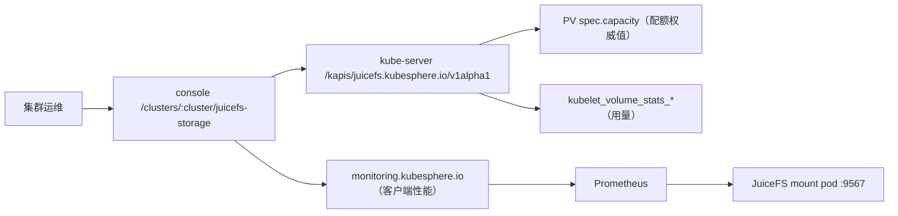

# TC-CORE-CLUSTER_STORAGE-01 集群存储 · 共享存储入口

- **用例 ID**: `TC-CORE-CLUSTER_STORAGE-01`
- **级别**: L1  **套件**: `core`
- **模块**: `cluster-storage` / `` ``
- **入口**: `{BASE_URL}/clusters/default/juicefs-storage/overview`
- **需求**: `prd/cluster-storage/_index.md`

## 产品功能

从集群菜单进入共享存储，核对标题、三个页签与概览卡片。

### 关联需求

- `prd/cluster-storage/_index.md`

### 覆盖的验收场景

文案来自需求 [`prd/cluster-storage/_index.md`](../../../../prd/cluster-storage/_index.md)，与用例的 `covers` 对应；改需求即改这里。

- **AC-CORE-CLUSTER_STORAGE-01** — Given 已登录且对 `volumes` 有 manage 权限，When 打开 `/clusters/default/juicefs-storage/overview`，Then 页面标题为「共享存储」、三个页签可见、概览卡片显示共享卷数与总配额，且不出现任何未翻译的 key。

### 关联设计

- 技术方案 [`design/cluster-storage/_index.md`](../../../../design/cluster-storage/_index.md)

## 覆盖的用户故事

文案来自需求 [`prd/cluster-storage/_index.md`](../../../../prd/cluster-storage/_index.md)，与用例的 `story` 对应；改需求即改这里。

### US1 - 作为集群运维，从集群菜单进入存储，看到共享存储入口与当前容量概况

## 验收场景
- **AC-CORE-CLUSTER_STORAGE-01** — Given 已登录且对 `volumes` 有 manage 权限，When 打开 `/clusters/default/juicefs-storage/overview`，Then 页面标题为「共享存储」、三个页签可见、概览卡片显示共享卷数与总配额，且不出现任何未翻译的 key。
## 设计目标
- 一个入口回答三个问题：**够不够用**（概览）、**谁占着、怎么调**（卷与配额）、**为什么慢**（性能）。
- 页面上的每个数字都要能追溯到唯一来源：配额来自 PV，用量来自 kubelet 的卷统计，性能来自 mount pod 的客户端指标。同一个事实不在两处解释。
- 只读安全：任何会改动集群的动作（改配额）都要二次确认、有明确的影响说明，并在失败时回到原值。
## 约束与边界
- 共享存储是**集群级**对象，不是项目级：页面在 `/clusters/:cluster` 下，菜单项按 `volumes:manage` 控制。
- 卷的创建与删除属于安装/运维脚本（`ks-installer` 的 juicefs chart），**不在页面里做**。页面只调容量。
- 一个 PV 对应 JuiceFS 文件系统里的一个目录；目录可以嵌套（`model-cache/public` 在 `model-cache` 内），两个配额同时生效。
- 与推理模块的边界：页面不决定模型放哪、不触发下载；它只展示容量与性能。

## UI 交互设计
页面 `/clusters/default/juicefs-storage`，三个页签：
| 页签 | 主区 |
| --- | --- |
| 概览 | 四张卡片（共享卷数、总配额、总已用、最高使用率）+ 各卷使用率条 + 配置提示 |
| 卷与配额 | 八列表格 + 行内「调整配额」按钮 + 配额弹窗 |
| 性能 | 六张时序图（读吞吐、写吞吐、缓存命中率、缓存读延迟、FUSE 延迟、对象存储错误） |
默认打开概览。页签切换不改变 URL 之外的状态。
## 入口与子模块
- 菜单：集群 → 存储 → 共享存储（`clusterNavs.storage`，`name: juicefs-storage`）。
- 子模块：`shared-storage`，下辖概览、卷与配额、性能三个功能点。
## 状态
- 空态：没有共享卷时，概览卡片显示 0，卷表显示「没有可管理的共享卷」。
- 指标未开启：性能页显示配置提示与开启方法，而不是空图。
- 权限不足：菜单项不出现；直接访问 URL 时后端返回 403，页面显示无权限。
## 功能需求
- **FR-CORE-CLUSTER_STORAGE-01** — 系统 MUST 在集群存储分组下提供共享存储入口，且只有具备 `volumes:manage` 的用户可见。
## 成功标准
- **SC-CORE-CLUSTER_STORAGE-01** — 从集群总览到共享存储概览不超过两次点击；概览首屏在 3 秒内出现卡片。
## 明确不做
- 不在页面里创建、删除、扩容 JuiceFS 文件系统本身。
- 不管理任意子目录的配额（只做「一个 PV = 一个目录」）。
- 不做快照、回收站、数据迁移。
## 假设
- 集群已安装 juicefs CSI 驱动，且共享卷使用 `juicefs-shared` 这个 StorageClass。
- Prometheus 已抓取 kubelet 的卷统计；客户端指标是否开启由概览的提示说明。
## 验收用例
- `TC-CORE-CLUSTER_STORAGE-01`

**Independent Test**：打开 `/clusters/default/overview`，在左侧「存储」分组里点「共享存储」，页面出现三个页签与四张概览卡片；卡片上的总配额与 `kubectl get pv` 里两个共享卷的容量之和一致。

## 前置与配置

- 已登录，且在 default 集群
- 对 volumes 有 manage 权限

## 测试步骤

1. 打开 /clusters/default/overview
2. 在左侧「存储」分组点「共享存储」
3. 核对页面标题为「共享存储」，页签为概览 / 卷与配额 / 性能
4. 核对概览出现四张卡片，且页面文本里没有 _PL / _DESC 这类未翻译 key

## 期望结果

- 页面标题与三个页签可见
- 四张卡片都有标题与数值
- 概览卡片里的共享卷数与卷页表格行数一致

## 失败排查

- 菜单项缺失时先确认 console 镜像的 server/config.yaml 里有 juicefs-storage
- 页面空白时看浏览器控制台是否有 kapis 401

## 产品改版后如何更新自动化

- 菜单文案变化时改 helpers/nav.py
